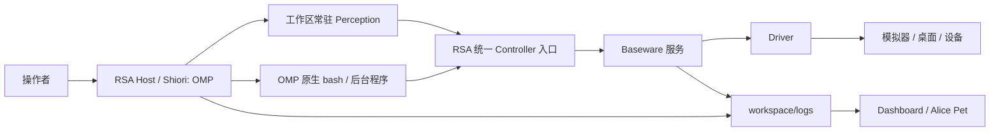

# 架构与边界

RSA（Recursive Self-Adaptation）让 Coding Agent 在 workspace 中探索设备、编写程序并验证能力。Baseware 提供设备接口，感知、操作和学习由工作区代码决定。

## 组件与进程

| 组件 | 职责 |
| --- | --- |
| `baseware/` | 独立设备服务：装配 driver，提供能力目录、控制权、取消、媒体和设备日志；外放 CLI、TS/Python API 与 MCP。 |
| `rsa/` | Harness：工作区、接管预算、统一能力入口、感知进程、Benchmark，以及 Shiori 的装配与日志。 |
| Shiori | Agent Loop 内核的职责名，当前由 RSA Host 内的 OMP 实现：模型请求、工具执行、会话、上下文压缩与原生后台管理。 |
| `rsa-dashboard/` | 日志 API 与统一的运行、Benchmark、Alice 界面，读取运行事实并提供人工交还入口。 |
| `rsa-companion/` | Electron 壳与原生 Alice Pet，复用同一 Dashboard 界面和日志来源。 |



Python 组合在自己的进程内完成，设备调用才进入 RSA/Baseware；执行方式见 [workspace](workspace.md)。

各组件独立安装并使用自己的锁文件。RSA Harness 只依赖 Baseware 的客户端和契约，不导入具体 driver；`rsa up` 负责按配置装配本机进程。

## 设备与统一能力

Driver 暴露 **Controller**：既可操作设备，也可返回信息或媒体；传感器属于 Controller。能力声明包含 ID、help、参数、控制要求及媒体类型；执行结果包含退出状态、输出、时序和观测。以 [设备契约](../baseware/src/contracts.ts) 和 [导出 schema](../baseware/src/catalog.ts) 为准。

Baseware 的 CLI/API/MCP 调用同一服务。RSA 把设备能力与工作区 `@capability` 合入 `rsa controller`，按需查询；它们及 MCP 不默认注入 OMP 工具列表。

Driver 只解释设备接口：触屏提供原生坐标的 down/move/up，双屏返回独立图像。组合、融合和游戏策略留在 workspace。Cua driver 连接原装 Cua Driver 提供电脑能力，模拟器 driver 不混入桌面操作。

## 控制权与生命周期

每次 `rsa auto on` 产生一个 **epoch** 并重置本轮时间与请求预算。RSA 用持久连接向 Baseware 取得有期限的操作权，工作区调用携带同一 epoch。查询目录、help 和只读 Controller 不需要接管；输入调用必须持有有效 epoch。通过 CLI 启动的 Python 能力也需要当前接管周期。

Baseware 负责唯一拥有者、旧 epoch 拒绝、动作取消和设备释放。拥有者断线、预算到期、设备断连或人工撤销都会结束操作权。普通短连接关闭只取消自身在途请求或等待，不取消已经提交的手柄动作；动作归控制 epoch 持有。动作时长由调用方决定，不设统一两秒上限。

手柄统一使用 `play`，输入为相对时间表，每项 `{atMs, durationMs, state}` 只影响声明的通道。不同通道可重叠，同一通道的时间段不能重叠；相邻时间段在边界直接更新合成状态，整段结束回到中立。例：

```sh
rsa controller controller/pad play --inputs '[{"atMs":0,"durationMs":500,"state":{"LEFT":1}},{"atMs":0,"durationMs":300,"state":{"B":1}}]'
```

`--inputs` 接收 JSON 数组；`--file /absolute/path/action.json` 接收 `{"inputs": [...]}` 文件。默认提交后返回动作 ID 和状态；加 `--wait true` 等到终态，或之后调用 `wait/status/cancel --action <id>`。取消等待不取消动作，显式取消、`release` 或交还控制权才释放输入。一次设备只执行一张时间表，新提交遇到已有动作会返回 `BUSY`；不隐式合并或覆盖。

时间单位为毫秒，具体采样语义由 driver 声明：3DS/Switch 按输入轮询时的单调墙钟推进，mGBA 按模拟帧取整。提交完成不代表游戏已处理所有输入；动作终态、实际耗时和采样数见设备日志。

人工交还同时停止 RSA 的自动循环、取消其管理的在途能力调用，并阻止新的模型请求。设备释放不等待模型推理结束；driver 完成清理后才报告 manual，已经进入底层的调用可能先收尾。OMP 原生 shell、后台任务和命名服务遵循上游生命周期；进程即使仍存活，旧 epoch 也不能再控制设备。详见 [Runtime](../rsa/src/harness/runtime.ts)。

工作区隔离文件、会话和服务地址，不是 OS 沙箱；多个工作区可能共享真实桌面。

## 会话与 Loop

同一 Host 复用 OMP 会话，重启默认恢复本 workspace 的当前会话；新 workspace 有独立索引，见 [workspace](workspace.md)。

当前使用 **OMP 原生系统提示词**。可选的 workspace 根 `AGENTS.md` 通过原生 `contextFiles` 加载；没有独立 `explore.md` 或自定义系统提示词替换。RSA 显式启用 OMP 的 `read/write/edit/bash/wait`，额外提供 `observe`。命令、后台任务、命名服务和 `proc://` 都复用 OMP。

外层续轮仍由 RSA 控制：

1. 在控制周期内用 [continue.md](../rsa/prompts/continue.md) 发起 OMP prompt；`auto on --message` 的补充消息只用于首次。
2. 工作区感知进程持续调用 `sample()`，将带时间戳的结果写入 `ObservationHistory`。插件在 prompt 开始及整批工具结束后读取最新结果，附加技能和记忆索引。显式 `observe` 可查询历史时刻或范围，已返回的结果不会再重复附加。
3. OMP 执行自己的推理与工具循环；一次 prompt 结束后，RSA 在预算内继续下一次。

环境在模型思考时继续运行。工作区可改感知和控制程序，不能改外层调度；见 [OMP 装配](../rsa/src/harness/omp/session.ts) 与 [扩展](../rsa/src/harness/omp/extension.ts)。

压缩复用 OMP，默认阈值 256000，图片数量预算 Infinity，入历史时按 OMP 压图。Codex 使用 WebSocket auto；见 [WS 测试依据](development.md#ws-恢复测试依据)。

## 可核查的运行事实

Baseware 记录设备事实，RSA 保存模型、工具、能力和感知记录，Shiori 接入 OMP 原生 telemetry。Dashboard 与 Pet 消费日志，不另起推理循环。来源与调用链见 [日志契约](logging.md)，评测见 [Benchmark](benchmark.md)。调用成功、文件增长或帧数增加不等于任务成功。
