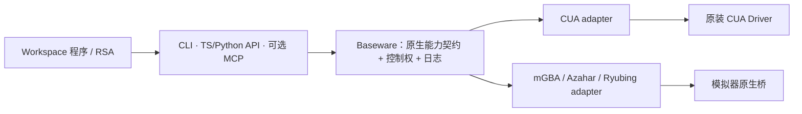

# Baseware 设计理念与能力契约

Baseware 是环境的驱动服务。它把设备已有的能力交给调用者，并管理连接、控制权、执行记录和媒体；如何感知、组合动作、训练或完成任务，由 workspace 中的程序决定。

我们以 CUA Driver 的原生工具契约为参照，在 Baseware 内独立保存契约。CUA 与模拟器都实现这套调用约定，不把其他硬件塞进 CUA，也不要求每台设备表现成电脑。

## 共用约定，保留设备语义

一项能力包含原生 `name`、`description`、`inputSchema`，以及可选的 `outputSchema`、`annotations`、`_meta` 等字段；调用参数是 JSON 对象，返回值是 MCP `CallToolResult`。输入类型由 schema 描述，不再预设“按键、鼠标、触屏”这几个穷尽所有硬件的类别。

这让 CUA 的应用、窗口、辅助功能、屏幕、输入和其他已注册工具能够完整通过。CUA 的工具名、字段和结果不被重新命名或转换成 argv。模拟器也声明自己的 schema：手柄时间表仍是 `pad.play`，触屏仍是 `touch.down/move/up`，双屏仍是两个独立采集能力。电脑鼠标不伪装成触屏，模拟器按键不伪装成键盘。

这里统一的是**发现、参数、结果与生命周期**，并不保证不同设备具有相同能力。未声明的能力不能调用；平台差异、坐标范围和时间单位必须能从实际目录中查到。CUA 是参考实现与契约来源，并非跨硬件领域的正式标准。



## 三个边界

- **Driver** 解释设备协议，声明真实可用的能力，执行和释放设备输入，提供原始媒体及来源信息。
- **Baseware** 发布目录、验证参数、仲裁控制权、关联调用与设备事实，并通过不同入口暴露同一能力。
- **Workspace / RSA** 发现和组合能力，维护感知历史、模型和任务状态。Baseware 不解释任务是否成功，也不接管 Agent Loop。

`Controller` 仍作为内部能力的名字；读取信息的传感器也是 Controller。每个 Controller 对应一项工具，而非一组再解析子命令的 CLI。

## 调用与结果

目录由正在连接的 driver 产生。`baseware export` 导出的 `baseware.json` 是当前快照，不是另一份人工维护的能力清单。三个入口使用相同参数对象：

```sh
baseware controller pad.play --args '{"inputs":[{"atMs":0,"durationMs":500,"state":{"LEFT":1}},{"atMs":0,"durationMs":300,"state":{"B":1}}],"wait":false}'
rsa controller controller/pad.status --args '{"actionId":"<returned-id>"}'
```

```python
from baseware import Client
result = Client().controller("screen.top.capture", {})
# result["result"] 是原生工具返回值；observations 含本机媒体路径。
```

CLI 的 `--file` 接受与 `--args` 完全相同的**完整参数对象**。数字与布尔值保留 JSON 类型。原 argv/bindings、分组子命令和 `cua.` 前缀不再提供兼容入口。RSA 保留 `controller/<name>` 命名空间，以区分 workspace 的 `python/<path>:<function>` 能力。

TS/Python API 返回执行信封：`id/status/exitCode/timing/observations` 加 `result`。`result` 保留原生 `content`、`structuredContent`、`isError` 与元数据。`stdout/stderr` 只是便于人阅读的文字摘要，不是完整结果契约。CLI 展示同一信封，但二进制内容使用已归档的文件引用，避免向终端输出大段 base64；API 保留原始字节内容。MCP 直接返回原生 `result`，使用原生工具名和 schema，不增加 argv、epoch 参数，也不向 OMP 默认注入工具。

设备调用与手柄动作是不同生命周期：异步 `pad.play` 返回 `actionId` 表示提交成功；通过 `pad.status/wait/cancel` 查看或操作该动作。每个输入通道有独立起止时间，组合与采样语义不因此次契约调整改变。

## 控制权独立于能力描述

`requiresControl` 是 Baseware 的执行要求，不是原生工具 schema 的参数。它与 `annotations.readOnlyHint` 分开：读取某个已接管手柄的状态可以是只读，但仍要求当前 epoch；没有声明只读的 CUA 工具默认要求控制权。

RSA 的持久连接持有有期限的 epoch，CLI/API/MCP 继承该上下文，不能因调用一个工具就自动接管。旧 epoch 被拒绝；人工撤销、到期或拥有者断线触发 driver 清理。等待清理返回后进入 manual；若释放失败，同时标记 connected=false 并禁止再次接管，不能把 manual 当作已成功释放的证据。取消一次等待与撤销整个设备控制权也分开，已交付给原生系统的动作可能先完成，再清理其持有状态。

能力共享一个设备连接时，acquire/release 由 driver 复用同一份幂等状态。不能因工具拆成多项就重复接管设备。

## 媒体、时间与日志

原生媒体内容及其顺序、标注在调用返回值中保留。Driver 将二进制内容归档到媒体文件，`observations[].contentIndex` 对应原生内容位置。日志中的 `result` 是归档表示：二进制 `data/blob` 换成 `dataPath/blobPath`，保留媒体类型和元数据，避免把图片重复塞进 JSONL。日志表示不是可以直接转发的原生工具结果。

`timing.clock` 标明单调时钟；不同进程的时钟不能直接相减。设备确实提供源序号时才记录 `sourceSequence`。Baseware 的调用完成、设备动作完成、Agent 读取观测、游戏推进分别记录，不互相冒充。连续采样、时序融合与历史查询由 RSA 的感知层承担。

## 上游契约与升级

[CUA 契约快照](../baseware/contracts/cua-driver/) 固定上游版本、来源、许可证和哈希。它用于审计原子能力与发现回归，不用来筛选运行期 `tools/list`；平台或版本新增的工具可以自然暴露。原生通用 manifest 与本机平台目录的覆盖范围不同，不能把其中一份当成全部平台能力。

更新 CUA 时，重新导出和校验快照，检查定义与结果保真、控制权及媒体处理。MCP SDK 的默认对象解析会裁剪部分未知嵌套字段，因此协议边界验证原生结构后保留原值；实际 MCP 往返测试覆盖这项要求。Baseware 维护 adapter 和自身扩展，不维护 CUA 的桌面实现，也不追着其内部函数或 FFI 类型复制整套运行时。

当前支持 mGBA、Azahar、Ryubing 和 CUA 桌面 backend；NDS 目前通过桌面 backend 操作。机器狗、摄像头阵列等尚未接入；本契约为它们留下描述能力的位置，不代表已经验证其控制或实时要求。

施工决策与验证记录见 [施工方案](baseware-contract-plan.md)，研究依据见 [CUA 对比研究](cua-reference-study.md)。
