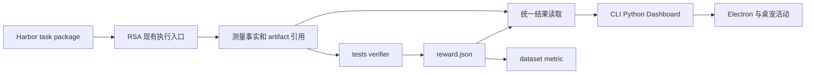

# Ludens Benchmark 收窄重构方案

状态：待实施，2026 年 10 月 28 日。本轮只确定方案，现行接口仍以 [Benchmark](benchmark.md) 为准。

## 目标

**整个 Ludens 只有一套 benchmark 作者约定和消费接口。**采用 Harbor 的任务包、verifier、reward、dataset 和 metric 文件约定；RSA 继续负责自己的执行。Python 能力评测、TS 工况、模型任务、设备评测和性能测量，都进入同一个目录、历史、评分、比较及看板。

统一的是“任务如何定义、证据如何交给评分、结果如何被消费”。执行可以是普通函数、命令或 OMP Agent，不要求每个 benchmark 都启动模型。也不把日常游玩日志、单元测试和 UI smoke 自动改称 benchmark。

验收的北极星是：**新增一个任务包和必要的执行绑定，就能被现有所有消费者发现、运行、读取、重评和比较，不修改 Harness 的 case 注册表，不给 Dashboard、Python 或桌宠另写成绩解析分支。**

## 现状和需要收掉的分叉

目前 CLI 与 Dashboard 已共用一部分 contract、store 和比较逻辑，问题并不是每个组件都有一套 runner。主要分叉在作者入口与记录所有权：

- 内置任务来自 `cases.json` 和 TS registry；workspace 任务来自 Python `@benchmark` 的 AST 发现，两者使用不同身份和入口描述。
- TS runner 创建 trial 后，Python 通过 `prepared_run` 接续；直接 import 时，Python 装饰器又自己创建 trial。已有接续机制，并非每次实际创建两份运行，但双方都维护生命周期和异常收尾。
- TS 和 Python 分别实现报告写入、校验和投影；报告还包含 raw、解析结果及修订关系。`bench report` 可以追加手写成绩，却没有统一的可执行 verifier。
- 视频存储和 Dashboard 索引内存脚本另有输出格式，没有进入同一评测目录。
- Dashboard 当前轮询跨 workspace 的完整结果列表，结果又包含全部报告。新契约需要按列表摘要和单次详情读取，避免把完整历史再次塞进热路径。

保留已经正确的边界：执行事实与评分分离、来源与控制权可追溯、原件由时空轴保存、普通 Python 能直接复用对象、修评分不重新执行动作。

## 直接采用 Harbor 的约定

本方案固定对齐 Harbor 提交 [`f3a5a923f6d722472c9e797af836ae4425fb215f`](https://github.com/harbor-framework/harbor/tree/f3a5a923f6d722472c9e797af836ae4425fb215f)。以该版本源码定义为准；其任务配置默认版本已经是 `1.4`，同版本文档仍有 `1.3` 的描述。

| 对象 | 直接采用的约定 | Ludens 的使用方式 |
| --- | --- | --- |
| Task | `task.toml`、`instruction.md`、`environment/`、`tests/`；`solution/` 为可选参考解 | 内置和 workspace 任务使用同一种目录结构；没有 builtin 与 Python 两种作者协议 |
| 任务身份 | `[task].name` 使用 `org/name`；可读 version 与内容 digest 分开 | Ludens 的新任务统一要求显式 name，目录名只负责定位；这比 Harbor 的可省略 name 更严格 |
| 内容版本 | 使用 Harbor package digest 的计算规则及 `sha256:…` 表示 | 固定任务、verifier、数据和环境定义；不再用一个手填 protocolVersion 代替全部版本 |
| Verifier | Linux 风格任务使用 `tests/test.sh`，脚本可调用普通 Python、Bun 等 | 一个评分入口；不强制 pytest，不要求作者导入 Harbor SDK |
| Reward | `reward.json` 是扁平的命名数值对象；`reward.txt` 是单个数值 | 新任务统一写 JSON；读取按 Harbor 规则支持 TXT，二者同时存在优先 JSON |
| Dataset | `dataset.toml` 用 name 和 digest 固定任务集合 | 一个 dataset 引用多个任务版本，不复制任务定义、不加入自创的 path 字段 |
| Metric | `metric.py --input-path … --output-path …`，输入 reward 或 null 的 JSONL，输出 JSON | 统一聚合入口；不把检查细节或完整 trial 偷塞进这份输入 |
| Artifacts | 任务声明需要收集的文件或目录；评分读取执行产物 | 普通文件沿用该约定，媒体和日志经下述 RSA 引用适配 |

格式依据：[Task 配置](https://github.com/harbor-framework/harbor/blob/f3a5a923f6d722472c9e797af836ae4425fb215f/src/harbor/models/task/config.py)、[内容 digest](https://github.com/harbor-framework/harbor/blob/f3a5a923f6d722472c9e797af836ae4425fb215f/src/harbor/publisher/packager.py)、[Dataset manifest](https://github.com/harbor-framework/harbor/blob/f3a5a923f6d722472c9e797af836ae4425fb215f/src/harbor/models/dataset/manifest.py)、[Verifier 解析](https://github.com/harbor-framework/harbor/blob/f3a5a923f6d722472c9e797af836ae4425fb215f/src/harbor/verifier/verifier.py)、[Metric IO](https://github.com/harbor-framework/harbor/blob/f3a5a923f6d722472c9e797af836ae4425fb215f/src/harbor/metrics/uv_script.py)。

Harbor 的 reward 不局限于 0、1 或百分比。`{"accuracy": 0.92, "elapsed_ms": 170}` 是合法的多维结果；不能由框架推断这些数值是否通过。具体阈值在 verifier 中，单位和含义在任务说明中。若需要展示单位或方向，可使用一份可选的描述性 metadata；它不参与执行、判分或额外生成报告。

不照搬 Harbor 的完整 `TrialResult` 类：它绑定 `TrialConfig`、Agent 和环境实现。我们采用其“评分与异常分开”的语义及 `verifier_result.rewards` 形状，把 RSA 的执行与来源记录放在现有 run 结构中。这样不会为了序列化一个结果把 Harbor runner 的依赖一起带进来。[TrialResult 源码](https://github.com/harbor-framework/harbor/blob/f3a5a923f6d722472c9e797af836ae4425fb215f/src/harbor/models/trial/result.py)

## 统一后的流程



一次 trial 对应一次实际执行；一次 verification 对应一次依据既有产物的评分。两者有独立 ID 和终态。重评增加 verification，不增加 trial 数，不启动被测能力或 Agent。

### 任务包和运行配置

任务包说明要完成什么、需要哪些环境材料、如何评分。执行绑定说明这次由谁完成它。二者分开，避免把本机 socket、控制租约、模型名或 Python callable 藏进 `task.toml` 的自由 metadata。

```text
benchmarks/
  tasks/<task>/
    task.toml
    instruction.md
    environment/          依赖锁定、fixture 和环境材料
    tests/test.sh
    tests/verify.py       也可以调用 TS verifier
    solution/            可选参考解
  dataset.toml
  metric.py              需要自定义聚合时提供
```

仓库任务放 `rsa/benchmarks/tasks/`，workspace 任务放自己的 `benchmarks/tasks/`。来源路径只影响定位，不改变任务类型或结果类型。发现只读任务配置，不导入作者代码。

本期的 dataset 只从上述本地目录解析 `name + digest`，未找到指定内容就报缺失，不自动替换成同名最新版。执行时把小型任务包按 digest 固定到 workspace 的 `.rsa/benchmarks/tasks/`，同一版本只留一份，供初次评分和重评使用。大输入、权重、ROM 和录像继续使用固定引用，不塞进任务包复制。共享 verifier 若导入包外代码，必须固定依赖版本和实际源码摘要；只保存入口文件 hash 不足以锁定评分规则。

测试材料必须放在 Harbor 实际纳入 digest 的目录中；不能假定任意根目录文件都会被打包。包外 executor 及其依赖单独记录不可变 revision，与被测 subject 的版本分开。版本未知就标记比较条件不完整，不把包内 digest 当成整个本机环境的指纹。

执行配置沿用 RSA 的模型、预算、workspace、trace 和控制信息，只补足任务引用与 executor 绑定：

| 执行方式 | 适用场景 | 边界 |
| --- | --- | --- |
| Agent | 游戏、装配台等需要 AI 完成的任务 | 继续使用 OMP、既有预算和控制权；模型与提示配置记录为执行条件 |
| Command | TS 工况、独立 Python 测量、driver 测试 | 使用明确 argv 和参数，调用现有进程执行与清理逻辑；不从文件名推断隐藏操作 |
| Python 同进程 | 评测已加载模型、Tensor、实例方法 | 显式 trial 作用域内调用普通函数；不序列化内存对象，不另起进程冒充复用 |

执行绑定可以通过 CLI/Python 参数传入，重复运行时保存为运行配置。它只引用任务和执行入口，不能再包含另一份任务名称、检查定义、评分 schema 或结果格式。内置的稳定命令绑定也作为普通运行配置，不恢复硬编码 case registry。参数留在执行记录，参数是否合法由任务的准备逻辑检查，不再为 benchmark 单独解析 Python 类型注解生成一套参数协议。

`solution/solve.sh` 始终是参考解，不用它假扮 TS 固定工况的默认被测入口。

### 执行与评分

执行器产出需要重评的最小事实，例如输入输出样本、动作终态、测量序列、实际调用的代码版本，以及已有日志或媒体引用。Verifier 只从这些事实计算 reward，丰富诊断写独立附件。

例如视频存储评测先保存编码帧数、实际时间跨度、冷解码误差和 RSS 样本；verifier 再计算有效帧率、误差和内存变化。不能让 `test.sh` 在重评时重新录视频，也不能把上一次算好的最终分数作为唯一证据。

重评输入必须在执行结束时固定：文件使用不可变副本或 hash，持续日志固定读取截止，timeline 固定 record、片段和 PTS。只指向不断增长的目录或最新截图不足以支持同一次 trial 的重评。既有 canonical 原件可以继续被引用，无需复制整套日志。

Python 的表达采用显式作用域，以下是拟议用法：

```python
with bench.trial(task_path, parameters={"split": "validation"}) as trial:
    samples = measure(already_loaded_model, dataset)
    trial.artifact("samples.json", samples)
# 作用域结束只完成执行记录；评分显式进行。
bench.verify(trial.id)
```

模型加载、训练和能力调用仍是普通 Python。删除 `@benchmark` 后，普通 import 不再悄悄创建评测；需要纳入评测时使用显式作用域。`@capability`、同步/异步调用、类方法与实际加载 codeSHA 的记录继续保留。本进程 observer 只提供参与执行的版本证据，不负责判分，也不声称能证明另一个常驻进程的行为。

### 单一记录所有者

在现有 `rsa_tools` 中收敛一个小型 trial 记录模块，负责创建记录、固定身份与条件、接收执行终态、登记附件、执行评分入口和验证 reward。Python 同进程作用域与 TS CLI 都调用这个实现，替换双方各写一套 trial/report 的代码。

TS CLI 通过已有 Python bridge 做低频的 begin、finish、verify；Command/Agent 的实际运行、取消、超时和输入释放仍由现有执行入口负责。子任务写测量文件，不再同时写 trial 终态。直接 Python 作用域则由当前调用方负责结束同一个记录事务。没有第二个常驻服务，没有任务队列，也不新增通用执行调度器。

记录所有权按文件划清：统一核心独占 `trial.json`、`verification.json` 及所选评分指针；verifier 独占本次输出目录。既有 run/设备接入仍负责 `manifest.json` 的来源信息，核心只引用它，不加入另一条读改写路径。子任务的条件、对象与附件通过小型完成结果交回核心；不能为解决争写再新建双向消息总线。

每个事件来源继续只有一个 writer。Python bridge 不与 TS worker 并写同一来源的 `events.jsonl`，生命周期摘要交给已有记录者；独立来源沿用 source/origin 身份，不能重新从零生成相同 run 的 seq/eventId。`finish` 在短临界区内检查终态并原子提交，重复收尾不覆盖已确认终态，也不再发一次完成事件。

顺序固定为准备、执行、收尾事实、评分。进程崩溃时既有 supervisor 通过同一记录入口补执行错误；它不根据缺少 reward 自动重做动作。开始/结束只产生少量 benchmark 事件，普通能力 trace 和逐帧采样沿用原日志政策。

直接 Python 调用被硬杀、没有 supervisor 确认终态时，历史展示为未完成；不推算成功、结束时间或评分。异常仍向原调用者传播。

## RSA 必须适配的部分

### 本地环境和设备

Harbor 的环境由 consumer 实现，常见实现是容器。RSA 的模拟器、真实桌面和既有 Python 进程属于明确的 `ludens-native` 执行 profile。设备连接、diagnostics 要求、初始状态、是否允许重置和输入控制都在有类型的执行配置中检查并记录；metadata 只作描述。[Harbor 环境边界](https://github.com/harbor-framework/harbor/blob/f3a5a923f6d722472c9e797af836ae4425fb215f/docs-mintlify/tasks/environment.mdx)

本期只实现 native profile，不导入 Harbor 的 Docker、云环境、MCP/skills 安装、资源隔离、多步 runner 或并发调度。一个任务要求这些执行能力时，预检返回不支持并列出要求，不忽略字段后继续跑。Task 文件可被识别不等于该任务能在当前环境执行。

native verifier 通过 trial 专属环境变量获得输入、附件与输出目录。它不在 macOS 全局创建 `/logs/verifier`、`/tests`、`/solution`，也不把 Harbor 默认的 Linux 环境偷偷当成本机 macOS。依赖 Harbor 绝对路径或特定 OS 的现成任务，需要相应环境适配；本方案不宣称它们零改动可运行。我们自己的 verifier 可以写成使用环境变量、以 Harbor 标准目录为缺省值的普通脚本。

这组路径只属于 RSA native 适配：`RSA_BENCH_TASK_DIR` 指向固定任务包，`RSA_BENCH_INPUT` 指向本次评分的固定输入清单，`RSA_BENCH_ARTIFACTS` 指向产物目录，`RSA_BENCH_VERIFIER_DIR` 指向本次独占输出目录。评分进程默认不继承 live socket、epoch、控制租约或被测模型凭据；模型评分器等额外依赖须显式配置。重评入口不调用被测 executor；这不是沙盒保证，原生脚本本身仍有普通用户进程的权限。

依赖版本写在 `environment/` 的锁文件或环境材料中，实际解释器、包版本、系统和组件 revision 记入运行条件。真实设备测试没有可验证的同一起点时，比较明确显示条件不齐；不能以两次都是同一游戏名判为同条件。

### 时空轴与附件

普通测量文件使用 Harbor 文件/目录 artifact 约定。已有 `.rsa/timeline`、`.rsa/archive` 和 canonical 事件继续保存原件；trial 只保存小引用清单，并沿用现有引用校验。

`recordId`、视频 PTS、跨来源 eventId 是 RSA resolver 的能力，不是 Harbor 原生语义。Verifier 需要普通图片或文件时，resolver 按需读取或临时物化；缺少原件、编码未完成、hash 不符或日志未记录所需事实，都明确报告证据不可用，不能换成当前画面补齐。

trial 和 verification 各有明确的 `evidence` 引用列表，承接现有证据地址：本地事件必须带 run/source/seq，跨来源事件使用 origin.eventId，媒体使用既有 timeline 引用，普通附件使用 artifact 引用。可选 reward key 只负责定位相关评分证据。Dashboard 直接消费这些地址，不从自由结构的 `details.json` 猜链接。旧的逐检查项展开改为评分证据与诊断附件，成绩本身仍只有 reward。

重评承诺以依赖仍可解析为前提。清理 workspace 时必须能看出关联 trial 会失去哪些证据；本期不新增跨机器同步、媒体复制或 GC 系统。将来导出可移植任务结果时再收集依赖闭包，单一本机路径不能宣称可移植。

### 评分状态与聚合

统一结果至少分开执行状态和评分状态：

| 情况 | 执行状态 | 评分表达 |
| --- | --- | --- |
| 完成且目标未达到 | completed | 有效的低分或零分 |
| 缺少必要测量或证据 | 保留实际执行状态 | 无法评分及原因，不生成假零分 |
| verifier 异常、空文件、非法 JSON 或非有限数值 | 保留实际执行状态 | 评分错误，保留诊断 |
| 执行超时、取消、设备或工具异常 | 相应执行终态 | 保留可得评分与异常，不把它伪装成正常完成 |

`reward.json` 的值都是有限数字，不放 null、字符串、检查对象或证据。部分维度缺测时省略该维度并说明原因；整体不可评分时消费结果的 `verifier_result.rewards` 为 null，不写一个包含 null 的假 reward 文件。有效空对象不证明成功。框架不再根据通用 checks 推断 passed/failed/inconclusive；需要成功率的任务自己定义 `success`，测量任务可以只有测量值。

Dataset 聚合输入仍严格为 reward/null。Harbor 默认 mean 会把 null 和缺失维度视为零，这是聚合政策，不是“执行异常等于能力零分”的普遍事实。[默认聚合实现](https://github.com/harbor-framework/harbor/blob/f3a5a923f6d722472c9e797af836ae4425fb215f/src/harbor/metrics/base.py)

Ludens 默认保留选定 trial 的全部行，包含不可评分的 null，并同时展示 trial 总数、有效评分数和执行/评分错误数。混合任务的数据集显式提供 `metric.py`，不要把 RSS、正确率和延迟平均成一个总分。若只统计有效试验，必须在聚合输入选择时显式声明、记录被排除的 trial 与原因；metric 脚本本身看不到异常类型，不能让它猜。

一次聚合固定 dataset digest、trial ID、verification ID、输入选择政策和 metric 文件 digest。同一 trial 的多次重评不能当作多个独立样本。

## 结果存储和唯一消费接口

每个 trial 继续属于一个 RSA run。保留现有 manifest、events、archive 和 timeline 的职责，删除另存 raw 报告、解析后的 outcome 和全量报告列表的写法。

```text
workspace/logs/<run-id>/
  manifest.json                    既有 run 身份和来源
  trial.json                       任务 digest、执行状态、条件、对象、引用、所选评分 ID
  events.jsonl                     既有生命周期和 trace
  artifacts/                       不属于已有原件的最小测量产物
  verifier/<verification-id>/
    verification.json              输入引用、评分代码版本、时间、状态、异常
    reward.json                    此次评分的唯一权威数值
    details.json                   可选诊断，不是第二份通用成绩 schema
    stdout.txt / stderr.txt
```

初次评分和重评使用同一个入口，每次写新目录。旧执行事实不改；新的 verification 指明依据哪个原 trial、使用哪个任务/verifier digest 以及原因。只保留明确的来源关系，不维护任意手写报告的修订 DAG。所选评分 ID 是可变的小指针；历史比较总是返回解析后的具体 ID。

verification 的输出与状态完整落盘后，才原子更新所选评分指针。失败评分保留自己的状态和诊断，不读取上一次遗留的 reward 冒充本次成绩。重复 finish 和取消/完成交错都纳入验收。

读取时把 execution 与所选 `reward.json` 组合成一个轻量结果，字段沿用 `verifier_result.rewards` 与独立异常语义。这个视图是文件引用的投影，不是第三种作者报告，不再持久化一份“Harbor 导出版成绩”。TS 和 Python 共用文件 schema 与契约样例；TS 只做读取和展示，不再实现一份作者报告转换/评分规则。

统一对外操作如下，CLI、Python 入口和 Dashboard 都遵守同一输入输出定义：

| 操作 | 消费范围 |
| --- | --- |
| list / inspect | 任务包目录、digest、环境要求和运行绑定说明 |
| run | 一个任务的一次执行；批量与 repeat 只是调用同一入口 |
| history / get | 分页 trial 摘要、单次执行、指定 verification 和附件引用 |
| verify | 基于已固定证据评分或重评；不发起被测动作 |
| compare | 指定 trial 和 verification，展示条件差异及同名测量差值 |
| aggregate | 固定 dataset 和试验集合，调用标准 metric IO |

操作定义共用，不要求每个界面开放全部操作。CLI/Python 发起执行和评分，Dashboard 继续只读，不增加网页控制入口。历史读取不要求 Host 或模拟器在线；证据仍通过既有可信 workspace 路径与来源解析，不能相信结果文件中的任意路径。

现有 `rsa bench` 保留为命令入口，移除 `python/path:function` 和旧作者 report 格式。`bench schema/validate` 改为检查 Task/Reward/Dataset；删除手写 `bench report --file` 的成绩注入入口，以可追溯的 verifier 重评替代。CLI 进程退出码表示执行/评分命令是否正常完成，不把某个 reward 等于零自动解释成进程崩溃；CI 要求成功率或性能阈值时调用任务明确的验收规则。

比较首先固定 task 与评分版本、参数、数据/初态和环境条件，之后比较 subject 的候选版本。任务包或评分规则变化时不自动给出“提升”结论；必要时先把两份旧证据按同一 verifier 重评。被测代码、权重和进程实际加载版本是 subject provenance，不能因为换了候选模型就把测试任务身份也改掉。

Dashboard 的列表只读分页摘要，详情再读选定评分及证据。保持既有历史、基线、附件和原运行链接；不新增另一套 Harbor 页面。Electron 复用页面。Pet 仍只消费 Dashboard Activity 的开始、完成和错误摘要，不读 task/reward 文件，不新增 benchmark runner 或轮询链路。运行中状态与异常继续走既有日志消费者。

Dashboard 的“运行剖析”标签和“运行性能”页继续分析普通 run 的请求时延、缓存和运行日志。它虽位于 Benchmark 导航下，但不是另一套 benchmark 作者或结果协议，不因此创建 task、trial 或 reward。

## 现有内容的迁移和删除

### 所有已有评测入口

| 入口 | 迁移后 | 保留的测量与证据 |
| --- | --- | --- |
| perception-lifecycle | Harbor 任务包与独立 verifier | 真实 Python、合成媒体、历史查询、reload、修复和归档事实 |
| control-handoff | 同一任务包约定，Command 执行 | 模拟 driver 下真实 Runtime/Baseware/Python 的释放、中断和旧控制权拒绝 |
| ws-recovery | 同一任务包约定，Command 执行 | 模拟 WS/HTTP、虚拟时间、全量/delta 和工具不重放证据 |
| background-compaction | 同一任务包约定，Command 执行 | 真实 OMP maintenance、受控输入、取消与归属事实 |
| capability-reuse | 同一任务包约定，Agent 执行 | 两批订单、跨轮真实复用、普通 import 的调用证据；沿用并独立调用 reuse-evaluator |
| clamp.py 示例及 workspace 评测 | 标准任务包；显式 Python trial | 普通 capability 保留；样本作为评分输入 |
| verify-video-storage.py | video-storage 任务 | 双流合成输入、实际采样、冷解码误差、压缩比和 RSS 样本 |
| check-index-memory.ts | archive-index 任务 | 大日志重建、首中尾历史一致性、重复查询、缓存释放和父子进程 RSS |

这八类入口使用同一套 Task/Reward/结果读取，不把工程性能评测排除在统一目标之外。后续 driver 横向评测也只能走这条接口。

已有 `baseware/tests/bridge.live.test.ts`、`rsa/tests/device.live.test.ts`、`rsa/tests/switch.live.test.ts` 仍是集成回归；它们可为未来 driver benchmark 提供测量逻辑，但当前不能宣称已有全部 driver 的性能矩阵。普通单测、Pet UI smoke 和 `analyze-run.py` 描述性日志分析继续原职责。是否叫 benchmark 的区别在于是否发布可重复比较的任务和成绩，不在于脚本使用了哪种语言。

### 删除或替换的具体代码

| 现有位置 | 处理 |
| --- | --- |
| `rsa/benchmarks/cases.json`、`rsa/src/benchmark/builtins.ts` | 用任务包与普通运行绑定替代，删硬编码作者 registry |
| `rsa/src/benchmark/catalog.ts` | 删除 builtin 加 AST 发现的合并流程，改为任务包发现 |
| `rsa/python/rsa_tools/benchmarks.py` | 删除 `@benchmark` 隐式建 run、`prepared_run`、旧报告写入；保留可复用的证据登记，收敛显式 trial 核心 |
| `rsa/python/rsa_tools/_bridge.py` | 删除旧 `discover_benchmarks/invoke_benchmark` 协议；改接统一 benchmark 操作。普通 capability bridge 不动 |
| Python benchmark AST 分支与导出 | 删除 benchmark 专用发现和类型推导；保留 capability 发现、加载和 invocation observer |
| `rsa/python/rsa_tools/report.schema.json`、`_benchmark_report.py`、`rsa/src/benchmark/report.ts` | 删除旧 metrics/checks 作者报告及双语言 writer，采用 reward 验证 |
| `rsa/src/benchmark/contract.ts` | 删 AuthorReport、CaseOutcome、report DAG 与通用 verdict；保留精简的公共读取类型和条件比较 |
| `rsa/src/benchmark/store.ts` | 删 raw/outcome 多份写入及默认读取全部报告；保留必要的 run 定位与按需读取，记录写入集中到同一核心 |
| `rsa/src/benchmark/runner.ts`、`worker.ts` | 保留必要的执行、预算、取消和清理；删 caseId 分派、另一份终态/report writer 和内置专用参数规则 |
| `rsa/src/benchmark/cases/` 与 `fixtures/` | 场景逻辑搬到任务执行入口；评分搬到 tests。故障注入、真实版本证据、清理和复用判据保留 |
| 两个性能脚本 | 测量逻辑保留；移除独立成绩发布入口，统一进入任务包、verifier 和 history |
| Dashboard benchmark-data、benchmarks、API、组件 | 改消费同一摘要/详情/评分引用；删除旧 report 结构分支，保留证据解析及页面能力 |
| README、templates/AGENTS、docs/benchmark.md 和相关测试 | 完成切换时更新作者指导、例子与消费者断言，不再教旧接口 |

历史原始产物不作为这次删代码的对象，也不自动改写 AI workspace。切换前盘点已有 benchmark 历史：可识别的旧 execution/report 逐项通过一次性离线转换，保留旧 ID 映射、固定报告链接、旧口径和原报告引用，标注为 legacy import。`passed:null`、expected/actual、无效报告和手工修订等非 reward 内容保留为诊断，不能伪造 verifier、缺失测量或可重评能力。真正损坏的数据列出迁移失败项并保留原件。转换工具不成为每次查询都运行的兼容层，新写入只允许新约定。

## 施工顺序

1. **固定契约样例。**从所选 Harbor 版本建立 Task、Dataset、Reward、Metric IO 的正反样例，明确 native profile 与不支持字段；先不动真实运行。
2. **收敛 trial 记录与评分。**提供显式 Python 作用域和 TS bridge，切开执行与 verifier；复用既有执行/控制代码，删除双写和隐式生命周期。
3. **迁移代表性任务。**先迁 clamp、一个 TS 工况和 capability-reuse，证明 Python 同进程、Command、Agent 三条路径输出相同；随后迁完其余内置与两个性能入口。
4. **统一数据集与消费者。**接 list/history/get/verify/compare/aggregate，Dashboard 改为摘要分页和详情按需，Electron/Pet 沿用同一链路。
5. **一次性切换。**处理有价值的旧历史，删除旧作者接口、registry、报告 schema、专用 bridge 和旧文档示例；完成下面的验收后再更新现行契约文档。

每阶段只增加下一阶段确实需要的字段。暂不做 Harbor Hub/registry 下载、分布式 runner、环境插件框架、自动实验搜索或 ATIF 全量导出。后续需要这些功能时仍围绕同一 Task/Reward 约定接入。

## 验收标准

| 验收项 | 必须看到的结果 |
| --- | --- |
| 契约一致 | Harbor 固定版本的任务/评分/数据集样例与本地解析结果一致；不支持的执行要求在预检暴露，未静默忽略 |
| 全部生产者统一 | 五个内置、clamp、视频存储、索引内存都能从同一目录发现，使用同一运行与读取入口；无第二份独立成绩格式 |
| Python 对象复用 | 已加载模型在同进程多次测量不重载、不序列化；普通 capability 调用不隐式新增 trial；记录真实加载版本 |
| 执行与评分分开 | 完成但零分、执行失败、评分失败、证据缺失可区分；错误不会触发动作重做 |
| 可重评 | 同一证据换 verifier 后新增 verification，trial 数不变、设备/被测模型执行计数不增；改写原件或缺失引用时拒绝伪造结果 |
| 写入所有权 | finish 与取消竞态不覆盖终态、不重复事件；事件 ID 唯一；评分未写完时不会被选中；新评分不消费旧 reward |
| 聚合正确 | 多维 reward、null、缺失维度和异常试验均有明确输入政策；不同单位不盲目平均；重复评分不增加独立样本数 |
| 对比口径 | 固定 task/verification 与条件，允许 subject 候选变化；协议、数据和环境变化时展示差异，不自动归因性能提高 |
| 现有控制不退步 | 取消、预算、人接管、旧 epoch/generation 和输入释放沿用原语义；benchmark 不替用户重新接管设备 |
| 存储与内存 | 已有大日志和视频只被引用；列表不加载全部报告或原始日志；详情分页/按需，热缓存仍有界，索引可重建 |
| 消费者一致 | CLI/Python 与 Dashboard 对同一 verification 的 reward 和异常一致；历史、附件、回放链接可用，Pet 每次重要终态只消费一次；评测不抢占最新游戏 run 或 Alice 跟随目标 |
| 历史切换 | 旧固定 reportId 链接、未知检查值和无效报告仍可追溯；legacy 数据不会冒充新 verifier 的执行结果 |

先用离线 fixture 验证三种执行入口和异常路径，Agent 的在线、真实设备及桌面效果在后续明确的验证运行中检查。合成录像不替代实际帧率，提交动作不替代执行成功，复用代码不替代学会任务；这些证据边界在新契约下继续保留。
