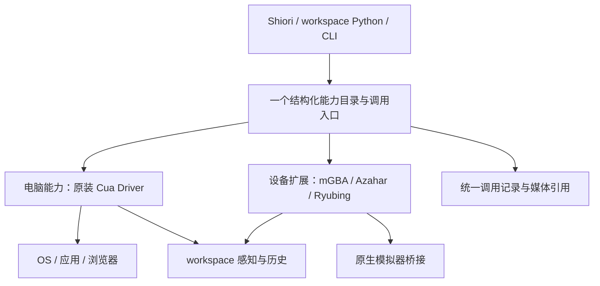

# CUA 与跨设备接口研究方案

状态：2026-10-24 施工前的研究基线，保留版本对比与取舍依据。后续实施见 [施工方案](baseware-contract-plan.md)，当前契约见 [Baseware 设计](baseware.md)；本文中的旧接口描述不作为现行使用说明。

## 结论

可以把 computer use 作为主要使用场景，以 CUA 为接口和实现参照，让模拟器成为同一体系里的设备后端。这样做能够复用成熟的电脑操作能力，且不必放弃跨硬件。

但目前没有一套现成的 CUA 接口同时覆盖桌面、独立双屏、手柄时间线、持续触屏和我们现有的控制周期。最合适的路线是：**电脑操作直接复用 Cua Driver；能力目录与结构化调用向它靠齐；视觉来源、坐标与投递结果参考更底层的 `cua.env.v1`；手柄和触屏保留明确的设备扩展。**

这类似选一个成熟交易接口作为基准，但先核实它是否真是现有业务的超集。对于我们，CUA 的电脑操作是强项，游戏设备的持续控制不是它当前已经覆盖的资产类别。

本阶段不建议把模拟器驱动塞进 Cua Driver 的内部 registry，也不建议把整套 spacesd 搬进来替代 Baseware。下面列出具体阻力，以及可以先消掉的重复代码。

## 研究基线

| 对象 | 本次核对范围 |
| --- | --- |
| Playness | `cfcc682b01cf84b28dbe2f478d3a3e7e16871ecd`；mGBA、Azahar、Ryubing、CUA provider，Baseware/RSA 调用契约及相关测试 |
| 本机 Cua Driver | `0.36.0`；读取版本、工具目录、描述和 manifest，没有执行电脑输入 |
| 对应发行源码 | `cua-driver-rs-v0.36.0`，`6d6c734c127025fb39ad5d585a10382808b39dc1` |
| 上游研究快照 | `dcb907efbfa7905015de09a330788dde4a79f884`；Cua Driver 工作区版本为 `0.38.0`，另查 `cua.env.v1` / spacesd |

研究快照不等于本机已安装版本。本次没有升级 CUA、启动 spacesd、改 driver 或重启游戏。上游源码保存在仓库外 `artifacts/research/cua-reference-20261024`。

## 先区分 CUA 的两层

| 层 | 已有价值 | 不能直接推导的能力 |
| --- | --- | --- |
| **Cua Driver** | 原生窗口/桌面、AX、键鼠、浏览器、剪贴板、批处理、会话、操作反馈；CLI、MCP、类型化 SDK | 任意显示器枚举、通用硬件插件、跨平台独立 key down/up、手柄时间线 |
| **cua.env.v1 / spacesd** | 更完整的 Display、Screenshot、CoordinateSpace、InputTarget、DeliveryReport、能力发现；另有视频流等服务 | proto 有某字段，不等于各平台后端都实现；也不是一个只有截图和输入的小型库 |

spacesd 可以在普通机器运行，不要求先建 VM。其完整 daemon 同时包含进程、文件、媒体、会话、隧道等服务；仅为了统一设备名字引入它，范围明显大于当前需求。Cua Driver 标注 MIT，spacesd 工作区标注 FSL-1.1-MIT；不能按根目录许可证假定所有组件采用同一许可。[上游组件说明][packages]、[spacesd 说明][spacesd]。

## 现有能力横向对照

这里的“完备”指现有设备能力没有在适配时丢失，不代表设备的每一项硬件功能都已经接入。

| 能力 | 电脑 / CUA | mGBA | Azahar / 3DS | Ryubing / Switch | 对齐方式 |
| --- | --- | --- | --- | --- | --- |
| 视觉来源 | 窗口、主桌面；spacesd 另有多显示器采集 | 一张 240×160 图像 | 上屏 400×240、下屏 320×240 独立图像 | 游戏呈现画面；系统键盘时另有对话框画面 | 统一来源身份和媒体元信息；不强制拼图或伪装成窗口 |
| 数字键 | press/hotkey；平台决定能否独立 down/up | 10 个键 | 14 个键 | 16 个键 | 表达按键状态相似，键值及执行语义不能直接互换 |
| 模拟轴 | 鼠标位置/滚轮，不等于摇杆 | 无 | Circle Pad/C-Stick，4 轴 | 双摇杆，4 轴 | 保留有范围、有方向的设备通道 |
| 持续组合动作 | click/drag/hotkey 等有各自边界；不是通用并行时间线 | `play`，按模拟帧推进 | `play`，按输入轮询墙钟推进 | 同 3DS | `play` 作为扩展；不改写成 hotkey 循环 |
| 触屏接触 | 鼠标拖拽不是原生触屏 | 无 | 单触点 down/move/up，320×240 坐标域 | 单触点 down/move/up，1280×720 坐标域 | 接触点是独立能力；保留返回后仍按下的状态 |
| 文本输入 | 文字输入、按键、AX/剪贴板路径 | 无 | 当前未暴露系统文本能力 | 仅系统文本框的 type/press | 可以共用文本参数习惯，必须保留作用域 |
| 语义对象 | AX 元素、窗口、DOM 等 | 无 | 无 | 无 | 没有的能力不声明；不造空实现 |
| 异步动作 | SDK async 是非阻塞等待；不等同持久 actionId | `play` 返回 actionId，支持查询/等待/取消 | 同左 | 同左 | 区分 RPC 生命周期与设备动作生命周期 |
| 时间依据 | 捕获/调用时间；不保证显示器原始帧时刻 | 模拟帧、帧量化时长 | 截图计数与输入轮询；上下屏串行采样 | 呈现帧序号；对话框截图另论 | 保留时钟来源与序号含义，不强行当成一种时间 |

当前仓库没有独立的 NDS provider；melonDS 走 CUA 桌面通道。不能把 3DS 的原生双屏能力算成 NDS 已实现能力。机器狗和多摄像头仅用于检查未来扩展方向，本次没有验证它们。

## 影响取舍的源码事实

### 1. Cua Driver 的主桌面接口不是完整的多显示器接口

`get_desktop_state` 没有显示器选择参数；原生 capture target 只有 Window 和 PrimaryDesktop，类型化 click 对非 `primary` 的 desktop target 明确拒绝。macOS 捕获路径选择主显示器。多个窗口可以分别截图，但这不等于每块物理显示器都能单独枚举、捕获。[输入契约][driver-inputs]、[捕获注册表][capture-registry]。

`cua.env.v1` 则已经定义并实现 `ListDisplays` 和按显示器选择的截图。macOS 后端枚举活动显示器，返回尺寸、缩放及刷新率。这一层更接近用户提出的多屏类比。[ComputerService][env-computer]、[macOS 显示器实现][macos-displays]。

但显示器、摄像头、双目并不都天然共享桌面坐标。共同点是“可辨认的观测来源”；是否存在统一坐标、同步采样或标定关系，应由设备实际提供，不能从图像数量推断。

### 2. 接口类型比平台执行覆盖更广

`cua.env.v1` 定义了 KeyboardDown/Up、PointerDown/Up，Linux X11 后端有对应实现；本次快照中 macOS、Windows、Wayland 使用的 ToolBackend 明确拒绝这些独立操作，建议使用 press/hotkey、click/drag。[ToolBackend][tool-backend]、[Linux 后端][linux-backend]。

因此，不能把模拟器的“左 500ms、跳 300ms”简单转换成电脑 hotkey 就声称完整适配。异步函数、批处理和独立输入时间线是三种不同能力。

### 3. Cua Driver 暂时不是可直接插入任意硬件的宿主

Rust 确实有 `register_host_tools`，但源码标注为临时的宿主管理工具入口，Python/TS 的普通 DriverOptions 不提供它。更关键的是，未知工具即便注册成功，也会被硬编码的风险分类判为 Unclassified 并拒绝；切换 permission mode 不改变这一点。已在 **0.36.0 发行源码和研究快照**中分别核实。[0.36 SDK 入口][release-sdk]、[0.36 授权分类][release-auth]。

要把 pad/touch 放进它的内部运行时，至少需要扩展工具分类准入，并接入设备资源与清理生命周期；若还要求类型化 SDK 方法，再扩展相应类型契约。当前把这一方向当作低成本插件接入不成立。

### 4. MCP 兼容不等于 CUA SDK 兼容

CUA SDK 的 generic call/list 不受固定方法列表限制，但 SDK 的 MCP 远程连接会要求 CUA 专用 envelope 能力，随后使用 connection、generation、授权及取消等契约。直接实现 DriverEnvelopeChannel 也能接独立服务，但仍须履行这些专用契约。普通 MCP server 只有 `tools/list` 和 `tools/call`，并不能直接替代这个运行时。[远程 SDK][remote-sdk]。

所以本方案承诺的是：设备能力可以采用同一种结构化工具契约，并通过标准 MCP 客户端消费。**不承诺 CuaDriver 的类型化 `click()` 等方法能原样控制任意模拟器。** 真正做到完整 CUA SDK 协议兼容，应作为独立决策，不能藏在“换个统一接口”里。

### 5. CUA 已有有价值的几何信息，时间语义仍需保留区别

CUA 可返回目标身份、图像尺寸、缩放、capture_id，并维护截图到动作坐标的变换；这些值得直接保留。但 capture_id 是图像身份，不是帧序号。Driver 的部分 provenance 路径没有填采样时间；spacesd 的 `captured_at` 在处理结束后取系统时间，不是严格的原始呈现时间。[provenance][provenance]、[截图实现][env-capture]。

我们的 CUA wrapper 保留了 structuredContent，但二进制图像变成 Observation 后，缺少图像与原生 capture/source 的显式关联。设置上游 `screenshot_out_file` 时还可能只有路径，没有 image block，当前不会自动产生 Observation。这是可以具体改善的适配缺口。[本地 wrapper](../baseware/src/drivers/cua/provider.ts)。

CUA Driver 的录制保存动作前后证据；它不能直接替代我们独立于模型调用持续采样的 ObservationHistory。spacesd 的视频流是另一条可选采集后端，不能把一次 Screenshot 请求当作视频。[录制实现][recording]。

## 建议的目标结构

Baseware 继续承担图中已有入口及控制周期的职责，不再增加一个聚合进程。名字是否保留不是这次设计的核心；它应当逐渐成为薄适配，而不是重新实现 CUA 的电脑系统。

### 共同契约只统一必要部分

1. **能力目录以结构化工具为准。** 对齐 CUA/MCP 的 name、description、inputSchema、outputSchema、annotations。电脑工具保留原始参数；设备专属能力在明确命名空间下扩展。help、baseware.json、CLI/API/MCP 从同一目录生成。
2. **调用参数直接是对象。** Python/TS 不再把参数编码成 argv，driver 不再从 argv 解析回对象。CLI 是该调用的一个入口，不能继续作为内部协议。RSA controller 仍按需发现设备与 workspace 能力，不默认注入 OMP 工具。
3. **原生结果保真。** 保留结构化内容、文本、错误和媒体；上游的 effect/verified/refusal 等信息不压成一个“成功”。日志使用有来源的媒体引用，避免重复保存 base64。
4. **观测保留身份和时空依据。** 每张图能对应 source/capture、尺寸、坐标域及时间依据。沿用现有 clock 和请求/接收区间；没有原始采样时间就不伪造。来源是窗口、主屏、3DS 上下屏还是摄像头，应能区分。
5. **动作生命周期保留设备含义。** pad 的提交/运行/终态、touch 的持有接触、电脑的一次调用分开表达。`play` 原生时间线不因改目录而退化；RPC 取消与动作取消不混为一谈。

不预先定义覆盖键鼠、手柄、机械关节的巨大输入枚举，也不强制每个 driver 提供同一组方法。共同字段用于发现和消费，具体能力的参数由 schema 表达。

电脑的截图坐标转换应复用 CUA 自己已有的 target/capture 绑定；3DS 的两屏组织、触屏与图像的组合关系仍由 workspace 自己处理。本方案不把这些策略搬进 driver。

### 控制权不叠两套相同逻辑

RSA 的 epoch 表示“这次自主运行何时结束、何时由人接管”，CUA session 管它自己接受的桌面调用和原生资源；二者不能简单当成同一个 ID。

接入时由现有入口把 epoch 的结束映射到对应 CUA 会话的结束，原生输入清理由 CUA 执行。模拟器仍通过自己的桥接释放。不要再在外层补一套键鼠状态模拟器或盲目重试器。若上游报告完成情况未知，记录未知并等待/核实清理，不能只因 RPC 被取消就显示“已释放”。

这部分当前 CUA 测试仅证明取消信号和 end_session 被调用，尚未证明真实长输入的释放顺序。因此不能因为采用原装 CUA 就删除人接管验收。多个 workspace 共享一个真实桌面也不等于拥有多个独立输入设备；需明确资源范围。

## 具体复用与删除范围

| 项目 | 建议 |
| --- | --- |
| 电脑截图、AX、键鼠、窗口、浏览器、原生坐标变换、平台差异 | 直接复用 CUA，不自建平行实现 |
| CUA 内部会话、在途操作、清理和错误反馈 | 使用上游生命周期；外层只连接本次运行的控制期限与日志 |
| 当前 CUA wrapper 的 `--args` 再包装、schema 再嵌套 | 在结构化调用迁移时删除；外部原始参数直接传递 |
| `commandEncoding`、API→argv→参数对象转换、MCP 的通用 argv 参数 | 迁移时删除，改为同一原生 schema；相关位置见 catalog.ts、contracts.ts、mcp.ts、Python Client 与 RSA WorkspaceController |
| 每种模拟器的协议、pad 时间线、原生 touch、精确截图来源 | 保留；CUA 没有可直接替代的实现 |
| workspace 感知进程、历史存储、AI 自建能力、Benchmark | 保留；它们消费设备能力，不属于桌面 driver |
| Baseware 的独立 wire transport | 暂不与参数迁移捆绑。是否改为标准 MCP，要核实控制租约、事件订阅、取消和后台动作能否完整承载，再删除旧 transport；不同时长期维护两套内部协议 |
| spacesd 全栈 | 暂不整体引入。以后需要远程电脑、多屏视频流时，把它作为具体后端评估 |

这一步的实际收益是消掉重复的参数/结果转换和电脑实现压力。它不会让全部现有桥接自动消失，也不能仅靠统一名字就让专用 CUA 客户端完整兼容。

当前电脑 provider 已经在复用原装 CUA 的工具和实现，这不是方案实施后才获得的收益。新增收益主要是：让其他设备向同一种结构化能力契约靠齐，并清除目前为了塞进 argv/ExecutionResult 而产生的重复包装。这里的通用工具协议主要来自 MCP，不能宣传为已经复用了 CUA 的整个运行时。

如果目标进一步是**实际替换 Baseware 的通用运行时**，先验证一个小范围的上游扩展是否可成立：注册新工具时同时注册它的授权分类、设备资源范围和清理 hook，并允许宿主不初始化桌面后端。只有这些成立，才评估把目录分发、会话和服务端交给 CUA，并删去对应自有实现。否则强行迁移容易把删掉的逻辑以补丁形式重新写回来。该方向可以保留为后续选项，本次不维护分叉。

## 施工前后的验证安排

先用 **电脑 + 3DS** 做一条完整样例，再迁移 GBA/Switch。3DS 同时包含双屏、模拟轴、独立接触和组合按键，能较早暴露适配丢失；GBA 的模拟时间与 Switch 的系统键盘负责补足不同语义。

| 验收 | 必须证明的事实 |
| --- | --- |
| 目录和调用 | CLI、Python、MCP 看到同一参数约束；Unicode、JSON、负数和类似 `--help` 的文字不经过 shell 重解释 |
| CUA 保真 | 原生 tool 参数/结构化结果/错误未丢失；AX 与像素路径仍可用；文件输出和 image block 都能追溯媒体来源 |
| 多图像 | 上下屏身份与尺寸准确，顺序采样不冒充同一帧；电脑窗口的坐标变换与 capture_id 保留 |
| 持续输入 | LEFT 500ms + B 300ms 实际先同时按，再只按 LEFT，再回中立；相邻同通道区间无意外归零 |
| 异步生命周期 | 提交后退出 CLI、取消 wait 不取消动作；显式 cancel 和人接管按各自范围释放 |
| 接触与范围 | touch down 返回后仍保持；坐标端点正确；pad release 目前会清同设备 touch，这一范围须明确声明 |
| 人接管 | 停止接受旧 epoch 输入；实际完成清理后报告交还；电脑长拖动/批处理与模拟器 pad+touch 分别验证 |
| 时间 | GBA 帧量化与 3DS/Switch 墙钟时序各自正确；capture 次数不冒充呈现帧号；无跨设备时钟直接相减 |
| 日志及资源 | 请求与动作终态能关联；媒体不重复塞入全量日志；持续采样下内存与文件句柄有界 |

现有 Azahar 原生桥接夹具已覆盖组合键、异步存活和交还；CUA 目前主要是 fake MCP client 测试。已有证据可以复用，缺少的真实设备证据不能用 mock 补成“已完备”。不需要为每个工具复制一套测试，围绕以上边界形成少量可重复的验证即可。

建议实施顺序：

1. 定下结构化能力契约及电脑/3DS 的映射样例，明确兼容承诺只到哪里。
2. 在原有 Baseware 内完成目录和参数直通；不改 OMP Loop，不增加服务，不更换原生输入实现。
3. 用上述关键工况证明信息与执行行为没有丢失，再迁移另外两个 driver，删除旧编码链。
4. 根据实际需要决定是否采用 spacesd 的多屏/流媒体后端，或向 CUA 上游提出硬件扩展入口。它们不是本轮迁移的前置条件。

本研究确认了接口和源码覆盖，并未运行 CUA 的新输入工况，也未验证 Windows/Linux 真机。下一步应先接受或调整方案，再施工。

[packages]: https://github.com/trycua/cua/tree/dcb907efbfa7905015de09a330788dde4a79f884#packages
[spacesd]: https://github.com/trycua/cua/blob/dcb907efbfa7905015de09a330788dde4a79f884/libs/cua-spacesd/README.md
[driver-inputs]: https://github.com/trycua/cua/blob/dcb907efbfa7905015de09a330788dde4a79f884/libs/cua-driver/rust/crates/cua-driver-contract/src/inputs.rs#L618
[capture-registry]: https://github.com/trycua/cua/blob/dcb907efbfa7905015de09a330788dde4a79f884/libs/cua-driver/rust/crates/cua-driver-core/src/capture_registry.rs#L118
[env-computer]: https://github.com/trycua/cua/blob/dcb907efbfa7905015de09a330788dde4a79f884/libs/cua/proto/cua/env/v1/computer.proto
[macos-displays]: https://github.com/trycua/cua/blob/dcb907efbfa7905015de09a330788dde4a79f884/libs/cua-spacesd/crates/cua-spacesd-desktop/src/macos_display.rs#L14
[tool-backend]: https://github.com/trycua/cua/blob/dcb907efbfa7905015de09a330788dde4a79f884/libs/cua-spacesd/crates/cua-spacesd-desktop/src/grpc/tool_backend.rs#L632
[linux-backend]: https://github.com/trycua/cua/blob/dcb907efbfa7905015de09a330788dde4a79f884/libs/cua-spacesd/crates/cua-spacesd-desktop/src/grpc/linux_backend.rs#L383
[release-sdk]: https://github.com/trycua/cua/blob/6d6c734c127025fb39ad5d585a10382808b39dc1/libs/cua-driver/rust/crates/cua-driver-sdk/src/lib.rs#L621
[release-auth]: https://github.com/trycua/cua/blob/6d6c734c127025fb39ad5d585a10382808b39dc1/libs/cua-driver/rust/crates/cua-driver-core/src/authorization.rs#L1142
[remote-sdk]: https://github.com/trycua/cua/blob/dcb907efbfa7905015de09a330788dde4a79f884/libs/cua-driver/rust/crates/cua-driver-sdk/src/remote_mcp.rs#L322
[provenance]: https://github.com/trycua/cua/blob/dcb907efbfa7905015de09a330788dde4a79f884/libs/cua-driver/rust/crates/cua-driver-core/src/perception_tools.rs#L410
[env-capture]: https://github.com/trycua/cua/blob/dcb907efbfa7905015de09a330788dde4a79f884/libs/cua-spacesd/crates/cua-spacesd-desktop/src/grpc/computer.rs#L354
[recording]: https://github.com/trycua/cua/blob/dcb907efbfa7905015de09a330788dde4a79f884/libs/cua-driver/rust/crates/cua-driver-core/src/recording.rs
