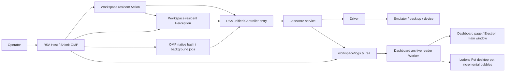

# Architecture and Boundaries

Ludens (RSA, Recursive Self-Adaptation) decouples device drivers, the Agent execution runtime, and workspace adaptive code: Baseware owns hardware and emulator interfaces, Shiori (built on OMP) owns control cycles and session scheduling, while perception modeling, action composition, and experience accumulation are defined and evolved entirely by workspace code (Workspace).

## Components and Processes

| Component | Process Shape and Core Responsibilities |
| --- | --- |
| `baseware/` | **Standalone device service**: loads built-in or external Drivers, provides a unified Controller capability catalog, control-lease (`epoch`) arbitration, input cancellation, and device fact logs; exposed via CLI, TS/Python APIs, and MCP. |
| `rsa/` | **Adaptive Harness**: manages workspace configuration and lifecycle, capability discovery and routing, resident perception (`perception.py`) and resident action (`action.py`) Python subprocesses, Harbor evaluation, and run-log archiving. |
| **Shiori** | **Sole execution kernel (role name)**: implemented by the RSA Host Runtime; uniformly governs control cycles, time/request budgets, signal cancellation, and exit cleanup. Agent mode mounts **OMP 18.9.1**; plain evaluation programs, Verifiers, and Metrics share the same lifecycle without starting a model. |
| `rsa-dashboard/` | **Local console service**: builds and queries log indexes through a dedicated Node Worker, serving realtime activity streams, spacetime video replay, run statistics, doc browsing, the capability catalog, and human-handover entry points. |
| `rsa-companion/` | **Optional desktop companion (Ludens Pet)**: Electron desktop shell; the main window reuses the same Dashboard view, while the native transparent pet window and audio engine incrementally consume the same activity log. |



Each component has its own `package.json` / `pyproject.toml` and lockfile. The RSA Harness depends only on Baseware's client and type contracts and never imports any concrete Driver implementation directly; `rsa up` orchestrates local processes from the workspace configuration and driver manifests.

## Devices and Unified Capabilities

1. **Unified Controller abstraction**: all capabilities a Driver exposes are collectively called **Controllers** (including controllers that execute inputs and sensors that capture frames/state). Each capability follows the CUA-native tool structure: `name`, `description`, `inputSchema`, optional `outputSchema` / `annotations`, and an MCP `CallToolResult` return value. See [Baseware Philosophy and Capability Contracts](baseware.md) for the design rationale and [baseware/src/contracts.ts](../../baseware/src/contracts.ts) / [baseware/src/catalog.ts](../../baseware/src/catalog.ts) for the type definitions.
2. **Dual-namespace aggregation with on-demand discovery**: RSA merges device capabilities (`controller/<id>`) and workspace Python decorator capabilities (`python/<path>:<fn>`) into the `rsa controller` directory. To avoid blowing up model context, no device capability or MCP tool is injected into OMP's model tool list by default; instead the Agent discovers and invokes them on demand via `baseware.json`, `rsa controller`, or `rsa_tools.Client`.
3. **Pure hardware boundary**: a Driver only faithfully maps hardware interfaces (e.g. independent per-screen captures `screen.top.capture` / `screen.bottom.capture`, native touchscreen coordinates `touch.down / move / up`); cross-screen image stitching, coordinate transforms, and game strategy all live in workspace code.

## Control and Lifecycle

### 1. Control Leases (`epoch`) and Permission Checks

- Each `rsa auto on` opens a new control cycle, minting a unique **`epoch`** and resetting the cycle's seconds (`seconds`) and model-request (`requests`) budgets.
- The RSA Host holds that `epoch` against Baseware over a persistent connection and injects `BASEWARE_EPOCH` into the workspace process environment.
- Capability-catalog queries and `--help` need no control rights; whether a concrete capability requires control is declared by its `requiresControl` property (some read-only state queries also require a valid `epoch`). Invoking workspace `python/...` capabilities via CLI likewise requires an active control cycle.
- On human handover (`rsa auto off`), budget exhaustion, host disconnect, or device disconnect, Baseware immediately revokes the old `epoch`, aborts in-flight actions, and performs device release (zeroing keys and touch contacts); once cleanup completes it returns to the `manual` state.

### 2. Gamepad Async Timeline (`pad.play`)

Emulator gamepads uniformly use the relative-timeline instruction `pad.play`, whose `inputs` parameter is an array of `{atMs, durationMs, state}`:

```sh
rsa controller controller/pad.play --args '{"inputs":[{"atMs":0,"durationMs":500,"state":{"LEFT":1}},{"atMs":0,"durationMs":300,"state":{"B":1}}]}'
```

- **Channel merge rule**: spans on different button/stick channels may overlap freely; spans on the same channel must not overlap. Adjacent spans switch the merged state directly at the boundary, and the whole timeline returns to neutral automatically when it ends.
- **Async lifecycle**: `pad.play` returns an `actionId` immediately after submission by default (the action belongs to the current control `epoch`; exiting the short-lived CLI connection does not interrupt a submitted action); passing `"wait": true` or calling `pad.wait / status / cancel` (with `{"actionId": "<id>"}`) waits on, queries, or cancels the action. Only one timeline executes per device at a time; submitting a new timeline while one is in flight returns `BUSY`.
- **Hardware clock semantics**: time parameters are in milliseconds; Azahar (3DS) and Ryubing (Switch) advance on the monotonic wall clock at input-poll points (minimum span 16ms), while mGBA (GBA) rounds up to frames at the emulated frame rate.

### 3. Resident Action Process and Input Reset

The workspace `action.py` resident action worker is permanently bound to the `epoch` and `inputGeneration` from startup. When `rsa action stop`, `rsa action reload`, or an `Action.step()` exception occurs inside an `auto` cycle, the system immediately cancels and releases all of this workspace's current inputs through Baseware (including concurrent CLI inputs), bumps `inputGeneration` to reject stale calls from the old instance, and keeps the current `epoch`, remaining budget, and OMP session. See [rsa/src/harness/runtime.ts](../../rsa/src/harness/runtime.ts).

## Session and Loop

### 1. OMP Superset Assembly and Outer Turn Continuation

The RSA Host reuses a single OMP session per workspace (persisted under `.rsa/shiori/sessions/`) and, on top of `Settings.isolated()`, applies the **minimal-override (Superset Shell) principle**:

- Keeps OMP's native system prompt (a workspace `AGENTS.md`, if present, is injected via native `contextFiles`).
- Explicitly enables the OMP-native tools `read`, `write`, `edit`, `bash`, `wait`, and registers the custom tool `observe`.
- Overrides only what the host contract requires: disabling `retry.modelFallback` (keeps the chosen vision model sticky), disabling `title.refreshOnReplan` and `cacheWarming` (keeps every model request strictly attributed to its control cycle), setting `PROVIDER_IMAGE_BUDGETS` to `Infinity` (retains history images before compaction so mid-run image drops don't break the Prompt Cache prefix), plus the optional `compactionThreshold`. See [rsa/src/harness/omp/session.ts](../../rsa/src/harness/omp/session.ts).

Inside an `auto` control cycle, the outer loop runs as follows:

1. **Open a turn**: issues an OMP `prompt` using [continue.md](../../rsa/prompts/continue.md) (on first takeover with `auto on --message`, a one-shot reminder is appended).
2. **Perception and action run in parallel**: the environment keeps running while the model reasons — the resident `Perception.sample()` samples continuously at `sample_hz` into `.rsa/timeline/`, and the resident `Action.step()` continuously reads the spacetime axis and executes high-frequency control at `step_hz`.
3. **Automatic context delivery**: the RSA extension hooks OMP's `before_agent_start` hook (see [extension.ts](../../rsa/src/harness/omp/extension.ts)). When auto-injection is on (default `inject on`), it automatically appends the latest undelivered primary-channel perception records plus sampler state transitions (`state / codeSHA / error`) at the start of each prompt; tool results are never appended with observations, the `tool_result` hook only records delivery receipts for native tool images, and mid-turn observation is composed explicitly by the model via `observe`. The former end-of-batch channel was removed on 2026-10-29; see [Injection converges to a single per-turn channel](../insights/omp-injection.md).
4. **Continue or hand over**: when a single `prompt` ends and budget remains, the next turn starts automatically; on human handover or budget exhaustion, the `addBeforeModelCall` gate immediately blocks new model requests and releases device control.

### 2. Context Compaction and Transport Recovery

- **Background predictive compaction**: reuses OMP's native two-phase compaction; the trigger threshold follows the model catalog by default (overridable via `rsa.json` or `--compaction-threshold`). See [OMP Background Compaction Retrofit](../insights/omp-compaction.md) for the patches made for the 30Hz realtime control loop.
- **WebSocket incremental transport and recovery**: OpenAI Codex uses WebSocket `auto` mode by default; see [WS Recovery Test Rationale](../insights/ws-recovery.md) for disconnect classification, cooldown backoff, and the SSE recovery policy for unfinished tool calls.

## Verifiable Run Facts

- **Decoupled multi-source facts**: Baseware independently persists device control and execution facts (`logs/baseware/`), RSA records model calls, tool executions, capability invocations, and perception deliveries (`logs/<run-id>/`), and Shiori mounts a scoped OpenTelemetry provider recording `agentLoop` telemetry.
- **Isolated Dashboard reads**: the Dashboard keeps archive parsing and index maintenance in a dedicated Node Worker thread; cold history directories are built by a globally-single-instance throttled temporary Builder subprocess and atomically published to `.dashboard-index/`; Next.js routes and Ludens Pet only read projected results over bounded RPC. See [Logging and Call Chains](logging.md#consumption-and-metric-interpretation).

## TypeScript and Python

RSA consists of a TypeScript host (`rsa/src/`) plus a Python toolkit (`rsa/python/rsa_tools/`):

- **TypeScript side**: owns the Shiori runtime, control leases, OMP session extensions, cross-process RPC, and CLI / Benchmark orchestration.
- **Python side**: owns `@capability` static discovery and dynamic execution, the resident `Perception` / `Action` loops, PyAV video-segment encoding, on-demand cold-frame decoding, and `current_trial()` evaluation evidence registration. Video encode/decode happens on demand inside the resident perception process; no separate streaming service is introduced.

## Capability Persistence Boundaries

Global `LUDENS_HOME` (default `~/.ludens`) stores application configuration, the `registry/<id>.json` workspace index, driver caches, and shared pet state. Registrations contain only `{id, workspace, name, updatedAt}`; `.rsa/workspace.json` holds each workspace's stable identity, and `rsa workspace open` updates the index after a move. Sessions and history remain inside the workspace; the registry can be rebuilt. See [the two-level directory layout](../tutorials/workspace.md#1-workspace-directory-layout).

Registry creation, relocation, removal, and pet target selection share per-workspace locking. When both locks are required, the registry lock precedes the pet-target lock. Removal reads the current registration, clears only its matching raw pet target, then unlinks the registration; an unreadable or unwritable target blocks removal before unlink. Re-registering cannot revive that cleared target. Unrelated targets, consumer heartbeat files, workspace contents, and running services are untouched. Normal pet-state polling stays read-only; only a stored target's relocation requires a locked re-read and update. Dashboard mutation receipts report committed configuration or the removed registration independently of later catalog/consumer reads.

Pet target PUT and consumer heartbeat POST return their committed `{ target }` and `{ consumer }` independently. A state GET preserves the saved target if the consumer record is unreadable (`connected: null` with `consumerError`), rather than claiming disconnection. Offline, missing, or identity-mismatched registrations retain the saved target with `targetUnavailable: true`; desktop consumers temporarily stop that source without clearing the choice. Consumer `targetRevision` identifies the attempted target; `revision` identifies a loaded source. Application failures are attributed only to a matching attempt, and following requires a matching loaded revision. A state read waits for target writes already accepted by that worker to settle, so a queued write cannot complete after its recovery read has reported the old selection. `targetConfigured` distinguishes an unset target file from an explicit saved stop; only the latter prevents an `ifUnset` startup choice.

The four state stores inside a workspace each have their own role and never redundantly duplicate each other:

| Store Location | Ownership and Contents |
| --- | --- |
| `.rsa/timeline/` | **Sole originals of capability observations and media**: maintained by the single-writer resident perception process; holds `@record` record metadata, segmented fMP4 video (`video/`, five minutes per segment by default, finalized after ten seconds idle), and SHA-256-deduplicated non-video media (`objects/`). |
| `.rsa/archive/` | **Structured text archive of models and tools**: deduplicated cross-request and cross-run by content hash into `objects/<sha256>.json.gz` plus streaming payloads; all embedded media reference `.rsa/timeline/` by reference. |
| `logs/<run-id>/` | **Single-run event stream**: holds `manifest.json`, `events.jsonl`, `streams/`, and Benchmark `trial.json` / `verifier/`; links Baseware, Archive, and Timeline via `eventSources` and content references. |
| `.rsa/shiori/` | **OMP-native session store**: holds `sessions/*.jsonl` and the current resume pointer, managed by the OMP SessionManager. |

## Unified Spacetime Axis and Replay

Perception sampling, resident actions, model inference, and device execution share the workspace's absolute wall-clock time origin and are precisely correlated through `recordId`, event sequence numbers, `modelCallId`, `toolCallId`, `actionId`, and the `trace` tree. The Dashboard player renders the full continuous sampling frames from `.rsa/timeline/` (including intermediate frames the model never consumed), action time spans, and model call details under one shared time cursor; history replay is a pure read-only projection — it never triggers device operations nor changes Ludens Pet's realtime follow target.
