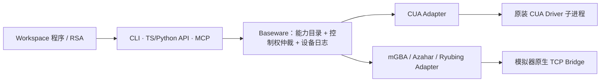

# Baseware Design Philosophy and Capability Contract

Baseware is Ludens' standalone device-driver service: it connects to an emulator or desktop backend, publishes a unified capability catalog, arbitrates device control (`epoch`), executes input and capture, and persists every call and device fact as verifiable logs. How frames are perceived, actions composed, skills accumulated, or task success judged is entirely left to upper-layer Workspace code and the RSA.

## Shared conventions, device semantics preserved

Baseware takes the CUA Driver's native tool contract as the structural model and maintains its protocol definitions independently in the repo (see [tool-contract.ts](../../baseware/src/tool-contract.ts) and [contracts.ts](../../baseware/src/contracts.ts)):

- **Uniform structure**: every capability (`Controller`) is described by `name`, `description`, `inputSchema`, plus optional `outputSchema`, `annotations`, and `_meta`; call arguments are uniformly JSON objects, and native return bodies uniformly follow the MCP `CallToolResult` (with `content`, `structuredContent`, `isError`).
- **Faithful semantics**: the unified call envelope does not blur hardware differences. CUA desktop tools keep their upstream names and parameter shapes; emulators declare their own hardware capabilities — gamepad timelines as `pad.play`, touchscreens as `touch.down / move / up`, and the 3DS dual screens as `screen.top.capture` and `screen.bottom.capture`. A PC mouse never masquerades as an emulator touchscreen, and emulator buttons never masquerade as a desktop keyboard; all coordinate bounds, button enumerations, and time units are directly discoverable from the live capability catalog.



## Three boundaries

| Layer | Core responsibility | Explicitly out of scope |
| --- | --- | --- |
| **Driver** | Parse a specific device protocol (TCP Bridge or stdio), declare genuinely available capabilities, execute and release low-level input, produce raw media bytes and source sequence numbers. | No cross-device capability stitching, no interpretation of game memory or task state. |
| **Baseware** | Aggregate and publish the capability catalog, validate parameters against JSON Schema, manage `epoch` control leases, correlate calls with device events, expose a consistent entry point via CLI / API / MCP. | No permanent screenshot archive for the workspace, no built-in retry policy or Agent Loop. |
| **Workspace / RSA** | Discover and compose capabilities, maintain the `.rsa/timeline/` perception history, run resident perception/action models and OMP sessions. | Never write emulator control state bypassing Baseware. |

## Calls and results

The capability catalog is generated dynamically by the currently connected Driver. Running `baseware export` (or starting the RSA Host) exports the live catalog as the workspace's `baseware.json` snapshot (contract in [catalog.ts](../../baseware/src/catalog.ts)).

### 1. Three call entry points

CLI, TS/Python API, and MCP accept identical JSON parameter objects (CLI supports `--args '<JSON>'` or `--file <path.json>`):

```sh
# Direct Baseware CLI call
baseware controller pad.play --args '{"inputs":[{"atMs":0,"durationMs":500,"state":{"LEFT":1}}],"wait":false}'

# Call via the unified RSA entry point (with controller/ namespace prefix)
rsa controller controller/pad.status --args '{"actionId":"<returned-id>"}'
```

```python
from baseware import Client

res = Client().controller("screen.top.capture", {})
# res["result"] is the native CallToolResult (with inline base64 media content);
# res["observations"][0]["contentIndex"] points to the index of the matching content block in result["content"].
```

### 2. Return envelope (`ExecutionResult`)

The TS/Python API and CLI uniformly return the full `ExecutionResult` envelope, while the MCP interface returns the native `result` inside the envelope directly:

| Field | Type and meaning |
| --- | --- |
| `id` | Unique execution ID of this device call. |
| `status` / `exitCode` | `"completed"` (`0`), `"interrupted"` (`130`), or `"failed"` (non-zero). |
| `actionId` | When the operation is tied to an async gamepad action (e.g. `pad.play / wait / status / cancel`), identifies that action instance. |
| `readOnly` | Whether this call was a read-only query that does not change device input. |
| `timing` | `{clock, requestedAtMs, receivedAtMs}`, based on the current Baseware process's monotonic clock. |
| `observations` | Media observation metadata list (with `id`, `controllerId`, `mediaType`, `contentIndex`, `timing`, and optional `sourceSequence`). |
| `result` | Native `ToolResult` (with full media bytes `data`/`blob`, `structuredContent`, and `isError`). |
| `stdout` / `stderr` | Short human-readable text summary. |

## Control is independent of capability description

- **`requiresControl` is orthogonal to `readOnlyHint`**: `requiresControl` is Baseware's execution gate, not a business parameter of the tool schema. A capability can be both a read-only query (`readOnlyHint: true`, e.g. reading the current gamepad composite state `pad.state`) and require the caller to hold a valid control `epoch` (`requiresControl: true`). CUA tools that do not explicitly declare read-only access require control by default.
- **Lease holding and release protection**: control is requested and held by the RSA Host's persistent connection; a single CLI / API / MCP call only inherits the lease via the `BASEWARE_EPOCH` environment variable and never seizes control automatically by calling a tool. When the lease expires, a human runs `revoke` / `auto off`, or the holder disconnects, Baseware immediately triggers the Driver `release()`, including Controllers still acquiring control. Both acquisition and cleanup have timeouts; if acquisition times out or cleanup fails, the state returns to `manual` after revocation but stays `connected: false` and refuses subsequent takeovers. A late acquisition only triggers compensating release of the original `epoch` and does not restore automatic control.
- **Connection-level idempotency**: multiple Controllers under one Driver share the same device connection; `acquire(epoch)` and `release(epoch)` stay idempotent at the Driver layer and never repeat the handshake just because capabilities are split into multiple tools.

## Media, time, and logs

### 1. Ephemeral capture and omitted archiving

- **No redundant screenshot library**: on emulator screenshots, the Bridge only writes the PNG to a temporary file for the Provider to read the bytes and pack into the return value's `result.content`, deleting the temporary file immediately after reading; whether a capability result is permanently archived is entirely decided by workspace code's `@record` and `.rsa/timeline/`.
- **Slimmed, redacted log payloads**: the `execution.result` written to the Baseware device log automatically strips binary `data` / `blob` bytes, keeping only `mediaType`, `contentIndex`, byte size, and any existing `timeline` or file reference (unarchived data is marked `dataOmitted: true` / `blobOmitted: true`).

### 2. Recording modes and continuous-sampling statistics

Baseware sets log verbosity at startup via `--diagnostics normal|full` (default `normal`):

- **`normal` mode**: fully records all side-effecting device input, action boundaries (`action_start / action_end`), control changes, active failures, and first-sampling faults; for successful read-only queries and resident sampling call chains carrying `trace.recordingPurpose = "continuous-perception"`, per-call `command / execution` details are omitted and replaced with one `device_sampling_stats` summary every **5 seconds** (counts, failures, and latency grouped by Controller and `recordingId / epoch`).
- **`full` mode**: additionally keeps the complete call record of every read-only query and continuous sample in a separate `diagnostics/` segment.
- **Fault-span merging**: the first error in continuous sampling immediately writes `device_sampling_error`; subsequent errors of the same kind only accumulate a counter. When a successful sample is observed followed by at least one full 5-second statistics window with no errors of the same kind (or the service stops normally), the fault span is closed.

### 3. Independent fact sources (`eventSources`)

Each Baseware service instance independently maintains `source.json`, `events/`, and `diagnostics/` under `--data-dir` (default `logs/baseware/` under the workspace), segmented by 1 hour or 256 MiB; every event is uniquely identified by `origin.eventId = "<serviceId>:<seq>"`. The RSA run log no longer copies Baseware event bodies; instead it registers the data-source path, `recordingId`, and sequence observation window in `manifest.json`'s `eventSources`, and readers merge on demand (see [Logging and call chains](logging.md#files-and-event-identity)).

## Driver packages and launch description

Baseware loads external driver packages via `--driver <id> --driver-package <spec>`; emulator drivers load only from external packages, and only the `cua` desktop adapter keeps a built-in registration.

### 1. Package addresses and caching

`<spec>` supports three formats:

1. **npm package**: e.g. `@scope/pkg@1.2.0`, installed by Bun into a cache directory outside the repo (default `~/.local/state/ludens/baseware/drivers/`; under `ludens/baseware/drivers/` of `XDG_STATE_HOME` when set);
2. **GitHub repo**: e.g. `github:org/repo#commit-sha`, a full GitHub HTTPS URL, or `git@github.com:org/repo.git#rev`. SSH addresses keep SSH transport; the cache distinguishes transport, repo, and revision. After checkout and dependency installation, the entry point is resolved via `package.json` `exports`;
3. **Local directory or entry file**: `file:/absolute/path` or `file:relative/path`; relative paths in the Baseware CLI resolve from the current directory, relative paths in RSA workspace config resolve from the workspace root.

For reproducible experiments, pin exact npm versions or Git commit SHAs in production and evaluation.

The loader records the actually resolved package source for use in the catalog's `drivers[].source`, Baseware's `service_start.driverSource`, and RSA's `manifest.drivers[].source`: GitHub records `requestedRevision`, `transport`, and the actually checked-out `resolvedCommit`; npm records `packageName` and the actually installed `resolvedVersion`; local `file:` records the entry path and `entrySha256`. The file hash covers only the imported entry file, not its dependencies. Source info is generated by the loader and cannot be overridden by external packages; `provider.version` still denotes the device or protocol version, not the package version.

### 2. `DriverRegistration` and `DriverManifest` contract

An external driver package must export a `DriverRegistration` (as the `default` export, or a named export `registration` / `driver`):

| Field / method | Constraint and responsibility |
| --- | --- |
| `id` | Required string matching `^[A-Za-z0-9][A-Za-z0-9_-]*$`, must equal the `--driver` argument. |
| `version` / `fallbackVersion` | Optional version strings; the run directory takes the Provider handshake's actual version first, then the declared version, then the built-in fallback, finally `"unknown"`. |
| `transport` | `"bridge"` (default, TCP line protocol) or `"stdio"` (child-process stdio). |
| `defaultPort` | Optional integer (`1..65535`); a `bridge` driver must get a legal port from `rsa.json.port` or `defaultPort`. |
| `needsGame` | Optional boolean: whether the backend must be started and a game loaded before Bridge readiness; the device may be prepared manually, or the launcher may start it with `rsa.json.game`. |
| `launchHint` | Device-preparation and manual-start hint text (shown in the Dashboard and CLI help). |
| `launchCommand` / `launchEnv` | Optional backend launch command array (excluding the game path, appended by the launcher) and environment-variable map (`RSA_BRIDGE_PORT` is overridden with the actual port). |
| `load({ port, command, clock })` | Async factory function: connects the device and returns `{ capabilities: { controllers }, onDisconnect, close }`, optionally with `version`; exact types in [registry.ts](../../baseware/src/drivers/registry.ts). |

The emulator-side TCP protocol implementation spec is in [Driver Bridge protocol](driver-bridge-protocol.md).

## Driver discovery: verify, don't endorse

The repo maintains no centralized allowlist of third-party drivers. Users can check whether any driver package's static registration declaration is compliant with:

```sh
baseware driver discover --package 'github:org/repo#rev'
```

- **Verification scope**: `discover` downloads and installs dependencies, imports the package entry module, validates `DriverRegistration` field legality, and outputs the `DriverManifest` as JSON; missing fields or illegal types exit with a non-zero status.
- **Security boundary**: although discovery **never calls `load()`**, package install scripts and module top-level code still execute on the local machine. `discover`, `rsa init`, and `rsa up --dry-run` are not security sandboxes — only load driver packages from trusted sources.

## Upstream contract and upgrades

The [baseware/contracts/cua-driver/](../../baseware/contracts/cua-driver/) directory pins the upstream CUA Driver's version, source hashes, license, and tool snapshot. The snapshot is used for offline auditing of atomic capabilities and for running the `python3 baseware/scripts/sync-cua-contract.py --check` regression test; at runtime the snapshot never trims newly added upstream platform tools. Because the MCP SDK's default schema parsing clips unknown nested fields, Baseware validates structure at the protocol boundary while preserving the original fields verbatim, and guarantees fidelity through MCP round-trip tests.
