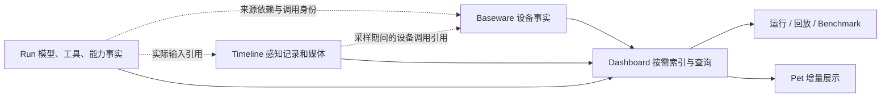

# 执行事实与诊断日志分离方案

状态：待实施。本文只确定设计、施工顺序和验收，不表示运行代码已经切换。现行契约仍见 [logging.md](logging.md)。

## 1. 问题与目标

这次问题主要发生在生产端：同一个连续采样过程被多个组件分别展开成生命周期事件，设备事件又被转存进 run。消费者分段、限缓存、临时进程构建已经缓解读取成本，但不能消除这些重复。

实测对象为马造 run `2026-10-27T10-56-03.345Z`、epoch `4dc706f3-91a1-4ce7-96cc-657e08d4e784`。其 `events.jsonl` 有 **518,252 条、469,901,131 字节**；包含启动与收尾，文件覆盖约 33 分 44 秒，自动控制预算是 30 分钟。

| 事实 | 实测 |
| --- | ---: |
| 模型请求 start/end | 各 100 条 |
| 持续感知成功记录 | 27,648 条 |
| capability start/end | 各 58,214 条 |
| Baseware command/execution | 各 58,214 条 |
| observation start/end | 各 56,025 条 |
| Python call start/end | 各 27,650 条 |
| Shiori 来源占全部事件 | 约 0.36% |

代表性的一次双屏采样产生 18 条、约 16 KB 的 JSON 元数据：Python start/end 两条，每个设备读取的 RSA capability start/end、command、execution、observation start/record/end 共七条，再加 timeline_media 和 perception_sample。`27,648 × 18 = 497,664`，已经解释了主要量级；这是该路径的估算，不是每次采样都严格相同，也不是名义 30 Hz 的实测证明。设备事件还另写在 Baseware 自己的文件中，未包含在上述 run 文件字节数里。

目标：**每种执行事实有唯一保存位置；完整历史通过引用读回；诊断细节可选。** 录像频率、AI 可调用的能力、原生返回内容和实际动作不因日志减量而改变。

本次不增加数据库、日志服务、执行框架或第二套媒体仓库；不修改 OMP 原生 session、provider 行为或 CUA 本体；不重新设计已经完成的 Dashboard 构建与缓存机制。

## 2. 保存什么，谁拥有

| 内容 | 唯一持久化归属 | 其他地方保存什么 |
| --- | --- | --- |
| 感知结果、采样区间、代码版本、媒体 | workspace `.rsa/timeline/` | record/asset 引用及实际使用关系 |
| 设备调用、观测来源元数据、动作生命周期、控制权 | Baseware 自己的分段日志 | source、operation、action 的身份引用 |
| 模型调用、工具、主动能力调用、普通 Python 装饰器调用、run 控制 | run 日志及现有 `.rsa/archive/` | 复用原有正文引用 |
| 运行统计、Activity、搜索、回放目录 | Dashboard 可重建索引 | 原始位置与小型投影，不复制正文 |
| Benchmark 报告 | 现有 benchmark 存储 | 被评估调用的身份、版本及事实引用 |
| Pet 气泡和状态 | 不建立新的事实档案 | 继续消费 Dashboard Activity 增量 |

同一次观测可以同时有“设备读取完成”和“加工结果录制完成”两种事实；它们不是同一个事实。前者保留设备时序，后者保留 workspace 处理结果，通过 ID 连接。删除的是相同参数、媒体元数据和结果在多层日志中的重复包装。

“全量历史可查询”指全部已保存事实都能按需访问。它不意味着默认保存每一层的调试事件，也不意味着能事后恢复从未记录的细节。

## 3. 连续采样使用紧凑事实

### 3.1 按执行上下文决定，不按名称删日志

沿用现有 Python context 和 Baseware 请求 metadata，增加明确的连续采样上下文，携带采样根 span 身份。只有框架常驻采样循环发起的调用进入此上下文；不根据 `sample` 函数名、截图工具名、图像类型或 3DS 双屏做判断，也不要求 AI 添加新装饰器。

同一函数由 AI 主动调用、普通 import 或 benchmark 调用时，保持普通调用记录。连续采样上下文内如果调用有副作用或不能确定只读的设备能力，也保持完整调用生命周期。日志策略不参与控制权判断，不改变 requiresControl、epoch 校验和取消行为。

### 3.2 一次成功采样的目标形态

对于当前两个只读设备调用的路径：

1. Baseware 每个读取保存一条紧凑完成事实：operation 身份、调用参数、开始/结束时钟、结果状态、观测 ID/设备帧号、必要的原生结果与来源关系。
2. Timeline 保存一条结果记录：实际执行的能力 ID、codeSHA、采样起止、trace、媒体和数据，以及该采样期间的设备调用引用。
3. Run 不再为这次成功采样写 Python 根调用 start/end、透明转发的 capability start/end、perception_sample 或 timeline_media 副本。

因此，代表性路径由 run 中的 **18 条包装事件**，变成跨唯一来源保存的 **2 条设备事实 + 1 条感知记录**。这不是把 18 条搬到另一个文件。最终还要把 Baseware、timeline、run 的总字节和派生索引一起测量。

保留现有 invocation 身份；timeline 记录足以证明这个采样根函数成功执行并完成记录。录制失败、采样异常、取消单独保留失败事实，不能因没有成功帧而消失。进程突然退出时，无法确认完成的尾部调用显示为未知，不补造成功或精确的失败次数。需要每次调用的完整在途轨迹时启用完整诊断。

只折叠采样根和纯设备转发包装。采样里调用的其他自建装饰器能力仍保留实际调用、代码版本、父子关系和结果；普通未装饰的 Python helper 不承诺逐函数追踪。后续如发现这些记录成为主要开销，再根据真实数据决定，不在第一版引入通用 span 折叠器。

不再落盘的透明转发层沿用调用上下文，不生成一个只能靠已删除事件才能解释的父 span。真正的 Python 能力与设备操作仍各有身份；紧凑事实保留采样根关联。normal 可以分析设备与采样耗时，但不承诺恢复被省略的逐层 RPC 耗时，full 才提供这些细节。

### 3.3 自动来源与时间

框架从实际设备响应收集 `{sourceId, operationId, observationIds}`，附在 timeline 的独立 `deviceCalls` 字段；它不依赖 AI 自填的 `sources`。常驻采样期间同时携带采样根 span，使未成功产出记录的设备调用也可定位。

`deviceCalls` 只证明“这次函数执行调用过这些设备操作”，不自动声称每个像素、文本或 JSON 字段都由其中某个返回生成。精确媒体派生关系只在有明确来源的路径记录。保留 AI 的 `sources/space` 原义，不用框架推测覆盖它们。

保留设备自身的 observation timing、sourceSequence、前后观测关系，以及现有 afterExecution 信息；它们只出现于设备事实，查询时按引用展开。afterExecution 是最近执行关系，不等于动作导致画面变化的因果证明。同一 clock 的单调时间可计算耗时，跨进程只按墙钟展示对齐。

### 3.4 健康状态与诊断模式

采用一个 workspace 配置 `logging.diagnostics: "normal" | "full"`，默认 normal；由启动配置传给各组件，实际加载值写入 manifest。本次不增加热切换、按工具名过滤或多档采样比例。

- **normal**：以上紧凑采样事实；保留主动调用、动作、模型、错误、控制权、采样启停、配置/代码变化、编码错误和 gap。
- **full**：额外保留采样各层 start/end 等诊断，仍遵守唯一来源，不重新转存设备事件或媒体。它不增加原始图片副本，也不承诺未录制媒体可恢复。

每 5 秒写一次 `perception_stats`，正常停止、reload 时补齐尾段，记录实际区间、尝试/完成/录制/错误数量、耗时统计与队列/gap 情况。统计是监控摘要，逐次成功记录仍在 timeline，设备事实仍在 Baseware。异常退出未 flush 的摘要标记不完整，不能覆盖原始记录。

性能 benchmark 默认使用 normal 并注明模式，避免测试了与日常运行不同的开销；明确需要内部阶段诊断的 case 才选择 full。已保存的采样和设备耗时仍可用于精确分位数；未记录的中间阶段不能从摘要中反推。

## 4. Baseware 不再通过 RSA 保存第二份

### 4.1 复用已有身份，补运行归属

Baseware 已生成 `origin.eventId = serviceId:seq`，直接作为事实身份，不新建全局事件 ID。沿用 operationId/actionId/trace。

调用 metadata 增加不透明的 `recordingId`，由 RSA 根据 workspace/run 身份稳定生成，并通过已有 context、环境注入、CLI/API 路径传递。Baseware 只透传该 ID，不认识 workspace 路径或模型轮次。epoch 继续表示控制周期，不能代替 run 身份。

operation 创建时冻结 recordingId、原 trace 与 epoch；异步 action_end、取消和释放继续使用它，不读取“当前 run”补标签。没有 recordingId 的独立 Baseware 客户端照常执行，事实保存为外部调用，不猜成当前 RSA 的调用。此 metadata 位于调用封装外层，不污染 CUA 原生工具参数或返回值。

### 4.2 分段源与 run 依赖

Baseware 保留自己的 data-dir，按服务实例保存独立分段。默认一小时或 256 MiB 切分，与现有文件化策略一致；活动段追加，封闭段不改写。每段小型摘要保存来源身份、seq/时间范围和 recordingId 定位信息；摘要可重建，只读当前所需段，不建立常驻全量事件表。

run manifest 中登记来源依赖：`sourceId`、已知本地来源根、`recordingId`、起始候选位置，以及连接/观察区间。来源描述在握手时可取得；必须在开始执行调用前登记。重连到同一个 service 追加区间而不重复登记来源，Baseware 重启则增加新的 sourceId。

**不为每条设备事件再写一行引用。** 范围只用于缩小扫描，实际归属必须核对 recordingId/operationId；不能按订阅期间、墙钟或 seq 区间把其他客户端事件算进来。

服务启动、断连等没有运行归属的事件可以作为该 run 的“设备背景”显示，不计作该 run 执行的动作或工具失败。背景范围限于明确的连接/观察区间；异常退出未正常收尾时只展示到最后确认的水位，不无限吸入服务未来的事件。已绑定控制周期的释放事件保留明确归属。

### 4.3 晚到、故障与保留

- run 结束不冻结显式属于它的外部事实。每次构建固定当时各源截止点，后续追加可增量读取；只对匹配 recordingId 或已有 operation 的晚到终态补齐原 run，不扩大无归属背景区间。
- RSA 订阅继续用于实时控制和状态通知，但通知不是持久化来源。正常情况先落设备事实，再发布其身份；写盘失败时，控制、释放与断连通知仍须发送，并标明未持久化，不能发布看似可解引用的已提交事实。订阅短暂断开不会要求重复设备动作来补日志。
- 源文件缺失、截断、写入失败、未知版本分别显示档案不完整；不能静默改读相似目录，也不能用自动重试输入来“修复”档案。尾部半行只处理为未完成写入。
- 日志与控制异常分开：日志失败应通过状态/stderr 可诊断，不改变已完成设备动作的返回、不重试动作；必要的取消与释放必须在日志故障时仍执行。恢复可写后记录已知缺口，不回退复制全文到 RSA；持续不可写时不承诺缺失事实可恢复。本次不引入每条事实 fsync 的耐断电承诺。
- 删除单个 run 不能顺手删掉共享 Baseware 源。来源文件成为与 timeline/archive 一样的保留依赖；本次不做自动 GC。复制或导出完整档案要包含声明的来源，只有 run 文件不再冒充完整包。

第一版仅支持现有本地文件源，由已登记 workspace/service 根解析并校验路径。Baseware 的独立运行方式保持；不为这次改造实现远端日志下载、同步协议或事件总线。

## 5. 合并设备内部的重复表达

设备读取当前同时写 command 和相同 span 的 observation_start，随后写 execution、observation、observation_end。合并后：

- 普通调用保留 command 与执行终态；观测列表及来源关系直接属于执行终态，不再另写 observation_start/end/error 三套事件。
- 连续采样的已声明只读调用以一条完整区间事实保存开始、终态和观测元数据；异常同样保留参数、起止、错误与归属。未知或有副作用的调用仍保存 start/end。
- action_start/end 独立保留。play 提交成功、wait 返回、实际动作终态是不同事实，不能折成一个 success。
- 原生 ToolResult 是结果正文的主表示；只有能证明 stdout/stderr 等字段完全由该正文生成时才不再重复保存，并记录可确定的重建方式。无法确定的字段原样保留，不按文本相似度猜。

**归档表示与调用返回分开。** CUA、模拟器的 CLI/API/MCP 返回仍完整，包括未知原生字段、content 顺序和错误信息。仅日志写入使用精简表示，不把精简后的对象返回给 AI。媒体仍按既有记录/引用契约处理，完整诊断也不能暗建第二套图片库。

## 6. 媒体登记脱离写日志的副作用

目前 EventLog.record 收到 timeline_media 或 observation_media 时，会顺带注册 hash→asset 映射。直接删除这些事件会破坏部分模型档案读取，所以先拆开这两个职责。

沿用现有 JsonArchive.registerMedia：在感知媒体发布、历史解码和 OMP 输入重编码的实际路径显式调用，且发生在相应结果进入档案编码之前。EventLog 只记录事实，不再通过事件类型执行媒体登记。

连续采样给 Host 的轻量通知可以继续用于有限的媒体身份缓存和健康状态，但不落成每帧日志，不把媒体字节推入日志。沿用现有 4096 项缓存以及“只有实际被档案消费才建立持久 hash 索引”的规则；不为所有采样创建小索引文件。

模型实际拿到的 observation_context、model_start.observations、历史查询与重编码的交付身份继续保留。默认日志模式不能影响同一请求的媒体解析；未记录、已过期、编码失败和有损视频近似恢复的限制照常明确显示。

## 7. 消费端一起改，不能只改写入端

### Dashboard 与回放

复用现有冷构建子进程、分段索引、generation 原子发布和缓存预算。原始位置扩展为 `{sourceId, segment, offset, length}`；构建固定多源截止点，每个来源顺序扫描一次，聚合器共享同一批事实。索引只保存身份、位置和必要的小字段。

不把 Baseware 重新拼成一份 run/events.jsonl，也不把所有采样转成 Activity 行。回放继续直接读取 timeline/video；选择某个采样或动作时，才展开关联设备事实。诊断视图可分页访问全部已保存事实，明确显示 normal/full 覆盖范围。

跨源展示采用墙钟加 sourceId/seq 稳定排序；分页游标绑定 generation 和源截止点。排序位置不是执行因果，不用跨源 seq 大小判断动作先后。按源保留 pending/终态关系，不因缺少被折叠的 start 误报永久 pending。

只需在共享读取契约中支持有限的 run、Baseware、timeline 三种来源；不设计可插拔日志平台。离线分析器复用相同归属和身份规则，使用各语言正常文件读取能力，无需为了复用开一个常驻查询服务。

### Benchmark 与能力复用

普通 python_call、能力版本与父子 trace 保留，因此直接 import 仍可证明实际调用。被折叠的采样根以 timeline 的 invocation 身份提供等价执行证据；subject 提取同时支持这两种明确来源，不把周期计数当作调用证据。

目前 reuse-evaluator 部分逻辑用 `start.seq < execution.seq < end.seq`。改为显式父子调用关系、operation/action 身份与各自源内顺序；跨源序号不能比较。缺少父关系时保留未知，不用时间邻近强配对。异步能力的提交完成与后续效果要分别评估，不能因效果晚于函数返回就丢掉，也不能据提交成功算动作成功。

Benchmark sink 可以实时消费同一事实来构建报告，但报告引用事实身份，不另存整套设备或采样事件。没有 Host 的独立 benchmark 保留它自己的现有事实归属，不依赖正在运行的 Dashboard。

### Pet、旧档案

Pet 仍只读取 Dashboard Activity 的增量文本和状态，不感知分段源，不读取帧、诊断事件或自行构建历史索引。主动工具、思考、错误、完成气泡仍走原展示路径。

新写入使用显式版本；旧 run 没有 source 声明时继续只读已有内嵌事件，不能再自动加读旁边的 Baseware 文件造成双计数。保留旧档案的有限只读解析，不双写新旧格式，不批量迁移或删除原始记录。语义变动同步 logging、benchmark、workspace 和架构文档。

## 8. 施工顺序

| 阶段 | 改动边界 | 完成条件 |
| --- | --- | --- |
| A. 身份与读取 | recordingId、source 描述、跨源引用、Dashboard/分析器/benchmark 读取；媒体登记解耦 | 单源旧档案与多源 fixture 都能正确查询；模型媒体不依赖日志事件副作用 |
| B. 唯一持久化 | Baseware 分段及 run 依赖登记，停止 RSA 全文转存；收敛设备观测重复事件 | 两个 run/客户端交错、晚到、重启和缺失源验证；完整历史无漏计/双计 |
| C. 连续采样减量 | normal/full、采样根折叠、只读紧凑完成事实、自动 deviceCalls、5 秒统计；移除每帧两次 Python 日志 RPC | ordinary import/嵌套能力仍有执行证据；采样率、输出和控制行为不变 |
| D. 实档与产品验收 | 离线重放这份大日志、构建/查询测量、回放与 Pet 检查；更新现行文档 | 达到以下验收条件，报告收益与不可证明项 |

开发中允许用临时 fixture 对照新旧结果；产品不保留双写开关。消费者先准备好，再切生产者；每阶段提交一个可验证的独立改动。真实 Host 的加载和新实跑按当时授权进行，不在设计阶段重启游戏。

## 9. 验收：先证据等价，再测收益

### 语义与失败路径

- 相同采样代码分别从常驻循环、CLI、直接 import、benchmark 调用；检查实际 id/codeSHA、嵌套关系、设备引用与错误。明确验证“采样根 → 嵌套装饰器能力 → 设备效果”的父链不经过缺失 span；普通 import 不因日志精简被判成未复用。
- 使用两个设备读取的 fixture 验证紧凑路径，再覆盖单一文本传感器、多个媒体及未知 CUA 字段，证明没有双屏/图像专用假设。原生返回做规范化内容对比。
- async play、组合键、独立持续时间、wait 取消、人工交还与真实终态分离；日志故障时仍执行原有释放。离线 fake driver 验证，不为日志重构额外操作真实桌面。
- 同一个 Baseware 服务中两个 run 交错、外部客户端、同 run 多 epoch、晚到终态、Host 重启、Baseware 重启；源文件丢失/截断/半行、订阅断连均不能误归属或默认为成功。
- normal/full 下媒体登记、热/冷历史、重编码身份与模型输入引用一致；保持视频的 ready/error/gap 和临时过期语义。
- Benchmark 证据使用 source/调用身份，不比较不同源的 seq，不把提交、观测数量或报告自述当任务成功。

### 真实大日志对照

只读原始 518,252 条档案，流式转换到维护目录的临时新格式，所有无法可靠恢复的新字段标注未知，不用转换器伪造新版已经采集过的上下文。原数据不改，测试产物不进入 repo。

分别报告：run、设备源、timeline 元数据、媒体、共享正文、派生目录的行数与字节；总计必须包含被移出 run 的内容。与已完成的构建验收同机器、同数据截止点和同缓存预算比较，至少重复三次，不只比较最优一次。

| 指标 | 验收要求 |
| --- | --- |
| 代表性采样事实量 | 无嵌套自建能力的双读取成功路径达到 2 设备事实 + 1 timeline 记录；无逐事件引用副本 |
| 档案总量 | 预期显著减少元数据，目标为本样本相关日志元数据减少约 70% 或更多；这是待测目标，包含全部唯一来源，未达到先定位剩余构成 |
| 构建 | 与当前约 30 秒大日志冷构建基线比较；原始解析量与派生索引量应随减量下降，不承诺按事件减少比例线性加速 |
| 内存与释放 | 统计 Next、查询 worker、builder、Host/Baseware/感知的相关峰值；连续三次重建后无残留 builder，无持续增长的缓存或队列；不以限制更小 heap 冒充优化 |
| 历史与关联 | 原模型调用、动作终态、Python 复用证据、实际模型输入和录制帧数量保持；头/中/尾、历史 epoch、跨段、晚到事实可查 |
| 回放 | 同一时间范围播放、拖动、跨视频段、暂停/继续可用；源缺失与 gap 有明确展示，正常路径不因设备源读取阻塞播放器 |
| Pet | 重建和历史查询期间仍消费当前 Activity 增量，无历史采样气泡洪泛、积压或切换目标 |

离线转换不能证明新生产者的采样开销、异常尾部或真实连续运行内存。用真实代码的离线连续采样 fixture 测标准/完整诊断模式，再由授权的新实跑验证实际频率、CPU、内存和控制；在此前不宣称实跑性能已改善。

本方案的主要代价是：单个 run 目录不再自包含，查询必须理解少量已声明来源；normal 不保存每帧所有包装层的调试轨迹。收益是把采集事实和诊断事件分开，保留可核查的经历，同时停止为同一个事实反复付出写入、IPC、索引和解析成本。
