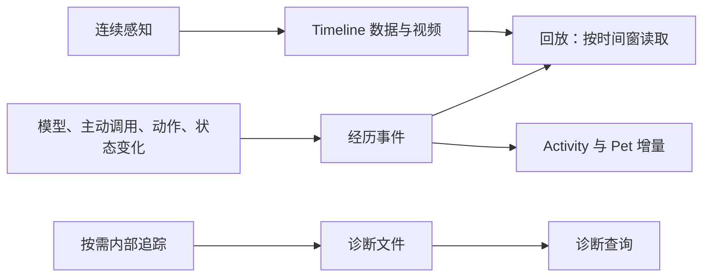

# 以经历回放为中心的记录方案

状态：待实施，2026-10-27 修订。本方案替代此前“每次采样保留两条设备事实加一条感知记录”的设计；运行代码尚未切换，现行契约见 [logging.md](logging.md)。

## 1. 先确定记录的用途

默认记录应让人和 Agent 回答：当时环境呈现了什么，Agent 实际看到了什么，采取了什么动作，发生了什么结果。排查某次截图经过哪几层 RPC、在哪一层耗时，属于按需诊断。

原则：**连续感知保存数据，主动行为保存事件，内部过程按需追踪。** 默认回放不是完整的分布式调用审计。不能为了未来可能需要的排障，给每次成功截图都保存调用树。

这次马造 run `2026-10-27T10-56-03.345Z` 的证据：

| 存储 | 已有数量 / 大小 |
| --- | --- |
| Run `events.jsonl` | 518,252 条，469,901,131 字节 |
| 其中模型请求 start/end | 各 100 条 |
| 其中 perception_sample | 27,648 条 |
| 同一 run 的 Timeline 结果记录 | 27,650 条，55,580,576 字节 |
| 对应 Timeline 定长索引 | 每条 64 字节，约 1.77 MB |

两种采样计数来自不同存储，不能直接当成严格相等。日志包含启动与收尾，覆盖约 33 分 44 秒；自动控制预算是 30 分钟。代表性的一次双屏采样生成 18 条、约 16 KB 的调用元数据：Python 根调用两条，每个设备读取七条，再加 timeline_media 与 perception_sample。Baseware 还另存设备事件。这些不是 18 件独立经历。

Timeline 的约 5,558 万字节是已经存在的结果档案，不是本方案新增的替代日志。它也有静态元数据重复，但不能因此把解决调用日志膨胀变成重写所有存储格式。

## 2. 三类记录，各自有明确边界

| 类别 | 默认保存什么 | 原有存储归属 |
| --- | --- | --- |
| 连续感知数据 | 实际录制的图像、其他媒体、text/data/space、采样时间、结果身份与能力版本 | `.rsa/timeline/` 的视频、结果记录和紧凑索引 |
| 经历事件 | 模型/工具活动、实际模型输入引用、主动能力调用、设备输入及终态、控制变化、感知启停/版本变化、故障区间 | RSA run 与 Baseware 各自的事件文件；正文复用 `.rsa/archive/` |
| 详细诊断 | 成功采样的逐层调用、单次设备读取、内部 RPC 起止及详细错误轨迹 | 显式启用时写入对应组件的诊断文件 |

统计是小型区间摘要，供监控和粗粒度分析使用，不再建立第四套原始事实。Dashboard 的索引与展示内容仍可重建，Pet 不拥有日志。

## 3. 正常采样不产生逐次通用事件

### 3.1 正常成功路径

一次正常的连续双屏采样只做原本需要的事情：读设备、执行 workspace 感知代码、将带 `@record` 的结果写入 Timeline。**这整条成功链路新增的通用调用事件为零。**

- 不写采样根函数及嵌套感知能力的逐次 Python start/end。
- 不写透明 RSA 转发的 capability start/end。
- Baseware 不为成功只读采集写 command/execution/observation 的逐次审计。
- 不另写 perception_sample、timeline_media 或每帧引用事件。
- 不把被省略的调用树搬进 Timeline 的 `deviceCalls[]`、某个隐藏文件或派生索引。

此时 Timeline 仍保存一次感知结果。这是图像、文本、结构数据等可回看的数据点，具有独立用途，不是对调用过程的重复描述。

### 3.2 策略沿调用上下文传递

使用已有 context/trace，在常驻采样入口标记连续感知用途，传给嵌套装饰器、RSA 与 Baseware。策略覆盖完整采样子树；不能只省根函数，留下每层 helper 的成功 start/end。无需 AI 新增装饰器，不按函数名、设备名、屏幕数或运行频率猜用途。

Baseware 的成功只读查询默认不建立自己的逐次经历事件。AI 主动通过 `rsa controller` 或 Python 能力发起的读取，仍由主动调用边界留下意图、参数、结果身份和耗时；连续采样内部的透明调用则不留该包装。独立 Baseware CLI 的只读结果照常完整返回，需要逐次审计时开启诊断。

已明确声明只读的能力适用此规则；未知或有副作用的能力保守地按操作处理。日志策略不修改 requiresControl 或 epoch 校验，也不能替代输入权限检查。

**任何真实设备输入、取消、释放、控制变化都不能被连续感知上下文隐去。** 即使 AI 在 sample 内按键，设备仍留下动作事实。纯观测链路才满足零成功调用事件的目标。

主动 CLI/import/能力调用保留逐次记录。普通未装饰 helper 不自动追踪。AI 自己在任意后台脚本里写的无限循环，不会仅凭频率被自动判成采样器；其主动能力调用可能仍很多，本次不增加通用后台循环框架。

### 3.3 区间统计，而不是暗存调用列表

现有调用包装仍可在内存中观察进入、退出、版本和耗时。连续感知每 5 秒落一次区间摘要，reload/正常停止时补尾段：

- 实际区间、尝试/完成/录制/失败次数、采样耗时总和及 min/max。
- 按能力 ID 与实际 codeSHA 汇总的调用、异常次数与耗时。
- 需要监控的设备读取计数、编码队列/gap 计数。

每个进程只汇总自己实际观察到的部分；Python 汇总其能力与采样，Baseware 汇总设备查询。归属仍用各自来源身份与运行上下文，不将多个来源的同一计数相加当成更多执行。数据随固定周期 flush，内存不保留逐次调用列表，不为做精确 p95 保存一整轮样本；若以后提供近似分位数需标明算法和误差。

能力统计证明“该版本在这个区间执行过多少次”，不证明某次调用造成某一帧，也不证明任务成功。代码版本变化后另计。只有真的被观察到的调用才计数，跨进程不能凭静态文件存在补 subject。

### 3.4 重复故障也是区间

连续感知首次出现故障立即保存原因、当时版本与代表性上下文；后续同类失败累计到周期摘要，保留首末时间、次数和代表样例。记录层在一个完整统计窗口未再出现同类错误后确认恢复；reload、停止也关闭该区间。成功/失败交替不会每次都写一组首次故障/恢复。它不延迟真实调用返回或运行时健康状态；故障区间内可以有成功尝试，不能展示成全程失败。

按组件、能力版本和错误类别组织，不用带时间戳的完整错误文本作无限增长的 key；样例不能冒充每次错误完全相同。

根 sample 失败决定感知健康状态。内部被捕获的异常可以进入异常计数与诊断，但不直接把整次采样或游戏判失败。主动操作失败、输入取消和释放失败逐次记录，不并入采样错误汇总。

normal 不保存每次重复异常的完整堆栈。异常退出尚未写出的统计尾段标记未知；已经保存的感知结果与动作事实仍可读取。不能补造丢失帧、成功结果或精确的尾部次数。

## 4. 感知档案保留哪些时间与来源

继续使用现有 JSONL 结果记录、64 字节索引、视频段、热窗口和历史 observe API。本次不重写 Timeline codec，不增加图片副本，也不新建视频服务。

每条实际记录继续具有：recordId/sequence、归档时刻、感知执行区间、能力/代码版本、真实返回的 text/data/space，以及媒体引用和适用的 sources。多屏只是多个媒体；音频、坐标、OCR、温度等有用数据不能为减少事件条数而删除。未标记 `@record` 的结果不因此自动永久保存。

时间含义保持分开：

| 时间 | 含义 |
| --- | --- |
| recordedAt | 感知结果的归档墙钟，作为现有回放对齐坐标 |
| sampling 的 clock/start/end | 感知函数执行的单调时间区间 |
| 视频 PTS/timeBase | 视频定位坐标；当前由归档时间推导并保证递增 |
| 设备采集时间/帧号 | 只有 driver 提供且实际保留时才可使用 |

PTS 不能冒充设备曝光时间；配置 30 Hz 不代表实际每 33.3 ms 得到一帧。不同 clock 的单调数值不能直接相减。本次不增加硬件同步要求。

normal 保留“哪一版感知能力生成了结果”和结果已有的明确来源信息。设备返回可以继续携带 timing/帧号供 AI 使用，是否将它放入感知结果由 workspace 决定；不为恢复完整诊断而自动将所有设备响应抄入每条记录。没有对应诊断档案时，不留下要求解引用的虚假 operation 事件引用。

模型实际读取某些记录时，低频地记录 recordId/sequence、所用媒体和交付身份。它引用的历史时刻与本次读取时刻分别保留；播放器不能拿最新帧替代模型当时所见。

Timeline 静态 identity、generation、视频参数存在进一步去重空间，可在未来实际成为瓶颈时提到段描述中，读取时展开。它与本次消除逐帧调用审计分开验收，避免同时改动所有历史格式。

## 5. 主动行为、动作与能力证据

模型请求、真实输入、输出、工具调用、后台程序启停、人工接管保留现有事实和正文引用。OMP 原生 session、WS/SSE 恢复与 provider 功能不改；不因本次取舍删除既有模型故障排查能力。

主动能力调用保留身份、实际 codeSHA、起止、状态与显式父关系。参数/结果只在已有可序列化的 CLI/controller/工具边界保存；Python 直接 import 延续当前调用元数据契约，不序列化任意参数、返回对象、内存模型或图像。直接 import 仍算实际使用，无需经过 controller 才能证明执行。

动作保留能重现输入意图与判断终态的内容：

- 一次 play 的完整输入时间表保存一次，包括组合键和独立持续时间。
- 提交结果、actionId、实际开始、结束/取消分别表达；不能把 RPC 返回当成动作完成。
- wait/status 的轮询不再被误算成新动作；驱动内部每次轮询输入状态也不变成事件。
- 实际高频更改输入仍是真实动作，可能有很多记录。可按原有一次时间表表示其输入，不为压日志而丢掉中间输入。

**运行时 trace 和持久化调用树是两件事。** 内存上下文继续用于控制、错误归因、benchmark observer；不要求它的每个节点都落盘。持久化事件若经过省略的父层，记录最近可查询的父引用，并保留诊断 trace 作为可选标识；没有可用父事件时明确未展开，不能把幽灵 parentSpanId 当永久 pending。

CUA 原生字段、content 顺序、错误与媒体返回不裁剪。归档时去掉可证明重复的派生文本，不改变实际 CLI/API/MCP 返回。媒体是否可恢复仍遵守记录开关、过期、编码 gap 和有损视频限制。

## 6. 诊断与 Benchmark 不绑架日常回放

一个配置：`logging.diagnostics: "normal" | "full"`，默认 normal，加载值记入 manifest。full 在原组件额外写诊断文件，保留逐次采样、内部调用和完整异常轨迹；仍不复制媒体或跨组件事件正文。第一版在启动时选择，不增加自动升级、事后追溯缓存、采样比例或按工具名过滤系统。

经历事件与 full 诊断文件分开。normal 的成功采样不能隐藏到别的组件日志或 stderr；full 只补充内部诊断，已存在的经历事件通过身份关联，不再复制一份。full 不会成为回放启动的必需输入，全量诊断在需要时有独立分页入口。

现有 Python `_context.emit` 将本地 event_sink 与日志 RPC 绑在一起，benchmark 又同时用事件收集 subject 和写文件。施工时拆开三个用途：

1. **本地执行观察**：直接收集实际目标能力、版本和 case 所需指标。
2. **日常记录策略**：选择经历事件、周期统计，或无需落盘。
3. **详细追踪**：需要逐次调用证据时显式启用并保存。

省略日志不会禁掉本地 observer，也不再为了每次 Python start/end 单独发持久化 RPC。它仍是原函数进程内的回调，不增加执行服务。

Benchmark 默认按 normal 测量真实日常开销；需要逐次采样父子关系的复用/诊断 case 显式要求 full，并在结果中记录实际采集模式。普通主动能力复用仍可用 normal 中保留的逐次证据。严格 case 在启动前检查各参与组件的有效模式：隔离 fixture 可按 full 启动，已有 normal 宿主不被自动重启或暗中升级。normal 的历史记录不能事后升级成逐次采样调用证明；采集条件不足应明确报告，不伪造通过。

报告引用同一事实来源或本次实际产生的指标，不复制整套 run/设备事件。独立离线 benchmark 保留自己的事实归属。现有跨源 seq 大小比较改为显式调用身份、来源内顺序和 action 关系；缺少关系就标记证据不足，不靠时间邻近拼接。

## 7. 有必要留的事件，也只保存一份

Baseware 保存设备输入、动作终态、控制变化及属于自己的故障；RSA 保存模型、工具、主动能力与本身生命周期。RSA 停止将订阅到的 Baseware 正文再写进 run。

复用 `origin.eventId = serviceId:seq`。请求 metadata 带不透明的 recordingId，由现有 workspace/run 身份产生，Baseware 不理解路径或模型语义。操作开始时冻结 recordingId/epoch/trace，晚到 action_end 沿用原归属。外部客户端没有 recordingId 时不猜成当前 run。

run manifest 登记 sourceId、本地来源根、recordingId 和连接/观察区间，而非逐事件引用。Baseware 文件按服务实例分段，默认一小时或 256 MiB，摘要只负责按需定位。沿用本地文件和有限来源读取，不扩展远端日志同步或通用事件总线。

范围只作读加速，最终归属核对 recordingId/operationId。同 run 多 epoch、同设备服务多个 run、Host 或 Baseware 重启不能混用 seq。无归属的服务背景只展示在已确认的观察区间；run 结束后继续补齐的只限明确属于它的晚到事实。

源文件不存在、日志写失败或异常尾部显示缺口。控制/释放通知不因日志失败被挡住，通知须说明未持久化；不重试动作、不回退复制全文来补档。正常成功写入后才发布可查询的事实身份，不承诺每条 fsync 的断电恢复能力。

单个 run 不是自包含包：完整复制应带上声明的 Baseware、timeline、archive 依赖；删除 run 不自动删除共享源。本次不做自动 GC。旧档案保留有限只读解析，不双写、不自动迁移；旧 run 没有 source 声明时不能又加读 Baseware 文件导致双计数。

## 8. 媒体登记与回放路径

首先将 `JsonArchive.registerMedia` 从 `EventLog.record` 的隐式副作用中移出。在实际媒体发布、历史解码和 OMP 输入重编码位置显式登记，先于档案编码。删除 timeline_media 事件不能破坏模型媒体解析。

必要的轻量 IPC 通知仍可服务现有状态与有界媒体身份缓存，但不持久化为逐帧事件。保留“实际被档案消费才创建持久 hash 索引”的规则，不给所有采样建小文件；媒体字节不进入日志。

Dashboard 分别读取三条路径：

- **画面与感知**：直接用现有 Timeline 段摘要、64 字节索引和视频读取时间窗；需要时展开感知数据。
- **行为轨道与 Activity**：读取经历事件的可重建投影；记录位置支持 sourceId/segment/offset/length。
- **内部诊断**：用户明确打开诊断时才加载 full 文件，分页查询。

已确定播放范围的正常回放不等待完整诊断索引。事件轨道尚在构建时可以单独显示进度，已有视频仍可播放；epoch 范围必须来自明确控制记录或其摘要，不能从当前时刻猜。缺媒体、gap 与只缺诊断是不同状态。

沿用现有临时 builder、generation 发布和缓存预算；不将 Timeline 每个样本再投影成通用事件或 Activity 行，不把多源正文拼回一份巨型 events.jsonl。分页以 generation/源截止点保证稳定，墙钟排序不是物理因果。

Pet 继续只消费 Dashboard 的 Activity 增量。采样成功、统计周期和同类故障的每次重试不弹气泡；首次重要故障与恢复可由现有展示层消费，不让 Pet 另读设备/采样文件。

## 9. 施工与验收

### 施工顺序

| 阶段 | 工作 | 可检查的结果 |
| --- | --- | --- |
| A. 记录策略与边界 | normal/full、持续采样 context、本地 observer 与落盘分离、媒体登记解耦 | normal 不破坏实际返回、媒体解析、版本采集；不靠写事件触发业务副作用 |
| B. 源头减量 | 整个采样子树与成功只读查询不逐次落盘；周期统计、故障区间；主动输入例外 | 成功连续采样零通用事件，无隐藏副本；失败不会按 Hz 刷屏 |
| C. 唯一来源与消费者 | 来源归属/分段、先接读取再停止转存；benchmark、分析器、回放、Pet 同步 | 晚到与多 run 正确，全量已保存事实可查；采样省略不形成 pending |
| D. 实档验证 | 只读大日志转换、真实代码离线采样、性能及 UI 检查 | 收益来自减少实际生产与索引，而非丢掉感知结果或把文件搬家 |

每阶段独立验证和提交，产品不保留新旧双写。同步 logging/workspace/benchmark/architecture 文档；不改 AI 的程序、经验、OMP 本体或在线游戏现场。加载真实 Host 与实跑按当时授权进行。

### 先验收增长规律

用同样的离线设备 fixture、固定时长和相同主动行为，分别运行 1/10/30 Hz，再增加一层嵌套装饰器：

- normal 的成功采样通用事件数始终为 **0**，在所有组件事件/诊断/stderr 中检查，不只统计 run 文件。
- 感知数据量可以随真实样本数增长；经历事件数主要随主动行为、状态变化和固定统计区间增长，不乘以采样率、设备数或 helper 层数。
- 能力计数随真实调用增加；周期摘要条目按能力版本聚合，不能藏逐次调用数组。主动 import 仍有逐次证据。
- 连续同类失败及成功/失败交替，都只产生故障区间与周期统计，不每帧写完整堆栈或恢复事件；真实健康状态仍及时更新。主动操作失败与输入释放仍逐次可查。
- 采样里真实按键必须有动作事件；异步提交、组合键、wait 取消和人工交还终态不被策略吞掉。
- 对同一确定性输入 fixture，normal/full 的调用返回、感知内容和引用语义一致，不要求时间戳逐字节相同。日志模式不改变采样配置与控制流程；实际频率与模型得到的实时画面可能受开销影响，分别测量，不声称名义 Hz 相同就有相同帧数。

### 再验收证据与产品

- normal 能定位每个已保存感知结果、模型实际输入、动作时间表和终态，保留主动调用的逐次复用证据；对省略的采样调用树明确显示未采集。完整采样链路与采样内部的逐次复用证据在 full 下验证。
- Benchmark 本地 subject 收集不依赖日志 RPC；严格 case 的采集模式明确；无父 trace、缺来源或缺终态不得误判成功。
- 多 run/客户端、晚到事件、重启、缺源与半行，均不能误归属、双计或永久 pending；正常回放不需要 full 文件。
- 回放验证播放、拖动、跨段、暂停/继续和历史 observe；可展示非视频数据。PTS、归档时间与设备时间的名称及含义正确。
- 冷构建和查询期间 Pet 仍跟随当前 run 增量，没有历史采样气泡洪泛或积压。

### 大日志与性能报告

原始 518,252 条日志只读，流式生成维护目录中的临时投影，不改原件。沿用原有 Timeline 与视频，不把 27,650 条结果档案当作新日志复制。旧日志无法可靠恢复的用途/归属明确标为未知，不用转换器伪造新生产者已运行过。

报告分别列出 run 经历事件、Baseware 事件、full 诊断、周期摘要、Timeline 元数据与索引、媒体、共享正文及 Dashboard 派生目录的总量。只看 run 变小不算验收成功；实际磁盘块占用与逻辑字节分开。

主要验收标准是上述零逐次成功事件和增长规律，不再用“18 压成 3”或预设压缩比例代替架构正确性。对当前样本量化到底减少多少，不先承诺百分比或剩余条数。

构建性能与已测约 30 秒基线保持相同数据范围和缓存预算比较；连续三次检查构建进程退出、缓存回落和历史查询。统计 Next/worker/builder 及生产者相关内存，不能靠收紧 heap 得出优化结论。完整诊断的额外成本单独报告。

离线转换只能验证表示与读取；真实代码的连续采样 fixture 才能验证日志 RPC、计数、错误和落盘是否减少。真实设备的流畅度、实际 Hz 与长时内存仍需后续授权实跑，不从文件减少直接推断。

## 10. 有意接受的取舍

normal 可以回看经历、查具体感知结果、查看动作与模型活动，也能知道哪些版本的能力在持续运行。它不能回答任意成功帧经过每层函数/RPC 的完整细节，不能从区间统计证明某次嵌套调用造成某帧；这些信息仅在明确需要时采集。

本次保留成熟的文件化存储与历史接口，不把回放变成新的执行引擎或全量审计平台。后续感知档案本身若成为主要开销，再优化其静态元数据或编码，仍以实际有用的数据为边界。
