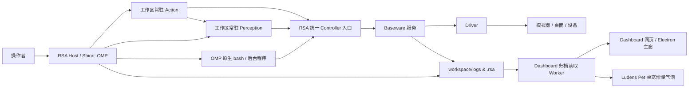

# 架构与边界

Ludens（RSA，Recursive Self-Adaptation）将设备驱动、Agent 执行运行时与工作区自适应代码解耦：Baseware 负责硬件与模拟器接口，Shiori（基于 OMP）负责控制周期与会话调度，而具体的感知建模、动作组合与经验沉淀则完全由工作区代码（Workspace）定义与演进。

## 组件与进程

| 组件 | 进程形态与核心职责 |
| --- | --- |
| `baseware/` | **独立设备服务**：加载内置或外部 Driver，提供统一 Controller 能力目录、控制权租约（`epoch`）仲裁、输入取消与设备事实日志，对外暴露 CLI、TS/Python API 与 MCP 接口。 |
| `rsa/` | **自适应 Harness**：管理工作区配置与生命周期、能力发现与路由、常驻感知（`perception.py`）与常驻动作（`action.py`）Python 子进程、Harbor 评测以及运行日志归档。 |
| **Shiori** | **唯一执行内核（职责名）**：由 RSA Host Runtime 实现，统一管控控制周期、时间/请求预算、信号取消与退出清理。Agent 模式挂载 **OMP 18.9.1**；普通评测程序、Verifier 与 Metric 共用同一生命周期而不启动模型。 |
| `rsa-dashboard/` | **本地控制台服务**：通过独立 Node Worker 构建与查询日志索引，提供实时活动流、时空轴视频回放、运行统计、文档浏览、能力目录与人工交还入口。 |
| `rsa-companion/` | **可选桌面伴侣（Ludens Pet）**：Electron 桌面壳，主窗口复用同一 Dashboard 视图，原生透明桌宠窗口与音频引擎增量消费同一套活动日志。 |



各组件拥有独立的 `package.json` / `pyproject.toml` 与锁文件。RSA Harness 仅依赖 Baseware 的客户端与类型契约，不直接导入任何具体 Driver 实现；`rsa up` 按工作区配置与驱动 Manifest 编排本机进程。

## 设备与统一能力

1. **统一 Controller 抽象**：Driver 对外暴露的所有能力统称为 **Controller**（包括执行输入的控制器与采集画面/状态的传感器）。每项能力遵循 CUA 原生工具结构：`name`、`description`、`inputSchema`、可选 `outputSchema` / `annotations` 以及 MCP `CallToolResult` 返回值。设计依据见 [Baseware 设计理念与能力契约](baseware.md)，类型定义见 [baseware/src/contracts.ts](../../baseware/src/contracts.ts) 与 [baseware/src/catalog.ts](../../baseware/src/catalog.ts)。
2. **双命名空间聚合与按需发现**：RSA 将设备能力（`controller/<id>`）与工作区 Python 装饰器能力（`python/<path>:<fn>`）合并至 `rsa controller` 目录。为避免撑爆模型上下文，所有设备能力与 MCP 工具**均不默认注入 OMP 的模型工具列表**，而是由 Agent 通过 `baseware.json`、`rsa controller` 或 `rsa_tools.Client` 按需发现与调用。
3. **纯粹的硬件边界**：Driver 仅忠实映射硬件接口（如双屏独立截图 `screen.top.capture` / `screen.bottom.capture`、原生触屏坐标 `touch.down / move / up`），跨屏图像拼接、坐标转换与游戏策略一律留在工作区代码中实现。

## 控制权与生命周期

### 1. 控制租约（`epoch`）与权限校验

- 每次执行 `rsa auto on` 会开启一个新的控制周期，生成唯一 **`epoch`** 并重置本轮秒数（`seconds`）与模型请求数（`requests`）预算。
- RSA Host 通过持久连接向 Baseware 持有该 `epoch`，并将 `BASEWARE_EPOCH` 注入工作区进程环境。
- 查询能力目录与 `--help` 无需控制权；具体能力是否要求控制权由其 `requiresControl` 属性声明（部分只读状态查询同样要求有效 `epoch`）。通过 CLI 调用工作区 `python/...` 能力同样要求处于活跃控制周期。
- 当发生人工交还（`rsa auto off`）、预算耗尽、宿主断线或设备断开时，Baseware 立即废止旧 `epoch`、中断在途动作并执行设备释放（清零按键与触点），清理完毕后回到 `manual` 状态。

### 2. 手柄异步时间表（`pad.play`）

模拟器手柄统一采用相对时间表指令 `pad.play`，参数 `inputs` 为 `{atMs, durationMs, state}` 数组：

```sh
rsa controller controller/pad.play --args '{"inputs":[{"atMs":0,"durationMs":500,"state":{"LEFT":1}},{"atMs":0,"durationMs":300,"state":{"B":1}}]}'
```

- **通道合成规则**：不同按键/摇杆通道的时间段允许自由重叠；同一通道的时间段禁止重叠。相邻时间段在边界直接切换合成状态，整张时间表结束时自动归位中立状态。
- **异步生命周期**：`pad.play` 默认提交后立即返回 `actionId`（动作归当前控制 `epoch` 所有，短连接 CLI 退出不会中断已提交动作）；传入 `"wait": true` 或调用 `pad.wait / status / cancel`（传 `{"actionId": "<id>"}`）可等待、查询或取消该动作。同一设备同时只执行一张时间表，并发提交新时间表会返回 `BUSY`。
- **硬件时钟语义**：时间参数单位为毫秒；Azahar（3DS）与 Ryubing（Switch）按输入轮询时的单调墙钟推进（最小跨度 16ms），mGBA（GBA）按模拟帧率向上取整换算为帧数。

### 3. 常驻动作进程与输入重置

工作区 `action.py` 的常驻动作 worker 固定绑定启动时的 `epoch` 与 `inputGeneration`。当在 `auto` 周期内执行 `rsa action stop`、`rsa action reload` 或 `Action.step()` 抛出异常时，系统通过 Baseware 立即取消并释放本工作区的全部当前输入（包含并发 CLI 输入），递进 `inputGeneration` 拒绝旧实例残余调用，同时保留当前 `epoch`、剩余预算与 OMP 会话。详见 [rsa/src/harness/runtime.ts](../../rsa/src/harness/runtime.ts)。

## 会话与 Loop

### 1. OMP 超集装配与外层续轮

RSA Host 在单工作区内复用同一个 OMP 会话（持久化于 `.rsa/shiori/sessions/`），并在 `Settings.isolated()` 基础上采用**最小覆盖原则（Superset Shell）**：

- 保留 OMP 原生系统提示词（若工作区存在 `AGENTS.md`，通过原生 `contextFiles` 注入）。
- 显式启用 OMP 原生工具 `read`、`write`、`edit`、`bash`、`wait`，并注册自定义工具 `observe`。
- 仅覆盖宿主契约必需项：关闭 `retry.modelFallback`（保证所选视觉模型粘性）、关闭 `title.refreshOnReplan` 与 `cacheWarming`（确保每次模型请求严格归属控制周期）、将 `PROVIDER_IMAGE_BUDGETS` 设为 `Infinity`（在压缩前保留历史图像，避免中途丢图破坏 Prompt Cache 前缀），以及应用可选的 `compactionThreshold`。详见 [rsa/src/harness/omp/session.ts](../../rsa/src/harness/omp/session.ts)。

在 `auto` 控制周期内，外层循环按以下步骤运转：

1. **发起轮次**：使用 [continue.md](../../rsa/prompts/continue.md) 发起 OMP `prompt`（首次接管若带 `auto on --message` 则附加一次性提醒）。
2. **感知与动作并行运转**：模型推理期间环境持续运行——常驻 `Perception.sample()` 按 `sample_hz` 持续采样写入 `.rsa/timeline/`，常驻 `Action.step()` 按 `step_hz` 持续读取时空轴并执行高频控制。
3. **自动上下文交付**：RSA 扩展挂载 OMP 的 `before_agent_start` 与 `tool_result` 钩子（见 [extension.ts](../../rsa/src/harness/omp/extension.ts)）。当自动注入开启（默认 `inject on`）时，自动追加尚未交付的最新主通道感知记录以及采样器状态变迁（`state / codeSHA / error`）；若同批工具已执行显式 `observe`，则跳过重复附加。
4. **续轮或交还**：单次 `prompt` 结束且预算未耗尽时自动发起下一轮；一旦人工交还或预算耗尽，`addBeforeModelCall` 门禁立即阻断新模型请求，释放设备控制权。

### 2. 上下文压缩与传输恢复

- **后台预测压缩**：复用 OMP 原生两段式压缩，触发阈值默认跟随模型目录（可通过 `rsa.json` 或 `--compaction-threshold` 覆盖）。针对 30Hz 实时控制循环的补丁改造见 [OMP 后台压缩改造](../insights/omp-compaction.md)。
- **WebSocket 增量传输与恢复**：OpenAI Codex 默认使用 WebSocket `auto` 模式，断连分类、冷却退避与未完成工具调用的 SSE 恢复策略见 [WS 恢复测试依据](../insights/ws-recovery.md)。

## 可核查的运行事实

- **多源事实解耦**：Baseware 独立持久化设备控制与执行事实（`logs/baseware/`），RSA 记录模型调用、工具执行、能力调用与感知交付（`logs/<run-id>/`），Shiori 挂载局部 OpenTelemetry provider 记录 `agentLoop` 遥测。
- **Dashboard 隔离读取**：Dashboard 将归档解析与索引维护放在独立的 Node Worker 线程中，冷历史目录由限流为全局单实例的临时 Builder 子进程构建并原子发布至 `.dashboard-index/`；Next.js 路由与 Ludens Pet 仅通过有界 RPC 读取投影结果。详见 [日志与调用链](logging.md#消费与指标解释)。

## TypeScript 与 Python

RSA 由 TypeScript 宿主（`rsa/src/`）与 Python 工具包（`rsa/python/rsa_tools/`）共同组成：

- **TypeScript 侧**：负责 Shiori 运行时、控制权租约、OMP 会话扩展、跨进程 RPC 与 CLI / Benchmark 编排。
- **Python 侧**：负责 `@capability` 静态发现与动态执行、常驻 `Perception` / `Action` 循环、PyAV 视频段编码、冷帧按需解码以及 `current_trial()` 评测证据登记。视频编解码直接在常驻感知进程内按需完成，不额外引入独立的流媒体服务。

## 能力持久化边界

工作区内的四类状态存储各司其职，互不冗余复制：

| 存储位置 | 归属与内容 |
| --- | --- |
| `.rsa/timeline/` | **能力观测与媒体唯一原件**：由常驻感知进程单一写入者维护，存放 `@record` 记录元数据、分段 fMP4 视频（`video/`，默认 5 分钟一段、空闲 10 秒收尾）与 SHA-256 去重非视频媒体（`objects/`）。 |
| `.rsa/archive/` | **模型与工具结构化文本归档**：跨请求、跨 run 按内容哈希去重存储 `objects/<sha256>.json.gz` 与流式载荷，内含媒体一律通过引用指向 `.rsa/timeline/`。 |
| `logs/<run-id>/` | **单次运行事件流**：存放 `manifest.json`、`events.jsonl`、`streams/` 与 Benchmark `trial.json` / `verifier/`，通过 `eventSources` 与内容引用关联 Baseware、Archive 与 Timeline。 |
| `.rsa/shiori/` | **OMP 原生会话存储**：存放 `sessions/*.jsonl` 与当前续接指针，由 OMP SessionManager 管理。 |

## 统一时空轴与回放

感知采样、常驻动作、模型推理与设备执行共享工作区的绝对墙钟时间坐标，并通过 `recordId`、事件序号、`modelCallId`、`toolCallId`、`actionId` 及 `trace` 树精确关联。Dashboard 回放器在同一时间游标下同步渲染 `.rsa/timeline/` 中的全量连续采样画面（包含未被模型采纳的中间帧）、动作时间跨度与模型调用详情；历史回放纯属只读投影，不会触发设备操作或改变 Ludens Pet 的实时跟随目标。
