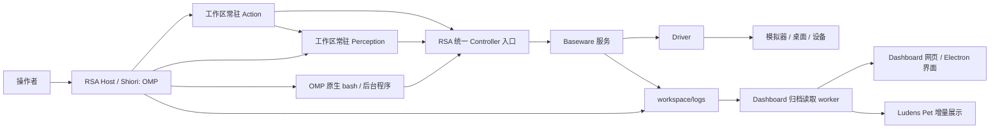

# 架构与边界

RSA（Recursive Self-Adaptation）让 Coding Agent 在 workspace 中探索设备、编写程序并验证能力。Baseware 提供设备接口，感知、操作和学习由工作区代码决定。

## 组件与进程

| 组件 | 职责 |
| --- | --- |
| `baseware/` | 独立设备服务：装配 driver，提供能力目录、控制权、取消、媒体和设备日志；外放 CLI、TS/Python API 与 MCP。 |
| `rsa/` | Harness：工作区、接管预算、统一能力入口、感知与动作进程、Benchmark，以及 Shiori 的装配与日志。 |
| Shiori | 唯一执行内核的职责名：RSA Host Runtime 统一控制周期、预算、取消与清理。Agent 模式由 OMP 实现；普通程序、verifier 和 metric 使用同一 Runtime，不启动模型。 |
| `rsa-dashboard/` | 归档读取 worker、HTTP API 与统一的运行、回放、Benchmark、Ludens Pet 界面，读取运行事实并提供人工交还入口。 |
| `rsa-companion/` | Electron 壳与原生 Ludens Pet，复用同一 Dashboard 界面和日志来源。 |



Python 组合在自己的进程内完成，设备调用才进入 RSA/Baseware；执行方式见 [workspace](../tutorials/workspace.md)。

各组件独立安装并使用自己的锁文件。RSA Harness 只依赖 Baseware 的客户端和契约，不导入具体 driver；`rsa up` 负责按配置装配本机进程。

## 设备与统一能力

Driver 暴露 **Controller**：既可操作设备，也可返回信息或媒体；传感器属于 Controller。能力采用 CUA 原生工具约定：名称、JSON Schema、注解与原生结果；Baseware 另记录控制要求、执行状态、时序和媒体。设计理由见 [Baseware](baseware.md)。以 [设备契约](../../../baseware/src/contracts.ts) 和 [导出 schema](../../../baseware/src/catalog.ts) 为准。

Baseware 的 CLI/API/MCP 调用同一服务。RSA 把设备能力与工作区 `@capability` 合入 `rsa controller`，按需查询；它们及 MCP 不默认注入 OMP 工具列表。

Driver 只解释设备接口：触屏提供原生坐标的 down/move/up，双屏返回独立图像。组合、融合和游戏策略留在 workspace。Cua driver 连接原装 Cua Driver 提供电脑能力，模拟器 driver 不混入桌面操作。

## 控制权与生命周期

每次 `rsa auto on` 产生一个 **epoch** 并重置本轮时间与请求预算。RSA 用持久连接向 Baseware 取得有期限的操作权，工作区调用携带同一 epoch。查询目录、help 不需要接管；每项能力独立声明 requiresControl，部分只读状态查询也要求有效 epoch。通过 CLI 启动的 Python 能力也需要当前接管周期。

Baseware 负责唯一拥有者、旧 epoch 拒绝、动作取消和设备释放。拥有者断线、预算到期、设备断连或人工撤销都会结束操作权。普通短连接关闭只取消自身在途请求或等待，不取消已经提交的手柄动作；动作归控制 epoch 持有。动作时长由调用方决定，不设统一两秒上限。

手柄统一使用 `play`，输入为相对时间表，每项 `{atMs, durationMs, state}` 只影响声明的通道。不同通道可重叠，同一通道的时间段不能重叠；相邻时间段在边界直接更新合成状态，整段结束回到中立。例：

```sh
rsa controller controller/pad.play --args '{"inputs":[{"atMs":0,"durationMs":500,"state":{"LEFT":1}},{"atMs":0,"durationMs":300,"state":{"B":1}}]}'
```

`--args` 或 `--file /absolute/path/action.json` 接收完整参数对象。默认提交后返回动作 ID 和状态；参数中加 `"wait": true` 等到终态，或之后调用 `pad.wait/status/cancel` 并传 `{"actionId":"<id>"}`。取消等待不取消动作，显式取消、`release` 或交还控制权才释放输入。一次设备只执行一张时间表，新提交遇到已有动作会返回 `BUSY`；不隐式合并或覆盖。

时间单位为毫秒，具体采样语义由 driver 声明：3DS/Switch 按输入轮询时的单调墙钟推进，mGBA 按模拟帧取整。提交完成不代表游戏已处理所有输入；动作终态、实际耗时和采样数见设备日志。

人工交还同时停止 RSA 的自动循环、取消其管理的在途能力调用，并阻止新的模型请求。设备释放不等待模型推理结束；driver 完成清理后才报告 manual，已经进入底层的调用可能先收尾。OMP 原生 shell、后台任务和命名服务遵循上游生命周期；进程即使仍存活，旧 epoch 也不能再控制设备。详见 [Runtime](../../rsa/src/harness/runtime.ts)。

动作 worker 固定绑定 epoch 和 inputGeneration。动作 stop/reload/故障通过 Baseware 重置本 workspace 的全部当前输入（包括并发 CLI），不重置 epoch、预算或 OMP 会话；旧 generation 被拒绝，释放失败则交还控制。manual 不运行动作 worker，下一次接管新建实例；动作重载不重启感知。

工作区隔离文件、会话和服务地址，不是 OS 沙箱；多个工作区可能共享真实桌面。

## 会话与 Loop

同一 Host 复用 OMP 会话，重启默认恢复本 workspace 的当前会话；新 workspace 有独立索引，见 [workspace](../tutorials/workspace.md)。

当前使用 **OMP 原生系统提示词**。可选的 workspace 根 `AGENTS.md` 通过原生 `contextFiles` 加载；没有独立 `explore.md` 或自定义系统提示词替换。RSA 显式启用 OMP 的 `read/write/edit/bash/wait`，额外提供 `observe`。命令、后台任务、命名服务和 `proc://` 都复用 OMP。

外层续轮仍由 RSA 控制：

1. 在控制周期内用 [continue.md](../../rsa/prompts/continue.md) 发起 OMP prompt；`auto on --message` 的补充消息只用于首次。
2. 工作区感知进程持续调用 `sample()`，把能力结果写入 workspace 时空轴。查询只选择已有记录；模型交付独立决定哪些内容需要追加到会话。插件在 prompt 开始及整批工具结束时使用同一交付策略：自动观察只追加新记录，技能、记忆和控制信息只追加变化。显式 `observe` 始终完整响应指定记录、时刻或范围，同批已交付的观察不再自动追加。`rsa perception inject off/on` 单独控制自动读取与附加，不改变采样、留档、录像及显式查询。
3. OMP 执行自己的推理与工具循环；一次 prompt 结束后，RSA 在预算内继续下一次。

独立的 `action.py:Action` 进程在 auto 期间按 `step_hz`（默认 30 Hz）调用 `step()`，可读取感知历史、执行设备输入并保留跨轮状态。两个进程共用 `@capability` 和可选 `@record`，调度入口分别是 `Perception.sample()` 与 `Action.step()`；不把每个能力都变成调度任务。感知入口要求记录，动作入口可只执行。工作区实现策略，Harness 提供生命周期与输入收尾。

环境在模型思考时继续运行。工作区可改感知和控制程序，不能改外层调度；见 [OMP 装配](../../rsa/src/harness/omp/session.ts) 与 [扩展](../../rsa/src/harness/omp/extension.ts)。装配是 OMP 的超集壳：只覆盖 host 自有契约（`retry.modelFallback` 关闭保持所选模型粘性、`title`/`cacheWarming` 关闭保证请求可归属控制周期、显式传入的压缩阈值），与 OMP 默认相同的键一律不设，模型行为参数跟随 OMP 与模型目录。

装配使用 `Settings.isolated()` 的内存默认值，不读取用户全局或 workspace 的 OMP 设置文件。原生重试保持启用，继续受请求预算与控制周期取消约束。新会话的思考等级按模型目录与 OMP 默认值选择；恢复已有会话时，OMP 优先沿用会话中保存的思考等级，不自动覆盖为新模型默认值。

压缩复用 OMP，触发阈值默认跟随所选模型的原生 OMP 设置（context window − reserve），可经 `rsa.json`/`--compaction-threshold` 显式覆盖，图片数量预算 Infinity，入历史时按 OMP 压图；后台压缩的行为改动与验收见 [OMP 后台压缩改造](../insights/omp-compaction.md)。Codex 使用 WebSocket auto；见 [WS 测试依据](../insights/ws-recovery.md)。

交付使用 OMP 的 `before_agent_start` 和 `tool_result` 持久化入口，共用查询、内容格式和批次收据；`context` 只检查请求与原生后台结果，不在此改写历史或补图。普通续轮保留交付游标，恢复会话的新 Host 和成功压缩等上下文替换后重新交付必要信息。去重按时空轴记录身份，不按像素相同判断时间证据；显式重读不被自动去重吞掉。已有消息保持原样随会话前缀复用，直到 OMP 原生压缩。

## 可核查的运行事实

Baseware 记录设备事实，RSA 保存模型、工具、能力和感知记录，Shiori 的 Agent 模式接入 OMP 原生 telemetry。Dashboard 与 Pet 消费日志，不另起推理循环。来源与调用链见 [日志契约](logging.md)，评测见 [Benchmark](benchmark.md)。调用成功、文件增长或帧数增加不等于任务成功。

Dashboard 将归档读取放在独立的 Node worker 线程中，Next 路由负责请求和响应。worker 共享一份可重建目录：原始事件位置、身份关系、展示所需的位置与截止点，以及小型统计；正文仍从原始 events、streams、archive 按需读取。Activity、运行概览和回放共用这个目录，Pet 只消费 Activity 增量。冷目录由查询 worker 按需启动一个临时子进程，固定输入截止、顺序聚合并批量写入新 generation；完成后原子发布，子进程退出释放工作集。全局只同时构建一个 run，查询仍使用已有可读目录。HTTP 取消只结束读取，构建独立继续；显式取消/失败保留状态，用户重试才重新开始。默认产品入口使用生产构建，开发热更新与归档消费分开。细节见 [日志消费](logging.md#消费与指标解释)。

## TypeScript 与 Python

RSA 的 `src/` 与 `python/` 都是正式组件。TypeScript 管理 Shiori、控制权、跨进程协议和产品接口；Python 包 `rsa_tools` 管理常驻感知与动作、时空轴媒体写入与按需解码。Python 使用独立的 pyproject/锁文件、可安装包和测试/类型检查，统一检查入口见 [开发指南](../tutorials/development.md)。workspace 中 AI 编写的 Python 与框架代码分别维护；能力函数执行工作并按需标记 `@record`，框架负责视频编码与文件生命周期。

PyAV 在现有常驻 worker 内按需加载，编码线程和队列受限，不新增录像服务。TS 和 Dashboard 通过同一时空轴引用消费媒体，历史解码可离线执行，不依赖活着的采样进程。

## 能力持久化边界

workspace 的 `.rsa/timeline/` 是显式记录能力结果的唯一原件归属。`@capability` 统一声明感知和动作能力，`@record` 将结果写入时空轴；已有感知进程负责单写入者与连续采样，用户函数仍在调用方 Python 进程执行。Baseware 返回原生数据，只使用调用临时文件；RSA run 记录引用，Dashboard 解析引用和可重建索引。RSA 额外保存的模型、工具与传输正文通过 `.rsa/archive/` 共享，媒体引用时空轴；OMP 自身的原生 session/blob 继续由上游管理。契约与生命周期见 [Workspace](../tutorials/workspace.md#能力留档与-workspace-时空轴)。

## 统一时空轴与回放

感知记录、动作、模型调用和日志共享 workspace 的绝对时间坐标。原始内容仍留在各自存储，通过 recordId、事件序号、模型/工具/动作 ID 和 trace 关联。Dashboard 按需投影为时间点或区间；对齐采用现有时间戳，不额外做硬件同步。

回放读取感知层实际留档的连续采样，包括未被模型读取的帧。模型输入详情按明确引用追到当时交付的观测。播放器在同一游标下展示画面、动作、模型调用与日志，复用已有文件索引和媒体原件；播放历史不执行操作、不启动采样，也不修改 Ludens Pet 关注目标。
