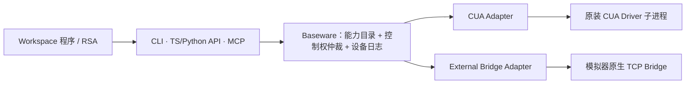

# Baseware 设计理念与能力契约

Baseware 是 Ludens 的独立设备驱动服务：负责连接模拟器或桌面后端、发布统一的能力目录、仲裁设备控制权（`epoch`）、执行输入与采集，并将每一次调用与设备事实持久化为可核查的日志。至于如何感知画面、组合动作、沉淀技能或评判任务成败，则完全交由上层 Workspace 代码与 RSA 决定。

## 共用约定，保留设备语义

Baseware 以 CUA Driver 的原生工具契约为结构蓝本，在仓库内独立维护协议定义（见 [tool-contract.ts](../../baseware/src/tool-contract.ts) 与 [contracts.ts](../../baseware/src/contracts.ts)）：

- **结构统一**：每项能力（`Controller`）均由 `name`、`description`、`inputSchema` 以及可选的 `outputSchema`、`annotations`、`_meta` 描述；调用入参统一为 JSON 对象，原生返回体统一遵循 MCP `CallToolResult`（含 `content`、`structuredContent`、`isError`）。
- **语义保真**：统一调用信封并不抹平硬件差异。CUA 桌面工具保留上游原名与参数结构；模拟器则声明各自的硬件能力——手柄时间表为 `pad.play`，触屏为 `touch.down / move / up`，双屏设备为 `screen.top.capture` 与 `screen.bottom.capture`。电脑鼠标不会伪装成模拟器触屏，模拟器按键也不会伪装成桌面键盘；所有坐标边界、按键枚举与时间单位均可从实时能力目录中直接查得。



## 三个边界

| 层级 | 核心职责 | 明确不做的事 |
| --- | --- | --- |
| **Driver** | 解析具体设备协议（TCP Bridge 或 stdio），声明真实可用能力，执行并释放底层输入，产出原始媒体字节与源序号。 | 不跨设备拼装杂糅能力，不解释游戏内存或任务状态。 |
| **Baseware** | 聚合发布能力目录，按 JSON Schema 校验参数，管理 `epoch` 控制租约，关联调用与设备事件，通过 CLI / API / MCP 暴露一致入口。 | 不替工作区建立永久截图档案，不内置重试策略或 Agent Loop。 |
| **Workspace / RSA** | 发现并组合能力，维护 `.rsa/timeline/` 感知历史，运行常驻感知/动作模型与 OMP 会话。 | 不绕过 Baseware 直接写模拟器控制状态。 |

## 调用与结果

能力目录由当前连接的 Driver 动态生成。执行 `baseware export`（或启动 RSA Host）会将实时目录导出为工作区的 `baseware.json` 快照（契约见 [catalog.ts](../../baseware/src/catalog.ts)）。

### 1. 三类调用入口

CLI、TS/Python API 与 MCP 接收完全一致的 JSON 参数对象（CLI 支持 `--args '<JSON>'` 或 `--file <path.json>`）：

```sh
# Baseware CLI 直接调用
baseware controller pad.play --args '{"inputs":[{"atMs":0,"durationMs":500,"state":{"LEFT":1}}],"wait":false}'

# 经 RSA 统一入口调用（带 controller/ 命名空间前缀）
rsa controller controller/pad.status --args '{"actionId":"<returned-id>"}'
```

```python
from baseware import Client

res = Client().controller("screen.top.capture", {})
# res["result"] 为原生 CallToolResult（含内联 base64 媒体内容）；
# res["observations"][0]["contentIndex"] 指向对应内容块在 result["content"] 中的索引。
```

### 2. 返回信封（`ExecutionResult`）

TS/Python API 与 CLI 统一返回完整的 `ExecutionResult` 信封，而 MCP 接口则直接返回信封内的原生 `result`：

| 字段 | 类型与含义 |
| --- | --- |
| `id` | 本次设备调用的唯一执行 ID。 |
| `status` / `exitCode` | `"completed"`（`0`）、`"interrupted"`（`130`）或 `"failed"`（非零）。 |
| `actionId` | 当操作关联异步手柄动作（如 `pad.play / wait / status / cancel`）时，标识该动作实例。 |
| `readOnly` | 标识该次调用是否为不改变设备输入的只读查询。 |
| `timing` | `{clock, requestedAtMs, receivedAtMs}`，基于当前 Baseware 进程单调时钟。 |
| `observations` | 媒体观测元数据列表（含 `id`、`controllerId`、`mediaType`、`contentIndex`、`timing` 及可选 `sourceSequence`）。 |
| `result` | 原生 `ToolResult`（含完整媒体字节 `data`/`blob`、`structuredContent` 与 `isError`）。 |
| `stdout` / `stderr` | 供终端阅读的简短文本摘要。 |

## 控制权独立于能力描述

- **`requiresControl` 与 `readOnlyHint` 正交**：`requiresControl` 是 Baseware 的执行门禁，而非工具 schema 的业务参数。一项能力可以既是只读查询（`readOnlyHint: true`，例如读取当前手柄合成状态 `pad.state`），同时又要求调用方持有有效控制 `epoch`（`requiresControl: true`）。未显式声明只读的 CUA 工具默认要求控制权。
- **租约持有与释放保护**：控制权由 RSA Host 的持久连接申请并持有，单次 CLI / API / MCP 调用仅通过环境变量 `BASEWARE_EPOCH` 继承租约，绝不会因调用工具而自动夺取控制权。当租约到期、人工执行 `revoke` / `auto off` 或持有者断线时，Baseware 立即触发 Driver `release()`，包括仍在获取控制权的 Controller。获取和清理都有超时；若获取超时或清理失败，撤权后虽回到 `manual`，但会保持 `connected: false` 并拒绝后续接管。迟到的获取仅触发原 `epoch` 的补偿释放，不会恢复自动控制。
- **连接级幂等**：同一 Driver 下的多项 Controller 共享同一设备连接，`acquire(epoch)` 与 `release(epoch)` 在 Driver 层保持幂等，不会因能力拆分为多个工具而重复握手。

## 媒体、时间与日志

### 1. 临时采集与归档省略

- **不建冗余截图库**：模拟器截图时，Bridge 仅将 PNG 写入临时文件供 Provider 读取字节并封装进返回值的 `result.content`，读取完成后立即删除临时文件；能力结果是否永久留档完全由工作区代码的 `@record` 与 `.rsa/timeline/` 决定。
- **日志载荷脱敏瘦身**：写入 Baseware 设备日志的 `execution.result` 会自动剥离二进制 `data` / `blob` 字节，仅保留 `mediaType`、`contentIndex`、字节大小以及已有的 `timeline` 或文件引用（未留档则标记 `dataOmitted: true` / `blobOmitted: true`）。

### 2. 记录模式与连续采样统计

Baseware 启动时通过 `--diagnostics normal|full`（默认 `normal`）设定日志详细度：

- **`normal` 模式**：完整记录所有含副作用的设备输入、动作起止（`action_start / action_end`）、控制权变更、主动失败以及首次采样故障；对明确声明只读的成功查询及带有 `trace.recordingPurpose = "continuous-perception"` 的常驻采样调用链，省略逐次 `command / execution` 明细，改为每 **5 秒**输出一条 `device_sampling_stats` 汇总（按 Controller 与 `recordingId / epoch` 统计次数、失败数与耗时）。
- **`full` 模式**：在独立的 `diagnostics/` 分段中额外保留每一次只读查询与连续采样的完整调用记录。
- **故障区间合并**：连续采样首次出错时立即写入 `device_sampling_error`，后续同类错误累加计数；待观察到采样恢复成功且历经至少一个完整 5 秒统计周期无同类错误（或服务正常停止）时，闭合该故障区间。

### 3. 独立事实源（`eventSources`）

每个 Baseware 服务实例在 `--data-dir`（工作区下默认为 `logs/baseware/`）独立维护 `source.json`、`events/` 与 `diagnostics/`（默认按 1 小时或 256 MiB 切段），每条事件以 `origin.eventId = "<serviceId>:<seq>"` 唯一标识。RSA 运行日志不再复制 Baseware 事件正文，而是在 `manifest.json` 的 `eventSources` 中登记数据源路径、`recordingId` 与序号观察窗口，由读取端按需归并（见 [日志与调用链](logging.md#文件与事件身份)）。

## Driver 包与启动描述

Baseware 支持通过 `--driver <id> --driver-package <spec>` 加载外部驱动包；模拟器驱动只从外部包加载，当前仅 `cua` 桌面适配器保留内置注册。

### 1. 包地址与缓存机制

`<spec>` 支持三类格式：

1. **npm 包**：如 `@scope/pkg@1.2.0`，由 Bun 安装至全局 `$LUDENS_HOME/cache/drivers/`（未设置 `LUDENS_HOME` 时为 `~/.ludens/cache/drivers/`）；缓存独立于源码仓库与工作区；
2. **GitHub 仓库**：如 `github:org/repo#commit-sha`、完整 GitHub HTTPS URL 或 `git@github.com:org/repo.git#rev`。SSH 地址保留 SSH 传输；缓存按传输方式、仓库与 revision 区分。完成检出与依赖安装后按 `package.json` 的 `exports` 解析入口；
3. **本地目录或入口文件**：`file:/absolute/path` 或 `file:relative/path`；Baseware CLI 的相对路径从当前目录解析，RSA 工作区配置中的相对路径从工作区根目录解析。

为保证实验可重现，生产与评测中应固定精确的 npm 版本号或 Git commit SHA。

加载器记录实际解析的包来源，供 catalog 的 `drivers[].source`、Baseware `service_start.driverSource` 与 RSA `manifest.drivers[].source` 使用：GitHub 记录 `requestedRevision`、`transport` 与实际检出的 `resolvedCommit`；npm 记录 `packageName` 与实际安装的 `resolvedVersion`；本地 `file:` 记录入口路径与 `entrySha256`。文件哈希仅覆盖导入的入口文件，不覆盖其依赖。来源信息由加载器生成，外部包不能自行覆盖；`provider.version` 仍表示设备或协议版本，不作为包版本。

### 2. `DriverRegistration` 与 `DriverManifest` 契约

外部驱动包需导出 `DriverRegistration`（作为 `default` 导出，或命名导出 `registration` / `driver`）：

| 字段 / 方法 | 约束与职责 |
| --- | --- |
| `id` | 必填字符串，匹配 `^[A-Za-z0-9][A-Za-z0-9_-]*$`，必须与 `--driver` 参数一致。 |
| `version` / `fallbackVersion` | 可选版本字符串；运行目录依次取 Provider 握手实际版本、声明版本、内置 fallback，最后为 `"unknown"`。 |
| `transport` | `"bridge"`（默认，TCP 行协议）或 `"stdio"`（子进程标准输入输出）。 |
| `defaultPort` | 可选整数（`1..65535`）；`bridge` 驱动必须由 `rsa.json.port` 或 `defaultPort` 提供合法端口。 |
| `needsGame` | 可选布尔值，标识 Bridge 就绪前是否需要启动后端并加载游戏；可手动准备设备，或由启动器使用 `rsa.json.game` 启动。 |
| `launchHint` | 设备准备与手动启动提示文本（在 Dashboard 与 CLI 帮助中展示）。 |
| `launchCommand` / `launchEnv` | 可选后端启动命令数组（不含游戏路径，由启动器追加）与环境变量映射（`RSA_BRIDGE_PORT` 由实际端口覆盖）。 |
| `load({ port, command, clock })` | 异步工厂函数，连接设备并返回 `{ capabilities: { controllers }, onDisconnect, close }`，可另带 `version`；具体类型见 [registry.ts](../../baseware/src/drivers/registry.ts)。 |

模拟器侧 TCP 协议实现规范见 [Driver Bridge 协议](driver-bridge-protocol.md)。

## Driver 发现：验证，不背书

仓库不维护中心化的第三方驱动白名单。用户可通过以下命令检验任意驱动包的静态注册声明是否合规：

```sh
baseware driver discover --package 'github:org/repo#rev'
```

- **验证范围**：`discover` 会下载并安装依赖、导入包入口模块、校验 `DriverRegistration` 字段合法性并输出 JSON 格式的 `DriverManifest`；若字段缺失或类型非法则以非零状态码退出。
- **安全边界**：虽然发现阶段**不会调用 `load()`**，但包安装脚本与模块顶层代码仍会在本机执行。`discover`、`rsa init` 与 `rsa up --dry-run` 均不是安全沙箱，请仅加载可信来源的驱动包。

## 上游契约与升级

[baseware/contracts/cua-driver/](../../baseware/contracts/cua-driver/) 目录固定保存了上游 CUA Driver 的版本、来源哈希、许可证与工具快照。该快照用于离线审计原子能力与运行 `python3 baseware/scripts/sync-cua-contract.py --check` 回归测试，运行期不会用快照裁剪上游新增的平台工具。由于 MCP SDK 默认 schema 解析会裁剪未知嵌套字段，Baseware 在协议边界校验结构后原样保留原始字段，并通过 MCP 往返测试保障保真度。
