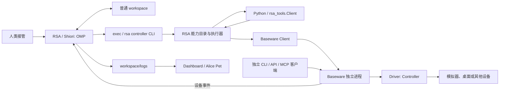

# Recursive Self-Adaptation 工程架构

当前边界：Baseware 提供环境的原始操作与观测；Shiori 是 Agent Loop 内核，负责推理、工具调度、会话与上下文，当前实现为 OMP；RSA 装配 Shiori，管理观测循环、接管预算和工作区能力。Dashboard 与 Alice Pet 消费运行日志。设备协议不进入 Harness，工作区不包含 runtime 源码。

## 组件与进程



| 组件 | 拥有的职责 | 不包含的职责 |
| --- | --- | --- |
| `baseware/` | driver 装配、设备连接、能力目录、操作权、动作取消、CLI / TS API / Python API / MCP、设备日志 | 模型、OMP、技能、工作区脚本发现 |
| `rsa/` | Shiori 装配、Agent 生命周期、观测循环、预算、统一能力 CLI/API、Python 发现与执行、工作区、Benchmark 与运行日志 | 设备私有协议、按键含义、游戏策略 |
| `rsa-dashboard/` | 日志读取、模型与动作统计、媒体展示、人工交还入口 | 模型推理与设备执行 |
| `rsa-companion/` | 消费日志，在 Alice Pet 气泡中呈现活动、画面与声音 | 策略、driver、独立模型调用 |

各组件独立安装，有自己的锁文件。`rsa` 以本地包依赖 `@playness/baseware` 的契约和客户端，生产代码不导入 `drivers/`。`rsa up` 是本机应用装配入口，可以选择设备类型并启动进程；这个选择不进入 Harness。启动配置使用 `driver`。`rsa controller` 是工作区统一能力入口，将 Baseware 目录中的原始设备能力与 Python 装饰器函数合并；它复用 Baseware 客户端，不复制 driver 实现。

## Driver 与 Baseware

Driver 是当前环境的最小能力实现。目前有 mGBA、Ryubing、Azahar 和 Cua；每个 driver 提供统一 Controller 集合、设备连接生命周期和自身的 help。传感器是返回信息或媒体的 Controller。

```ts
interface Controller {
  id: string;
  requiresControl: boolean;
  mediaTypes?: readonly string[];
  help(): string;
  acquire?(epoch: string): Promise<void>;
  execute(argv: readonly string[], context: {
    epoch?: string; signal: AbortSignal;
  }): Promise<ExecutionResult>;
  release?(epoch: string): Promise<void>;
}
```

契约只约定发现、help、读取/执行、媒体与时序、取消和交接。help 说明真实设备通道、参数与效果，不说明某个按键在游戏中做什么。`screen`、`pad`、`keyboard`、`touch` 是已有 driver 选择的 ID，Harness 不解析它们。能力 ID 在同类集合内唯一；当前 CLI 每个 Baseware 进程选择一个 driver；游戏模拟器 driver 独立提供该设备的能力，不混入 Cua 桌面操作。不增加热插拔或插件管理器。

Ryubing 与 Azahar 原生触屏使用同一个单触点 `touch` Controller，只公开 `down / move / up` 和原生整数坐标范围：Switch 为 x=0..1279、y=0..719，3DS 为 x=0..319、y=0..239，左上为原点，x 向右、y 向下。触点状态跨调用保留，转换在设备输入采样后完成；取消和交还释放触点。点按、拖拽、时序和画面坐标转换由 Agent 在 workspace 中组合，设备层不处理屏幕布局。Azahar 的 `screen.top`、`screen.bottom` 分别返回独立硬件图像，不输出预先拼好的画面。应用装配层把两路原始观察作为默认输入；Agent 在 workspace 的 observe hook 中决定如何融合、取舍和加工。Harness 不识别屏幕名字或预设融合算法，仍通过同一 Controller 调用并归档原始和派生观测。

观测包含媒体类型、不可变文件路径、时钟 ID、请求和返回时刻，可带源帧序号。执行结果包含状态、退出码、stdout/stderr、时序和可选 observations；只读 Controller 可以只返回文字，也可同时返回文字与媒体。同一设备时钟下可以关联动作后的观测；帧号前进不等于动画完成，也不等于游戏推进。

三种调用入口走同一服务：

- CLI：`baseware list`、`baseware controller <id> ...`。
- API：TS `BasewareClient`，Python `from baseware import Client`。
- MCP：`baseware mcp` 通过官方 SDK 暴露目录、help 和 controller 工具。

本地 Unix socket 使用逐行 JSON，区分请求 ID、结果与设备事件。TS 客户端可多路复用连接；Python 每次调用建立短连接。MCP stdio 进程连接同一 Baseware，不能再装配一份 driver；当前 RSA 不把它接入 OMP，也不新增 RSA MCP 适配器。接口取消最终都传递到同一 driver；没有入口自行重试有副作用的动作。

## 操作权与人工接管

RSA 创建每轮 epoch，通过一条持久连接向 Baseware 申请一次有期限的服务操作权；即使目录只有只读 Controller，也使用同一交接流程。普通 CLI、API、MCP 输入调用携带该 epoch；它们不因打开连接而取得操作权，只读调用无需接管。

Baseware 独立负责：

1. 同一时刻只接受一个拥有者；授予后才能执行 requiresControl 的 Controller。
2. 动作完成、取消与释放由 driver 保证；不规定统一的按键或关节归零方式。
3. 拥有者连接断开、预算到期或人类 `revoke` 时释放设备。
4. 普通短连接关闭只取消这个客户端的在途请求，不结束整轮接管。
5. 旧 epoch 的迟到动作被拒绝。

RSA 负责停止 Agent、取消 shell/Python 进程组、更新会话和日志。设备交还不等待模型结束。Baseware 的交还事件也会停止 RSA 循环，避免独立设备服务已经释放而模型还继续操作。正在交还或清理时不接受新的接管。

动作时长由调用方选择，不设两秒上限；各 driver 只检查自己的数值表示、最小采样单位和输入格式。预算与人工接管请求取消长动作，清理完成才报告 manual；底层已开始的调用可先收尾。

Cua driver 通过一个持久 MCP 客户端连接未修改的 CuaDriver.app，动态将上游工具及 JSON schema 映射为 `cua.<name>` Controller。readOnlyHint 决定是否需要操作权。窗口、浏览器、键鼠、剪贴板和脚本执行都沿同一目录进入。Baseware 保持上游会话并在交还时清理，下一轮按需恢复；桌面权限由 CuaDriver.app 持有，不向 OMP 增加 Cua 工具。

## 工作区与可执行能力

workspace 是普通 coding task 目录：

```text
workspace/
  AGENTS.md               # 简短目录约定
  rsa.json                # 本机启动配置
  skills/<name>/SKILL.md   # 可复用的方法；可带辅助脚本
  memory/current.md       # 当前目标、状态、疑问和下一步
  scripts/*.py            # 可选；不要求固定脚本目录
  benchmarks/*.py         # 可选评测；也可与能力代码同目录
  logs/
    <run-id>/             # RSA 运行或独立 Benchmark 的记录与产物
    baseware/             # 设备服务日志与源观测
    background/           # 本机进程日志与 launchd 描述
    consumers/            # Pet 消费、排队和展示提交的独立日志
```

`rsa controller list` 返回短能力目录，`rsa controller <id> --help` 返回所选能力的完整用法。公共 ID 分为 `controller/<id>` 和 `python/<相对路径.py>:<函数名>`；原始设备由 Baseware 的实际目录预填，Harness 不列举具体设备名称。CLI 是默认调用入口；Python `from rsa_tools import Client` 提供 `list/help/call`，共用相同目录与执行器，方便函数组合。

未标记的 Python 文件是普通脚本。RSA 在 list 及 Python help/call 时静态扫描 `.py` 中用 `@capability` 标记的顶层函数，读取签名、类型标注和 docstring。扫描不执行 import 或顶层代码，排除日志、依赖、虚拟环境与 Git 目录。新增、修改、删除在下一次查询或调用时生效；错误签名作为诊断返回，由 Agent 修正。发现的函数不注册为 OMP 工具，也不逐轮注入目录与 schema。

设备参数为原始 `string[]`，CLI 直接透传；Python 参数为对象，CLI 使用 `--args '<JSON object>'`。实际调用 Python 时在 workspace 启动进程，校验参数和发现时的源码版本，导入对应模块并返回 JSON 值，失败向调用方报错。调用日志保留文件、函数、源码 hash、参数和结果。函数可以通过 `Client().call()` 组合原始设备或其他工作区能力，也可调用普通 Python 辅助函数。它们仍是工作区里的代码，不被复制成 Harness 插件。

目录、help 与只读 Controller 无需接管；输入和 Python 函数须携带当前 epoch，由 Runtime 检查和绑定取消信号。CLI/API 连接关闭会取消自身调用，人工交还会取消本周期全部调用及 Python 进程组。嵌套调用复用同一宿主和 epoch，不使用会阻塞嵌套请求的全局队列。设备自身的并发约束仍由 Baseware driver 执行。

shell/Python 自动继承 RSA 与 Baseware 地址、本轮 epoch 与 trace。设备操作最终进入 Baseware，传感器调用通过 RSA 观测路径落盘，模型工具和脚本内多次设备操作能关联到同一日志链。一次 shell 中的复合操作结束后，循环仍统一补充观测。不同工作区默认不共享这些派生能力。此实现是可信本机执行环境，不提供 OS 沙箱或多用户权限边界。

## Benchmark

`rsa bench list/help/run/history/compare` 管理内置 Harness 工况和工作区 `@benchmark` 函数，统一契约在 `src/benchmark/contract.ts`。声明与能力复用静态发现和 JSON 参数 schema，但评测有独立目录，不进入 Controller 或 OMP 工具列表。作者可以关联被测能力、返回指标和可选断言，也可以用普通 Python 辅助函数组织数据、训练和评测。

直接 import 或 Python `rsa_tools.benchmarks.run` 在当前进程执行，复用已加载的模型；CLI 启动一次 Python 入口。内置故障工况仍在临时工作区和独立 worker 内执行，避免全局故障注入污染调用方。执行差异留在适配器，不产生另一套结果或看板。没有新增执行服务或训练平台。

每次评测写入所属 `workspace/logs/<run-id>/`，保存定义快照、参数、条件、被测对象引用、指标、断言、产物和事件。`status` 表示执行状态，`verdict` 表示可选断言结论；没有断言的指标评测可以正常完成。父运行和 trace 关联 Agent 发起的评测；纯本地评测无 Host 也能落盘。数据和权重不自动复制，版本由作者显式声明。

CLI 与 Dashboard 共用比较规则：标出评测定义、参数和条件变化，将代码或模型变化视为被测对象变化。历史结果不随新规则改写。完整用法、工况来源和边界见 [Benchmark 说明](../benchmarks/README.md)。

## Shiori、OMP 循环与经验

Shiori 定义职责，不要求独立进程或新包。当前适配代码仍在 `src/harness/omp/`，日志标记 `source.component=shiori`、`implementation=omp` 和实现版本。以后替换内核仍使用相同职责名；RSA 的周期预算与原生内核一次 loop 是两种范围。

在一次宿主生命周期内复用同一 OMP 会话；再次接管只重置预算与 epoch。重启宿主默认续接该 workspace 的当前会话。新 workspace 从空文件和空会话开始，显式复制的文件属于其初始内容。

OMP 固定暴露 `read/write/edit/exec/observe`；能力通过 `exec` 中的 CLI 按需调用，不追加每个装饰器函数的模型工具定义。循环在初始 prompt 和每批工具完成后提供观测及 skill/memory 索引。模型默认使用这些观测，`observe` 用于按需额外采样。主动采样之后若又执行动作，该观测不能代表批次结束状态；没有后续动作时可复用，避免重复图片。环境在模型思考期间继续运行。

工作区的单个无参数 `@capability(hook="observe")` 函数可替换自动观测，负责自行采集、处理并返回文字与媒体路径。观察边界重新静态发现并执行当前版本；没有 hook 就用装配层的默认采样。错误以诊断加默认观测返回，取消则结束调用。显式 `observe` 工具仍读取原始设备。源码按 hash、媒体按独立文件归档，旧上下文不随工作区代码或输出文件变化。该机制不预设屏幕数量、裁剪策略或环境含义，也不允许修改 Harness 本身。

模型自行选目标、探索按键、编写脚本并形成经验。`skills/` 保存影响未来决策或行动的可复用方法；`memory/current.md` 覆盖当前状态，历史留在日志。Harness 不注入游戏攻略，不手工改模型生成的经验。`consolidate` 是用户显式触发的一次原会话整理，只开放 read/write/edit，不采样或控制设备。

OMP 原生压缩阈值保持 256000，图片数量预算为 Infinity，观测入库时走 OMP 原生压图。主循环使用 WebSocket auto；历史首次请求、传输故障和超大帧按固定 OMP 补丁处理，不建立新压缩器。具体故障依据和验证记录见 [RSA README](../README.md)。

## 日志与展示

Baseware 独立记录设备事件，并向订阅者发送相同事件。RSA 将它们放入当前 run 的 `events.jsonl`，观测复制到该 run 的 `observations/`；Dashboard 和 Pet 因此仍能读取完整的单次运行。

设备事件保留 Baseware 的 source/origin，RSA 转发只新增本地收件时序和观测路径。`traceId/spanId/parentSpanId` 串起 Shiori 工具、工作区能力、嵌套 Python 与设备动作；`modelCallId/toolCallId/operationId/epoch` 继续标识各自职责。能力查询、调用、异常和取消都有终态。Baseware 的控制事件使用 `baseware_control`，与 RSA 的 `control` 分开；不把文件写入、调用成功或帧数增加当成学习效果。

OMP 原生 telemetry 经 session 局部 tracer 写入同一 EventLog，无外部 exporter 或全局 tracer 替换。原生 loop 汇总单独保存，不与已有模型用量相加。消费者保留日志来源并记录自己的进度；日志协议、指标口径与边界见 [logging.md](logging.md)。

模型大请求、响应、流记录继续使用已有 payload/stream 文件。认证头和凭据不写入传输日志。运行数据位于任务 workspace 或仓库外的会话索引目录，不提交 Git。

## 运行与验证

`rsa init` / `rsa up` 管理本工作区的模拟器、Baseware、Host 和 Pet，Dashboard 可共享。独立入口也可用于开发：先启动 Baseware，再运行 `rsa run --baseware-socket ...`。新宿主保持 manual，`rsa auto on` 才发送模型请求。

默认验证离线进行：假设备驱动走真实 Baseware core/socket，RSA CLI/API 验证同一目录、嵌套 Python 调用、取消与旧 epoch 拒绝；Baseware 自身 CLI/API/MCP 仍走同一服务。真实 OMP 会话用本地假模型流核对工具列表不随工作区函数变化，以及观测与历史。真实模拟器测试另外显式开启，避免扰动正在运行的游戏。

此阶段没有自动发布插件、跨工作区经验合并、Agent 修改 runtime 或重写整个 loop。工作区目前只开放自动观察函数的替换点。
