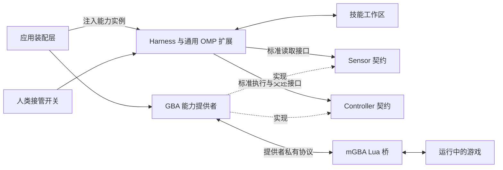

# Recursive Self Adaptation 工程架构

设计记录：从 2026-10-11 的 GBA 首版逐步扩展至 Switch。当前实现还包含 OMP 依赖补丁、独立 Dashboard 与 Alice Pet；最新启动和验证方式以 [RSA README](../README.md) 及源码为准。

第一阶段为 AI 提供一套手柄和采集卡接口，让它自行探索正在运行的游戏，自行形成目标，并把经验沉淀为可继续使用和修订的技能。Harness 只识别标准的 Sensor 和 Controller 能力，由外部提供者实现并注入；模型运行、经验积累和人工接管不依赖具体环境。

实现采用一个 Bun 包、一个本地宿主进程、一个 OMP 扩展和一个 mGBA Lua 脚本。应用装配层创建 GBA 能力提供者，将其传感器和控制器注入 Harness；Harness 通过 OMP SDK 加载通用 RSA 扩展。提供者实现、Harness 和装配层在源码中分开，同包同进程不改变依赖方向。mGBA 是另一个常驻进程；CLI 按需启动。针对当前固定版本开发，接口变化直接同步修改两端。

## 1 设计约束

- 环境说明只包含设备事实：通道、格式、采样方式、按键枚举、状态、时序和执行结果。
- Harness 和通用 RSA 扩展不得导入 GBA 提供者，不包含 GBA 按键枚举、帧率、ROM、Lua、模拟器协议或设备类型分支。
- Harness 可以理解能力契约和媒体格式；模型可以从观测中推断场景。这里的“不了解接了什么”指工程依赖和运行逻辑不绑定场景，并非要求模型无法认出游戏。
- 不提供游戏攻略、按键的游戏含义、预制操作技能、地图、坐标或 RAM 解析。游戏名称和场景意义由模型从感知中识别。
- 模型自行制定探索目标。启动提示只解释如何发现设备、操作环境和记录经验。
- 第一次运行的技能目录为空；后续运行可以继承该实验工作区内的技能。
- 环境时间由提供者管理，Harness 不假设可以暂停环境。GBA 提供者保持游戏正常运行，模型推理期间不会暂停。
- 初版循环固定为 ReAct；模型可修改技能和技能脚本。宿主、设备协议和循环代码由工程侧维护。
- 工作区是普通任务目录，Harness 源码、提示词和运行状态放在外部；不复制 runtime、初始化 Git 或预建插件体系。
- 人类可以随时交还或收回操作权。设备恢复手动操作不等待模型回复。
- 首个应用装配支持 macOS、mGBA 0.10.5、一个能力集合、一个模型会话、一个 AI 控制源；这些设备选型不进入 Harness 的核心契约。

“空技能”表示没有人为注入这个游戏的专属经验；底层模型已有的预训练知识仍然存在。

## 2 模块和进程



运行时 Harness 调用的是已注入实例的标准接口。源码依赖方向为：

```text
app/main.ts        → harness、providers/mgba
harness           → contracts
providers/mgba    → contracts
contracts         → 不依赖具体环境
```

初版在一个包里用普通函数和对象完成装配，不建立提供者注册中心、动态加载器或依赖注入框架。

| 模块 | 职责 | 场景知识边界 |
| --- | --- | --- |
| contracts | 定义 Sensor、Controller、观测、执行结果及取消语义 | 无设备枚举、游戏语义和厂商协议 |
| 应用装配层 | 选择并创建提供者，注入能力，选择模型和工作区，关闭资源 | 知道本次应用连接 GBA |
| Harness Runtime | 通用控制权、请求取消、单实例循环、运行记录 | 只调用注入对象的契约，不选择设备实现 |
| 通用 OMP 扩展 | 注册工具、组装观测与技能上下文、记录模型事件 | 认识媒体格式和能力目录，不认识 GBA |
| 固定循环 | 保持自动模式下的连续交互，串行驱动 OMP | 不预编写移动、战斗、通关策略 |
| 能力 CLI 门面 | 列出已注入能力，按 ID 转发参数和返回结果 | 不解析提供者的按键命令，不维护设备帮助文案 |
| GBA 提供者 | 实现画面采集、手柄 CLI、实际输入仲裁、设备连接和帧计时 | 持有 mGBA 技术知识，不提供游戏攻略 |
| 工作区 | 保存模型自行编写的记忆、技能、脚本和任务文件 | 场景经验由模型运行后形成；不包含 Harness 实现 |

应用装配层负责设备与 Harness 的整体生命周期；Harness 自身负责 OMP 会话。标准能力的 acquire/release 是交互契约，打开 TCP、加载 Lua 等动作由提供者承担。

## 3 标准能力契约和注入

Harness 接收能力实例集合，描述信息与可调用实现一起注入。只给一份设备清单而让 Harness 自己判断设备类型、再创建适配器，不符合这个边界。

以下类型说明接口边界，Observation 和 ExecutionResult 使用统一的媒体、时间、状态与输出结构：

```ts
interface Capabilities {
  sensors: Sensor[];
  controllers: Controller[];
}

interface Sensor {
  id: string;
  mediaTypes: readonly string[];
  help(): string;
  read(argv: readonly string[], signal: AbortSignal): Promise<Observation[]>;
}

interface Controller {
  id: string;
  help(): string;
  acquire(epoch: string): Promise<void>;
  execute(
    argv: readonly string[],
    context: { epoch: string; signal: AbortSignal },
  ): Promise<ExecutionResult>;
  release(epoch: string): Promise<void>;
}

interface ExecutionResult {
  id: string;
  status: "completed" | "interrupted" | "failed";
  exitCode: number;
  stdout: string;
  stderr: string;
  timing: {
    clock: string;
    requestedAtMs: number;
    receivedAtMs: number;
  };
}
```

标准化范围是发现、help、读取/执行、返回格式、时间信息、取消和操作权交接。参数 argv 由对应能力解析：Harness 不需要先理解按键、关节或其他设备的动作格式。help 必须说明设备真实的可用命令、参数及其物理效果，不说明游戏里的策略含义。

`acquire` 完成时提供者已授予当前 epoch 操作权；`release` 完成时该 epoch 的在途操作已停止且未来请求不再生效。如何停止、是否需要归零、如何恢复真人输入均由提供者实现，Harness 不假设所有控制器都能用“全部设为 0”处理。AbortSignal 负责请求取消，release 负责最终交还，二者含义分开。

Sensor ID 和 Controller ID 在各自集合内唯一，作为不透明标识使用。`screen`、`pad` 只是 GBA 提供者选用的名字。环境和工作区 ID 由装配层分配，Harness 不从 ROM 或设备型号推导。时间字段使用宿主注入的运行时钟；提供者内部帧计数不参与通用调度。

装配关系如下，具体连接参数只出现在提供者构造处：

```ts
// app/main.ts 的概念性装配代码
const provider = await createGbaProvider({ endpoint, artifactsDir, clock });
const harness = createHarness({
  capabilities: provider.capabilities,
  autoObserve: [{ sensorId: "screen", argv: ["capture"] }],
  workspace,
  model,
  clock,
});

try {
  await harness.run();
} finally {
  await harness.close();
  await provider.close();
}
```

上面的代码用于说明装配关系，实际实现见 rsa/src。provider.close 属于应用资源清理，不是第三种供模型探索的环境能力。第一版不做运行中热插拔。

## 4 CLI 门面和 GBA 控制器实现

通用 CLI 门面只负责列出能力、按 ID 分发调用。提供者自己的 help 通过同一个入口直接展示：

```sh
rsa sensor list
rsa sensor <sensor-id> --help
rsa sensor <sensor-id> <提供者参数...>
rsa controller list
rsa controller <controller-id> --help
rsa controller <controller-id> <提供者参数...>
```

外层命令解析器移除能力 ID，将其后的 argv 原样交给对应能力；除统一的 help 入口外，不解释提供者参数。help 在未接管时也可读取，execute 绑定当前有效的 epoch。能力对象由宿主持有，短命 CLI 通过本地 IPC 调用它们。

下面的动作设计只属于 GBA 提供者：十个 digital 按键，值为 0 或 1，完整状态、有限时长和短序列。`StateSpan`、按键枚举、时长上限均放在 providers/mgba 内，不进入 contracts。

```ts
// providers/mgba/gamepad.ts 的提供者内类型
interface StateSpan {
  state: Record<string, number>;
  durationMs: number;
}
```

```sh
rsa controller pad --help
rsa controller pad state
rsa controller pad apply --state '{"RIGHT":1,"A":1}' --for-ms 120
rsa controller pad play --file sequence.json
rsa controller pad release
```

`pad` 的 `apply` 是一个完整状态加一个持续时间。省略的通道取 neutral；持续时间结束后全部回到 neutral。`--for-ms` 必填，CLI 进程退出不会让计时提前结束或变成无限保持。

`play` 是同一种原子状态的时间序列：

```json
[
  {"state":{"RIGHT":1},"durationMs":100},
  {"state":{"RIGHT":1,"A":1},"durationMs":80},
  {"state":{"RIGHT":1},"durationMs":120}
]
```

相邻片段直接切换完整状态，跨片段仍为 1 的按键持续保持；只在序列末尾统一归零。这里没有预制连招。AI 可以把自己发现的序列保存成技能脚本。

GBA 提供者的时序约定：

- 初版一次 `apply` 或整段 `play` 的总时长上限为 2000 ms，由该提供者声明和检查；Harness 不硬编码此限制。
- 一个控制器同时只执行一个动作，不设动作积压队列。并发动作直接返回 `BUSY`。
- CLI 的 `pad release` 中断当前按键动作但保留自动操作权；标准接口的 `Controller.release(epoch)` 同时撤销操作权并恢复真人输入。二者都不排在普通动作后面。
- 命令正常返回时动作已经结束；返回宿主请求/收到结果的时间区间，以及提供者的实际开始/结束帧和执行结果。宿主时间区间不是设备精确执行时刻。中断返回 `interrupted`，不伪装为完成。
- `state` 返回控制器当前施加的通道状态和当前动作 ID，不返回游戏内部状态。
- 毫秒时长由 GBA 提供者按模拟器时间换算，在帧边界落实；记录实际帧数和宿主耗时。模拟器掉帧时不承诺墙钟时长精确相等。

动作定时在 mGBA Lua 桥侧执行，不能写成 `setKeys; shell sleep; clearKeys`。这样模型延迟、shell 取消和 CLI 退出都不负责保持按键。

GBA 控制器 help 包含通道取值、neutral、完整状态替换语义、时间单位、最大时长、完成条件和中断行为，不说明任何游戏含义。其他提供者自行实现其 CLI 参数与设备说明，不必模拟 GBA 按键。

## 5 传感器 CLI 和模型感知

GBA 提供者的 screen 能力用法为：

```sh
rsa sensor list
rsa sensor screen --help
rsa sensor screen capture
```

初版 GBA 提供者的 `screen` 返回 PNG 快照。调用时采集新画面，返回不可变文件路径和结构化元数据，不反复覆盖一个 `latest.png`。这属于提供者采集行为；Harness 依据 mediaType 消费文件，不检查数据是否来自游戏。

```ts
interface Observation {
  id: string;
  sensorId: string;
  mediaType: string;
  path: string;
  timing: {
    clock: string;           // 宿主本次运行的单调时钟 ID
    requestedAtMs: number;
    receivedAtMs: number;
  };
  sourceSequence?: number;   // 提供者源序号；Harness 不解释其物理含义
}
```

`requestedAtMs` 到 `receivedAtMs` 给出新采样发生的区间，不能把收到文件的时刻冒充精确采样时刻。动作记录使用同一个宿主单调时钟。未来读取已有缓冲片段时，提供者必须另外声明真实采样区间，不能沿用这个新采样约定。

CLI stdout 输出 JSON，二进制留在文件中。通用 OMP 扩展的 `observe` 工具按 sensor ID 调用注入能力，将 image 媒体作为真正的 `ImageContent` 回传给视觉模型。CLI 和工具共享能力实现。仅把文件路径写入 shell 输出不等于模型看到了画面。

自动观察哪些传感器、使用哪些读取参数，由装配层按设备 help 配置给当前固定循环。GBA 装配配置 screen 的 capture；Harness 只持有 `{sensorId, argv}`，不内置 screen/capture 字面量或猜测设备类型。模型也可以根据能力清单和 help 主动调用其他观测。

正常 ReAct 循环在每次 prompt 开始和一条模型回复的整批工具执行结束后执行配置的自动观察。`exec` 与 `observe` 按调用顺序执行。批次中相同传感器、相同参数的主动观测若未被后续 shell 操作作废，则复用其结果；图片不重复附加。初始观测作为会话消息保存，批次自动观测附在最后完成的工具结果中，等待采集及持久化后才请求模型。图片进入会话时复用 OMP 的默认压图能力；原始传感器文件保留，历史图片不在请求投影中反复转换。环境即使没有收到动作，也可能自行变化；模型可随时主动调用 observe 获取新采样。

音频属于媒体能力，但 GBA 提供者初版不声明一个尚未接通的 audio 设备。加入音频需要提供者完成采集与片段时间信息，同时 OMP 接入层支持该 mediaType 的模型消费。当前 OMP 普通工具结果只有 text/image，不能把 WAV 路径当作已实现听觉，也不默认把游戏音乐转写为文字。能力接口不依赖设备类型，不等于所有模型已经支持全部媒体格式。

## 6 OMP 接入

以本地 OMP 源码版本 `ca18a903c5d7c946c26c728a66d3a9151f0c26b1` 核验 API，运行时使用 npm 发布的 18.9.1，依赖与 bun.lock 已固定；不改动 OMP 核心。

宿主通过 `createAgentSession` 创建独立会话，明确指定工作目录、system prompt、工具和扩展。初始原生 skills、rules、contextFiles、promptTemplates、slashCommands 为空，关闭环境中的 MCP、LSP、自动发现扩展及额外自动学习/记忆注入。认证和选定模型由宿主配置，凭据不进入提示。

宿主默认续接当前工作区已选定的 OMP 会话，沿用会话身份、持久化历史和压缩状态，新 run 单独记录事件与观测。新工作区创建新会话；`--new-session` 只替换当前上下文，保留工作区中的技能、记忆和其他任务文件。`--resume <session.jsonl>` 用于首次绑定旧历史或显式选择另一会话；只接受归属于同一 canonical 工作区的会话，原文件原地继续追加。不自动搜索、拼接或复制模型消息。打开会话前先取得工作区宿主占用，避免两个进程同时续写。

实现使用 restricted SDK 会话：显式 prepared extension 绑定 before_agent_start、tool_result、context 和 tool_call hooks，工具通过 SDK customTools 传入。SDK CustomTool 的取消信号是 execute 的第五个参数，与 Extension ToolDefinition 的第三个参数不同。只有 read/write/edit/observe/exec 被启用。

这些设置隔离默认上下文来源。复用 OMP 的模型调用、工具调用循环、会话保存与上下文压缩，不自行实现这些机制。

模型工具保持少量：

| 工具 | 用途 |
| --- | --- |
| `exec` | 执行 shell，按注入的能力清单调用 CLI，以及模型自己的脚本 |
| `observe` | 按 sensor ID 和提供者参数读取媒体，再按媒体格式传给模型 |
| `read`、`write`、`edit` | 复用 OMP 文件工具，读取和修订笔记、技能、脚本 |

`exec` 是薄的子进程封装：固定工作区、注入本轮控制权代号、处理取消、返回退出码和输出。不另做 shell 解释器、PTY 管理器、任务服务系统。它是一个前台任务；取消时终止它的进程组。即使有子进程未及时退出，设备侧的控制权检查仍使旧动作失效。

环境学习入口使用替换后的通用 system prompt，防止沿用“替用户修改代码仓库”的默认任务。提示只解释设备发现、技能目录和自主探索，不包含具体游戏目标。

初版 shell 是遵守实验约定的本地运行环境，不是操作系统级沙箱。工作目录和工具列表不等于文件系统、网络权限隔离；因此本阶段能够声称“没有注入游戏知识”，不能声称已实现严格隔离的盲测环境。严格盲测需要另外限制主机文件和网络访问。

## 7 固定 ReAct 循环

沿用 OMP 自身的模型 → 工具 → 模型循环。宿主只管理外层的连续运行：一次 `session.prompt` 自然结束后，只要自动模式仍有效，就开启下一次探索周期。

```text
自动模式开启
  → 读取设备清单、当前技能索引和新观测
  → OMP 模型决定：观察、操作、记录、读取技能或修改技能
  → 工具执行结束，采集新观测、技能索引和运行状态
  → 工具结果与观测一起保存进 OMP 历史
  → 继续 OMP 内部循环
  → 本次 prompt 完成后，宿主再次检查控制权并继续探索
```

不在 `agent_end` 回调中递归启动下一轮，也不依赖 `session_stop` 的有限次数 advisory continuation。宿主使用一个串行执行函数等待本次 prompt 结束，生命周期更容易判断。

扩展通过 `before_agent_start` 返回正式的初始观测消息，通过 `tool_result` 将新观测附在工具结果后，由 OMP 统一保存。观测包含注入的能力描述、当前控制权、媒体和技能索引；多工具轮次各自保存执行后的观测。`context` hook 只检查请求预算、记录最近观测 ID 和技能版本，不改写模型历史。扩展不解析 GBA 的按键数据；收到的设备 stdout 作为原始工具结果交给模型。

推理耗时期间 Harness 不干预环境时钟，动作结束后的设备行为由提供者 help 说明。模型不返回操作时不会重放上一个动作。GBA 提供者在动作完成后保持 neutral；这条设备规则不写进通用循环。固定循环不提供默认的“向右走”“不断按 A”等策略。

正常轮次仅追加消息，保持已有文本和图片稳定，以满足模型提供者的缓存前缀和增量续传条件。上下文缩减复用 OMP 压缩，不另设滚动图片裁剪；压缩会有一次正常的前缀重建。原始图片仍保存在运行文件中供主动读取，短期历史、模型的笔记和长期技能分别保存。实际缓存命中以提供者返回的用量为准。

OMP 18.9.1 在发送前还会按提供者图片数量预算裁剪历史；DeepSeek 默认 5 张，Codex 为 200 张，实跑已确认裁剪会破坏请求前缀。OMP 适配层统一通过 `createOmpSession` 创建会话，将当前模型的 `PROVIDER_IMAGE_BUDGETS[model.provider]` 覆盖为 `Infinity`。这是一条对所有当前及未来提供者自动应用的 Harness 策略，保留 token 和请求体预算，取消图片数量裁剪。该进程内 SDK 策略不进入能力契约或设备提供者；背景与验证见实验 README 的“Harness 统一图片预算与缓存”。

终止条件包括人工关闭、运行预算耗尽、模型终止错误、设备断开和宿主退出。终止后交还设备并记录原因；不自动重启一轮掩盖失败。

## 8 人工接管和迟到动作

对人类呈现手动/自动两种稳定模式。设备连接状态独立显示。交接过程中只显示正在交接，收到设备确认后才显示交接完成。

每次自动接管分配一个新的 UUID `epoch`，它只表示这次操作权归属，宿主重启也不复用。所有模型周期、shell 子进程和设备请求携带创建时的 epoch；CLI 不能在运行时重新索取“最新 epoch”把旧请求升级为新请求。

开启自动：

1. 等待上一个已取消的模型周期退出；不会同时跑两个控制循环。
2. Harness 创建新 epoch，调用注入控制器的 `acquire(epoch)` 并等待确认。初版只装配一个控制器。
3. 通过配置的传感器读取新观测，再开始模型调用。

关闭自动：

1. 宿主立即停止接受当前 epoch 的新动作，并停止后续模型周期调度。
2. 调用注入控制器的 `release(epoch)`；由提供者停止在途操作，撤销这个 epoch 并完成设备交还。
3. 并行取消 OMP 请求及其 shell 进程。设备交还不依赖这一步完成。
4. 提供者确认交还后，界面报告已回到手动。迟到的模型结果和旧 epoch 的设备命令均失效。

操作权在 Harness 入口和提供者实际执行处都生效。Harness 负责请求生命周期，提供者负责设备已经停止执行的事实；Harness 不直接发 Lua 命令。对 GBA，提供者在实际输入写入处仲裁，AI 模式下不得把真人按键和 AI 按键直接按位合并，手动模式下脚本停止覆盖按键。

已在 mGBA 0.10.5 验证 Lua `keysRead` 输入仲裁：自动模式屏蔽原生方向键；交还后原生方向键恢复；持续按住方向键跨越自动→手动交接时也能恢复输入。Qt 原生输入与 AI 输入在实际读取边界切换，不做按位合并。

GBA 桥端动作有有限时长，连接断开时清除 AI 状态并退出自动模式。该提供者初版单个动作最长 2 秒模拟时间；墙钟耗时受模拟器运行速度影响。正常人工交还应在下一输入/帧边界落实，需实测。Harness 重启始终以手动模式开始，不依赖上述 GBA 帧时序细节。

## 9 技能和自适应

工作区中只有一种技能载体：标准 `SKILL.md` 目录，可附带模型自己编写的脚本和证据引用。

```text
workspace/
  memory/
    current.md
  skills/
    <模型自行命名>/
      SKILL.md
      scripts/
```

`SKILL.md` 的必要 frontmatter 只有 `name` 和 `description`。正文由 AI 自行组织，可以描述观察到的现象、适用条件、操作方法、失败情况及对应观测/动作 ID。没有预写的游戏技能模板内容。

`memory/current.md` 保存当前目标、现场状态、疑问和下一步，覆盖过期内容；技能保存可复用的方法和已知例外。两类内容都由环境 agent 维护。`memory/**/*` 与技能共用内容 hash 存储，但有独立版本和文件索引，记忆变化不会改变技能版本，正文也不自动注入每轮请求。

通用提示鼓励模型区分猜测与经过重复尝试的经验，但不强制增加一套候选、晋升、审批状态机。模型自行决定何时形成技能、何时修订或弃用；不能把自行标记“已掌握”当作能力已提升的证明。

技能生效采用一个直接的文件流程：

1. AI 通过文件工具或 shell 修改技能文件。
2. 工具批次结束后的下一次模型请求前，插件扫描当前工作区 `skills/*/SKILL.md`。
3. 索引生成 name、description、path 和内容版本。版本覆盖 `SKILL.md` 及附属脚本的文件 hash，内容变化时保存不可变文件；只存发生过变化的文件，不每轮复制整个工作区。
4. 本轮请求只注入最新索引。模型按需读取正文和运行脚本；写入的文件格式无效时返回具体诊断，不自动补造内容。
5. 运行记录保存本轮可见的技能索引版本、显式 `read` 工具读取的文件版本、完整 `exec` 命令，以及执行前的技能目录版本。shell 间接读取了哪些文件不做系统调用追踪，也不宣称能自动识别每一次技能使用。

索引在下一次模型请求生效，正在生成中的模型回复不热更新。旧技能正文曾出现在历史中时，保留其历史身份，并在当前索引中标记更新版本供模型重新读取，不篡改以前的证据。

初版关闭 OMP 原生自动技能发现，由插件维护这一个动态目录索引，避免本机技能混入和两个索引相互竞争。文件仍使用标准格式。当前 SDK 的 `AgentSession.refreshSkills()` 可刷新原生可重载技能，但显式传入 `skills: []` 时原生技能不是 reloadable；本设计不混用这两条机制，也不把会话 reload 当成插件代码热更新。

自适应闭环是“使用经验 → 观察结果 → 修订经验 → 再次使用”。Harness 保存证据和版本，不替 AI 写游戏知识，也不为了展示学习而强制每几步生成一个 skill。

人类可以在 manual 且空闲时执行 `rsa consolidate [--seconds 600]`，让同一个 OMP 会话做一次经验提炼。该次任务临时只开放 `read/write/edit`，跳过传感器采集并始终不获取控制器；完成或取消后恢复工具。`rsa auto off` 也可取消整理，清理结束前不能启动其他任务。它复用现有会话、文件工具、版本和事件记录，不另建记忆服务或替代 OMP 原生压缩。

## 10 存储和记录

`workspace` 是启动时的当前目录，也可用 `--workspace` 或 `RSA_WORKSPACE` 指定。宿主切换到该目录，OMP 与工具 shell 使用相同 cwd；Harness 不要求它包含 Git，也不初始化版本库。源码、通用提示词和依赖由工程侧在 `rsa/` 维护，不复制进任务目录。任务文件和运行日志都属于该工作区。

每次启动的运行记录放在 `<workspace>/logs/<run-id>/`。会话续接和内容快照仍放在仓库同级的运行目录 `../artifacts/` 下，以工作区 canonical path 的 SHA-256 前 16 位标识；basename 只用于辨认，经过安全字符处理并截取至 32 字符。同一目录的路径别名归一化后共用状态，不同目录即使同名或位于同一父目录也独立。

```text
<workspace>/                   # 普通任务目录，不包含 Harness runtime
  AGENTS.md                    # 目录用途和任务约定
  skills/
  memory/
  logs/<run-id>/
    manifest.json              # 模型、版本、装配元数据
    events.jsonl               # 带序号、时间和关联 ID 的事件流
    payloads/                  # 请求、响应和工具结果，按 hash 保存 gzip
    streams/                   # 原始 SSE / WebSocket 事件
    observations/              # 图片；后续可含音频片段
  ...                          # 模型自己的脚本和任务文件

artifacts/rsa/
  ws-<basename>-<workspace-hash>/
    current-session.json       # 当前会话路径，重启时默认续接
    sessions/                  # 新建的 OMP 会话
    skill-versions/             # 技能与记忆的内容快照和独立清单
    workspace.json             # 看板定位 workspace/logs 的路径索引
```

旧会话通过显式 `--resume` 绑定后仍留在原路径；旧运行记录继续可读，不搬迁。内容 hash 沿用原有证据存储，不扩展成项目版本管理。模型登录凭据仍由本机 OMP 共享管理，模拟器配置和存档仍由 provider 管理。

工作区缺少 `AGENTS.md` 时，首次启动写入简短目录说明；已有文件不覆盖。用 OMP 原生 `contextFiles` 加载根目录文件，`customSystemPrompt` 保留 Harness 主提示并附加项目上下文。关闭目录树扫描，不隐式加载父目录或全局指令。额外终端日志同样约定保存在 `logs/`；工作区前后快照排除 `logs/`，避免递归复制日志。

`manifest.json` 记录使用的是空经验还是继承经验、初始技能版本和版本固定信息。提供者版本等元数据由装配层传入，仅用于记录，Harness 不据此选择执行分支。观测和动作在能力边界获得 ID；模型结论引用这些 ID，便于核查。技能使用装配层指定的工作区，不通过游戏名称决定加载目录。

事件记录保存请求、实际执行、完成/中断、观测、控制权变化、技能变化、模型用量。统一外壳为 `schemaVersion/runId/seq/at/atMs/type/trace/data`；关联字段依次包含接管 epoch、模型调用 modelCallId、提供者请求 requestId、实际 HTTP 发送 httpId、toolCallId 和能力操作 operationId。并行工具通过自己的 toolCallId 区分；CLI 经环境变量和 IPC 传递关联字段，操作权校验不依赖这些观测字段。

通用 EventLog 只负责时间线与完整附件保存；OMP 传输观测器放在 harness/omp 内。它包裹现有 streamFn，先执行 OMP 原有请求 hooks，再保存最终 payload；HTTP fetch 边界另外保存实际 body 字节，区分模型调用与传输重试。模型结束事件保存统一 usage、首 token 延迟、结束原因和完整响应引用，原始流事件保留提供者 usage。HTTP 错误、取消和工具失败同样进入时间线。完整传输记录目前覆盖主循环；OMP 内部压缩记录生命周期与原生会话，其内部摘要调用不经过这个拦截器。

请求与响应大对象无损 gzip 到 payloads，以原字节 SHA-256 命名；主事件流保存引用，不重复内嵌图片。认证请求头和 Cookie 不进入传输日志，业务正文保留。模型自己的解释与设备测量分开保存。这里只提供交互轨迹回看和后续质量检查的数据，不承诺在持续运行的环境中精确重放同一局。

模型上下文大小和本地记录大小分开管理：压缩上下文不删除原始观测。初版按需采集图片，不录制整场视频；设置每次接管的时长预算和宿主会话的模型请求数预算，达到预算交还控制权并保留结果。记录模型返回的 token 用量；初版没有金额/token 硬上限或独立图片数量预算。后续磁盘清理由人类显式选择，不建立后台清理系统。

## 11 通用调用传输和提供者私有传输

CLI 与 Bun 宿主使用一个本地 Unix socket，按行传递 JSON 请求/响应。通用请求包含 capability kind、能力 ID、argv、控制请求所需的 epoch，以及可选的 trace 关联字段。每个 CLI 连接承载一个请求，能力边界为实际读取/执行分配 operationId，不再额外建立 IPC 请求编号系统。一个请求只产生一个最终响应；动作 CLI 等到实际完成或中断再退出。通用 dispatcher 按 ID 找到已注入实例，不查找 provider 名称或解析内部协议。

`--workspace` 或 `RSA_WORKSPACE` 为运行和管理命令选择工作区，显式参数优先。默认 socket 为 `/tmp/playness-rsa-<uid>-<workspace-hash>.sock`；`RSA_SOCKET` 可手动覆盖连接地址。宿主在打开会话、连接设备前先绑定工作区的固定 socket，即使覆盖连接地址也不允许同一工作区并发启动。模型的 shell 自动继承对应 socket 与 epoch。

不同工作区使用独立宿主进程和 OMP 会话，不自动加载彼此的技能、记忆或历史。并行设备仍需独立模拟器实例和端口：应用装配层的 `--port` 与该实例的 `RSA_BRIDGE_PORT` 配对，mGBA 默认为 47653，Ryubing 默认为 47663。工作区隔离覆盖上下文、文件索引、日志和控制连接；文件系统与网络权限仍共享，不构成操作系统沙箱，也不隔离模拟器存档或配置。

GBA 提供者内部使用 localhost TCP 连接 mGBA Lua 桥。连接建立后按帧回调处理请求，不在模拟器主线程等待模型。桥协议只需要 HELLO、CAPTURE、APPLY、STOP、STATE、OWN、DISOWN 及其 OK/ERROR。mGBA 与 Ryubing 复用 providers/bridge.ts 的按行请求关联，具体消息参数仍由各自提供者解释；Harness 只负责通用 CLI 的 JSON 编解码，不认识这些桥消息。

TCP 按字节流处理，必须支持半包和多包，写端处理未发送完的字节。CAPTURE 只有在 PNG 完整写出后才响应，防止把半张图片交给模型。每条请求带 request ID，控制请求另外带 epoch。

GBA 提供者将 pad play 的所有状态片段在开始前发送完并校验总时长；桥在帧回调中执行整个短序列，末尾释放。中断会废弃剩余片段。截图和动作共用一套有序桥消息，人工交还命令可中断正在计时的动作。其他提供者可使用自己的 USB、串口或网络传输，不需要仿照 Lua 桥协议。

控制命令没有透明重试：连接断开时不能知道某个按键是否已经执行，自动重发可能重复操作。报告断开，交还控制权，下一次启动重新观察即可。初版不做自动重连、消息补投、断点恢复或多版本协商。

## 12 工程目录

核心包位于 `rsa/`，与同仓库的 `rsa-dashboard/`、`rsa-companion/` 独立构建。同包内明确分出 contracts、harness、providers 和 app；OMP 的版本固定修改放在 `rsa/patches/`。原 Vite 研究站不纳入这个研发仓库。

```text
rsa/
  package.json                 # Bun 包、rsa CLI、固定依赖
  bun.lock
  bin/rsa                     # 可加入 PATH 的 shell 入口
  src/
    contracts.ts               # Sensor、Controller、Observation、ExecutionResult
    harness/
      cli.ts                   # 通用 auto/status 与能力调用门面
      runtime.ts               # 标准操作权、取消、日志
      events.ts                # 通用事件外壳、完整附件存储
      transport.ts             # 通用本地 CLI 请求/响应
      workspace.ts             # 技能与记忆索引、内容快照
      workspace-state.ts       # canonical 工作区、外部状态路径与当前会话指针
      omp/
        session.ts             # SDK 创建、串行循环、隔离默认上下文、模型事件
        workspace-session.ts   # 当前会话选择与工作区归属校验
        extension.ts           # 通用 context hook、observe、exec
        trace.ts               # OMP 模型传输、原始流和工具事件关联
    providers/
      bridge.ts                # 本机 TCP 按行请求关联、断连与资源清理
      mgba/
        provider.ts            # GBA 能力、参数与 help
        bridge.lua             # 模拟帧采集、动作与输入源切换
      ryubing/
        provider.ts            # Switch 能力、参数与 help
        RsaBridge.cs           # 画面采集、墙钟动作与控制权
        ryubing.patch          # 固定版本模拟器的集成点和构建修复
        build.sh               # 构建独立 macOS arm64 应用
        launch.sh              # 启用桥端口并启动
    app/
      main.ts                  # 提供者选择与组合；唯一同时依赖两侧的位置
  prompts/
    explore.md                 # 通用探索指令
  tests/
```

screen/pad 的小型实现放在同一个 provider.ts 中，外层循环放在 session.ts 中。没有代码的未来能力不放占位实现。

人类的入口暂定为：

```sh
rsa --workspace <path> run
rsa --workspace <path> auto on
rsa --workspace <path> auto off
rsa --workspace <path> status
```

也可以设置 `RSA_WORKSPACE` 后省略参数，`rsa run --workspace <path>` 同样有效。

该实验包的 `rsa run` 由 app/main.ts 实现，根据 `--provider mgba|ryubing` 静态装配提供者；这些选择不进入 Harness。第一步仍由人类在 mGBA 打开 ROM 并加载 Lua 脚本，装配层连接提供者并注入能力，保持手动模式；`auto on` 才发起模型调用。状态只需呈现能力是否可用、操作权、当前执行、模型是否在思考、耗时和用量。GUI 自动按钮以后调用同一个管理入口。添加新环境时新增提供者及其装配入口，复用同一份 Harness。

## 13 首轮实现顺序和验收

| 阶段 | 实现内容 | 可观察的验收结果 |
| --- | --- | --- |
| A 能力和设备闭环 | 标准能力接口、GBA 提供者、CLI 门面、控制权切换 | 注入能力后画面可读，原始按键按时生效和释放，真人输入恢复 |
| B OMP 闭环 | 独立会话、exec、observe、固定循环 | 模型确实收到图片，自行查看 help 并连续操作；停止后不再发新动作 |
| C 技能闭环 | 空技能目录、索引刷新、内容版本、记录 | 模型写出的技能下一请求可见，后续能读取或执行；新会话可继承 |
| D 自适应实验 | 自主目标、自然探索、轨迹检查 | 能指出技能形成和修订对应的交互证据，再评估后续行为是否改善 |

设备阶段在 GBA 提供者内部验证 0.10.5 的 Lua 输入仲裁；该项不成立就先解决接入点，不往上堆模型和学习功能。

需要保护的工程契约只有这些关键行为：

1. 多键同时按下、状态替换、跨片段持续保持和最终释放符合 help；CLI 中断不产生无限按键。
2. 自动模式下只有 AI 输入源生效；手动模式恢复真人输入。自动 → 手动 → 自动快速切换时，旧模型回复和旧脚本不能影响新一轮。
3. 人工关闭发生在模型请求、动作执行、截图、技能文件写入等不同阶段时，设备仍能独立交还；再次开启不产生两个模型控制循环。
4. 动作完成后的新观测确实来自后续采样，图片文件完整、时间区间和动作记录可关联。
5. 新增和修改技能后，下一模型请求看到最新索引；旧版本仍可追溯。初始上下文没有混入用户本机其他技能。
6. 设备断开、模型终止错误、预算结束和宿主退出会停止自动模式，保留明确原因；重启默认为手动。
7. 将 GBA 能力替换为不同 ID、不同参数词汇的测试提供者后，同一 Harness 仍可发现 help、读取媒体、转发命令和交还操作权。此项验证实际注入行为，不靠源码字符串检查，也不引入第二个真实场景。

使用真实 ROM 做 GBA 端到端演示；测试代码使用短小可控的能力提供者验证注入边界和交接竞态。无需为数据类型声明、默认文案或静态目录结构写测试。

“文件写出来了”只证明技能机制运行。评估适应效果时应比较相近条件下空经验与继承经验的尝试，并查看技能是否实际被使用。人类可在评估阶段准备相同起点，但这些调试手段不进入 AI 的控制器接口。初版不建立自动评分器，不把模型自报进步计为成功。

## 14 简洁实现的边界

Harness 保留标准返回格式、单控制源、epoch、原始记录和媒体正确传输；GBA 提供者保留自身参数检查、按键释放和动作时长约束。每一层只检查自己拥有的契约，不重复检查另一层的设备细节。

暂不引入：微服务、消息队列、数据库、向量检索、多个反思 agent、技能审批流水线、通用工作流 DSL、插件市场、热更新运行时代码、远程设备管理、兼容旧协议或多种自动 fallback。

状态保存在简单文件中；枚举和分支直接写清楚；关键异常明确返回。没有实际需求的扩展点只在职责边界中说明，不预建框架。

## 15 后续开放循环自适应

未来让 AI 编写 loop 时，替换的是当前 OMP 驱动和 context hook 承担的调度策略，包括观察频率、上下文选择、动作编排和反思时机。注入的 sensor/controller 能力及 CLI、技能工作区和执行记录继续沿用。

Harness 负责通用操作权和调用取消，提供者负责设备实际执行和停止。生成的循环仍通过同一套注入能力操作环境，不能要求 Harness 了解提供者的执行细节。初版先保持这一职责分离，不提前设计循环 DSL 或热替换系统。

接入机器狗时，新提供者实现传感器读取、控制器命令及 help、设备实际的停止与交还语义，并由新的装配入口注入。Harness 和通用 RSA 扩展保持不变；采样频率、状态范围和控制周期由设备说明。未来若引入新的媒体类型，可能需要扩展通用模型媒体接入能力，但不添加设备类型分支。游戏上的成功不直接证明模型能满足物理设备的控制要求。

## 16 已核验的接入依据

- [OMP SDK](https://github.com/can1357/oh-my-pi/blob/ca18a903c5d7c946c26c728a66d3a9151f0c26b1/docs/sdk.md)：Bun 进程内嵌入、会话控制以及默认能力发现行为。
- [CreateAgentSessionOptions](https://github.com/can1357/oh-my-pi/blob/ca18a903c5d7c946c26c728a66d3a9151f0c26b1/packages/coding-agent/src/sdk.ts#L534)：systemPrompt、skills、rules、contextFiles、extensions、toolNames 等显式设置入口。
- [OMP 扩展接口](https://github.com/can1357/oh-my-pi/blob/ca18a903c5d7c946c26c728a66d3a9151f0c26b1/docs/extensions.md#L476)：context 请求投影、agent_end 通知语义和 session_stop 的 continuation 限制。
- [OMP 技能](https://github.com/can1357/oh-my-pi/blob/ca18a903c5d7c946c26c728a66d3a9151f0c26b1/docs/skills.md)：文件结构、索引发现和按需读取。
- [技能刷新](https://github.com/can1357/oh-my-pi/blob/ca18a903c5d7c946c26c728a66d3a9151f0c26b1/packages/coding-agent/src/session/agent-session.ts#L6370)与 [skillsReloadable 设置](https://github.com/can1357/oh-my-pi/blob/ca18a903c5d7c946c26c728a66d3a9151f0c26b1/packages/coding-agent/src/sdk.ts#L4583)：动态技能目录需要明确刷新设计。
- [工具结果内容类型](https://github.com/can1357/oh-my-pi/blob/ca18a903c5d7c946c26c728a66d3a9151f0c26b1/packages/ai/src/types.ts#L1329)：当前普通工具结果支持 TextContent 和 ImageContent。
- [mGBA 稳定版脚本 API](https://mgba.io/docs/scripting.html)：截图、按键、frame/keysRead 回调和 TCP socket。该文档注明主要由 0.10.2 生成，0.10.5 上的组合行为仍需按阶段 A 实测。

首版已跑通 mGBA 0.10.5 的截图、组合按键、有限时长动作、交还与旧 epoch 拒绝；已用 OpenAI Codex / gpt-6.1-sol 实跑 OMP 循环。一次 32 请求的运行完成 15 次设备操作，模型自主写出一份技能，并在后续请求中读取。此结果验证学习载体可用，不构成游戏能力提升的评估。启动方式与验证命令见 rsa/README.md。音频和自编写 loop 尚未实现。


## 17 Switch 提供者（2026-10-14）

第二个真实环境使用 Ryubing 1.3.3 的本地补丁构建，实现同一 `Sensor` / `Controller` 接口。`screen` 从呈现路径取得原始 PNG；`pad` 在 Npad 写入 emulated HID 前覆盖一号手柄的完整状态。数字按键、双摇杆、动作时间及中断语义都由提供者 help 描述。GBA 使用模拟帧计时；Switch 使用输入轮询采样的单调墙钟时间，因此不假设两种设备有相同时间单位或分辨率。

应用层负责选择提供者、端口及初始观测请求；通用 Runtime、OMP 循环、提示词、技能索引、事件日志保持复用。新游戏用空工作区；既不迁入 GBA 技能，也不注入火纹操作含义。真实输入边界处检查 epoch；结束/取消清空 AI 状态，关闭接管/断连恢复原生输入。设备只监听本机回环地址，属于可信本机进程间接口。

补丁、可复现构建脚本、启动方法及已知限制见 `rsa/src/providers/ryubing/README.md`。本阶段不提供音频、触屏、内存读取、存读档或游戏状态解析。


Ryubing 原生系统键盘也属于设备界面。它出现时游戏可能停止出帧，`screen` 改为采集弹窗实际视觉内容，`keyboard` 控制器提供文字与原始编辑按键，并沿用同一个设备 epoch。提供者不解释“角色名”等游戏含义；Harness 仍按能力发现与调用。弹窗观测只记录本次采样时间，不冒用游戏帧序号。
