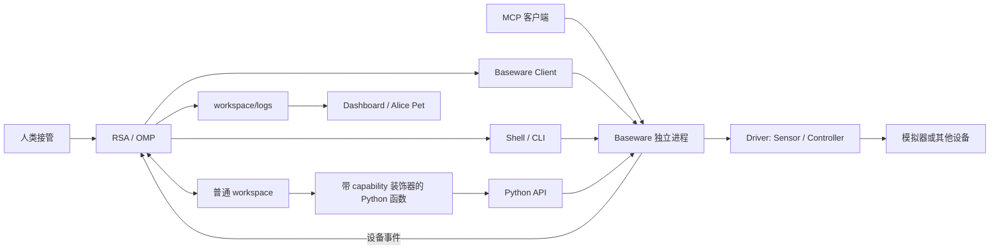

# Recursive Self-Adaptation 工程架构

当前边界：Baseware 提供环境的原始操作与观测，RSA 管理模型会话、固定交互循环和工作区中形成的能力。Dashboard 与 Alice Pet 消费运行日志。设备协议不进入 Harness，工作区不包含 runtime 源码。

## 组件与进程



| 组件 | 拥有的职责 | 不包含的职责 |
| --- | --- | --- |
| `baseware/` | driver 装配、设备连接、能力目录、操作权、动作取消、CLI / TS API / Python API / MCP、设备日志 | 模型、OMP、技能、工作区脚本发现 |
| `rsa/` | Agent 生命周期、OMP 会话、观测循环、预算、Python 工具发现与执行、工作区与运行日志 | 设备私有协议、按键含义、游戏策略 |
| `rsa-dashboard/` | 日志读取、模型与动作统计、媒体展示、人工交还入口 | 模型推理与设备执行 |
| `rsa-companion/` | 消费日志，在 Alice Pet 气泡中呈现活动、画面与声音 | 策略、driver、独立模型调用 |

各组件独立安装，有自己的锁文件。`rsa` 以本地包依赖 `@playness/baseware` 的契约和客户端，生产代码不导入 `drivers/`。`rsa up` 是本机应用装配入口，可以选择设备类型并启动进程；这个选择不进入 Harness。启动配置使用 `driver`；RSA CLI 只管理 Agent，设备调用统一通过 Baseware，移除了原有 sensor/controller 转发入口。

## Driver 与 Baseware

Driver 是当前环境的最小能力实现。目前有 mGBA 和 Ryubing；每个 driver 提供 Sensor / Controller 集合、设备连接生命周期和自身的 help。

```ts
interface Sensor {
  id: string;
  mediaTypes: readonly string[];
  help(): string;
  read(argv: readonly string[], signal: AbortSignal): Promise<Observation[]>;
}
interface Controller {
  id: string;
  help(): string;
  acquire(epoch: string): Promise<void>;
  execute(argv: readonly string[], context: {
    epoch: string; signal: AbortSignal;
  }): Promise<ExecutionResult>;
  release(epoch: string): Promise<void>;
}
```

契约只约定发现、help、读取/执行、媒体与时序、取消和交接。help 说明真实设备通道、参数与效果，不说明某个按键在游戏中做什么。`screen`、`pad`、`keyboard` 是已有 driver 选择的 ID，Harness 不解析它们。能力 ID 在同类集合内唯一；当前 CLI 每个 Baseware 进程装配一个 driver，不增加热插拔或插件管理器。

观测包含媒体类型、不可变文件路径、时钟 ID、请求和返回时刻，可带源帧序号。执行结果包含状态、退出码、stdout/stderr 和时序。同一设备时钟下可以关联动作后的观测；帧号前进不等于动画完成，也不等于游戏推进。

三种调用入口走同一服务：

- CLI：`baseware list`、`baseware sensor <id> ...`、`baseware controller <id> ...`。
- API：TS `BasewareClient`，Python `from baseware import Client`。
- MCP：`baseware mcp` 通过官方 SDK 暴露目录、help、sensor 和 controller 工具。

本地 Unix socket 使用逐行 JSON，区分请求 ID、结果与设备事件。TS 客户端可多路复用连接；Python 每次调用建立短连接。MCP stdio 进程连接同一 Baseware，不能再装配一份 driver。接口取消最终都传递到同一 driver；没有入口自行重试有副作用的动作。

## 操作权与人工接管

RSA 创建每轮 epoch，通过一条持久连接向 Baseware 申请一次有期限的服务操作权；即使目录只有 Sensor，也使用同一交接流程。普通 CLI、API、MCP 调用携带该 epoch；它们不因打开连接而取得操作权。

Baseware 独立负责：

1. 同一时刻只接受一个拥有者；授予后才能执行 controller。
2. 动作完成、取消与释放由 driver 保证；不规定统一的按键或关节归零方式。
3. 拥有者连接断开、预算到期或人类 `revoke` 时释放设备。
4. 普通短连接关闭只取消这个客户端的在途请求，不结束整轮接管。
5. 旧 epoch 的迟到动作被拒绝。

RSA 负责停止 Agent、取消 shell/Python 进程组、更新会话和日志。设备交还不等待模型结束。Baseware 的交还事件也会停止 RSA 循环，避免独立设备服务已经释放而模型还继续操作。正在交还或清理时不接受新的接管。

动作时长由调用方选择，不设两秒上限；各 driver 只检查自己的数值表示、最小采样单位和输入格式。预算与人工接管依然能打断长动作。

## 工作区与可执行能力

workspace 是普通 coding task 目录：

```text
workspace/
  AGENTS.md               # 简短目录约定
  rsa.json                # 本机启动配置
  skills/<name>/SKILL.md   # 可复用的方法；可带辅助脚本
  memory/current.md       # 当前目标、状态、疑问和下一步
  scripts/*.py            # 可选；不要求固定脚本目录
  logs/
    <run-id>/             # RSA 事件、模型记录、观测
    baseware/             # 设备服务日志与源观测
    background/           # 本机进程日志与 launchd 描述
```

未标记的 Python 文件是普通脚本。RSA 静态扫描 `.py` 中用 `@capability` 标记的顶层函数，按函数签名、类型标注和 docstring 生成独立模型工具。扫描不执行 import 或顶层代码，排除日志、依赖、虚拟环境与 Git 目录。错误签名返回诊断，由 Agent 修正。

实际调用时在 workspace 启动 Python 进程，校验参数和已发现的源码版本，导入对应模块，调用函数并返回 JSON。工具名稳定地关联文件和函数，调用日志记录源码 hash、参数、结果。函数可以调用 Baseware、其他辅助函数或外部本地程序。它们仍是工作区里的普通代码，不被复制成 Harness 插件。

每次开始交互和一批工具完成后刷新目录。只有目录、签名或源码变化时，才调用 OMP 原生 `refreshRpcHostTools` 更新工具；不重开会话，不自行实现工具调度器。删除函数即撤下工具。Python 工具、shell 和 observe 串行执行；一次 Python 函数中的多次设备调用被视为一个模型工具，结束后循环补充观测。

shell/Python 自动继承 Baseware 地址、本轮 epoch 与 trace，CLI 和 API 可以串起同一条日志链。工作区代码只组合已经开放的 driver 接口；不同工作区默认不共享这些派生能力。此实现是可信本机执行环境，不提供 OS 沙箱或多用户权限边界。

## OMP 循环与经验

在一次宿主生命周期内复用同一 OMP 会话；再次接管只重置预算与 epoch。重启宿主默认续接该 workspace 的当前会话。新 workspace 从空文件和空会话开始，显式复制的文件属于其初始内容。

循环在初始 prompt 和每批工具完成后提供观测及 skill/memory 索引。模型默认使用这些观测，`observe` 用于按需额外采样。主动采样之后若又执行动作，该观测不能代表批次结束状态；没有后续动作时可复用，避免重复图片。环境在模型思考期间继续运行。

模型自行选目标、探索按键、编写脚本并形成经验。`skills/` 保存影响未来决策或行动的可复用方法；`memory/current.md` 覆盖当前状态，历史留在日志。Harness 不注入游戏攻略，不手工改模型生成的经验。`consolidate` 是用户显式触发的一次原会话整理，只开放 read/write/edit，不采样或控制设备。

OMP 原生压缩阈值保持 256000，图片数量预算为 Infinity，观测入库时走 OMP 原生压图。主循环使用 WebSocket auto；历史首次请求、传输故障和超大帧按固定 OMP 补丁处理，不建立新压缩器。具体故障依据和验证记录见 [RSA README](../README.md)。

## 日志与展示

Baseware 独立记录设备事件，并向订阅者发送相同事件。RSA 将它们放入当前 run 的 `events.jsonl`，观测复制到该 run 的 `observations/`；Dashboard 和 Pet 因此仍能读取完整的单次运行。

设备事件携带 operationId；模型、工具和 Python 调用通过 modelCallId / toolCallId / epoch 关联。Baseware 的控制事件使用 `baseware_control`，与 RSA 的 `control` 分开。请求取消与动作失败均保留结果；不把文件写入、调用成功或帧数增加当成学习效果。

模型大请求、响应、流记录继续使用已有 payload/stream 文件。认证头和凭据不写入传输日志。运行数据位于任务 workspace 或仓库外的会话索引目录，不提交 Git。

## 运行与验证

`rsa init` / `rsa up` 管理本工作区的模拟器、Baseware、Host 和 Pet，Dashboard 可共享。独立入口也可用于开发：先启动 Baseware，再运行 `rsa run --baseware-socket ...`。新宿主保持 manual，`rsa auto on` 才发送模型请求。

默认验证离线进行：假设备驱动走真实 Baseware core/socket，CLI/API/MCP 走同一服务；真实 OMP 会话使用本地假模型流验证新增、修改、删除 Python 工具，以及观测与历史。真实模拟器测试另外显式开启，避免扰动正在运行的游戏。

此阶段没有自动发布插件、跨工作区经验合并、Agent 修改 runtime 或自写 loop。需要这些能力时再扩展相应边界。
